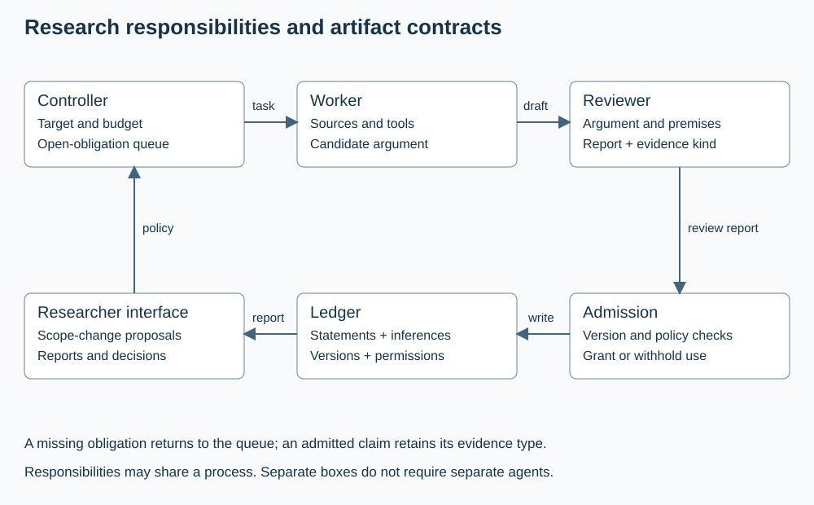

[English original](/posts/2026/08/agent-system/architecture-views/) · [中文课程总览](/posts/2026/12/Agent-System-zh/)

**模式参考。** 这是一个简短的设计说明，不是一个独立的课程。对于完整推导的论证的逐步练习和评估，请阅读 [ 完整课程章节 ](/posts/2026/08/agent-system-zh/foundations/)。下面的几何参考是案例 的可选扩展。

架构图应该回答一个指定的问题。称为“推理引擎”的盒子只有在指定其输入、输出和权限时才有用。

*这是建议的责任图，而不是部署图。箭头携带研究记录； 结果纳入组件单独授予使用断言作为前提的权限。*

##  同系统四个视图

| 视图 | 问题 | 必填内容 |
|---|---|---|
| 语义 | 什么是系统原因吗？ | 命题，对象版本，假设，推理记录 |
| 逻辑 | 什么证明了这个结论？ | 联合前提，替代论证，定理应用，归纳顺序 |
| 执行 | 接下来运行什么操作？ | 队列、重试、预算、checkpoint、取消 |
| 操作 | 什么能在失败后幸存？ | 持久写入、身份、服务边界、重播和失效 |

依赖箭头不能同时表示网络调用。搜索循环不得被视为循环证明。使用 [ 双图示例 ](/posts/2026/08/agent-system-zh/design-principles/) 来查看区别。

## 智能体之前的职责

调度器安排任务；执行单元提出研究记录；审查者检查证据；admission 环节决定结果可否按既定规则复用；ledger 保存版本与依赖。这些职责可以由同一个进程承担。区分职责，并不意味着每个方框都要对应一个模型、服务或人。

形式化检查器（如果存在）检查编码命题。 来源适配器定位证据。两者都无法默默地改变最初的目标。研究人员接口提出了拟议的范围变更以及决定这些变更所需的证据。

## 动手实践

为实验中的 ledger 画出四种视图，标明哪些组件已实现，哪些只是设想。然后模拟在保存审查与更新任务状态之间中断。运行视图应解释：如何恢复，且不会重复应用同一审查，也不会把它用于错误的命题版本。

## 参考符号

[C4](https://c4model.com/introduction) 为软件架构提供已建立的上下文和容器视图。这里的语义和逻辑视图添加了部署视图无法表达的数学内容。这些是设计方案；该图并没有断言任何特定的研究系统都实现了它们。

## 设计决策实例：从互补的视图中提取一个系统

依赖关系视图显示哪个断言依赖哪个前提。工作流程视图显示提案如何在审查中移动。存储视图显示版本和源的持续位置。将所有三个组合成未标记的箭头隐藏了逻辑蕴涵和文件传输之间的差异。

**验收练习。** 对于每个箭头，说明其含义以及那里可能发生的故障。如果无法给出箭头的操作或数学解释，请将其删除或将其标记为建议的关系。

---

[系列指南](/posts/2026/12/Agent-System-zh/)·[贯穿课程的案例](/posts/2026/08/agent-system-zh/research-cases/)·[实验室](/posts/2026/08/agent-system-zh/hands-on-lab/)
