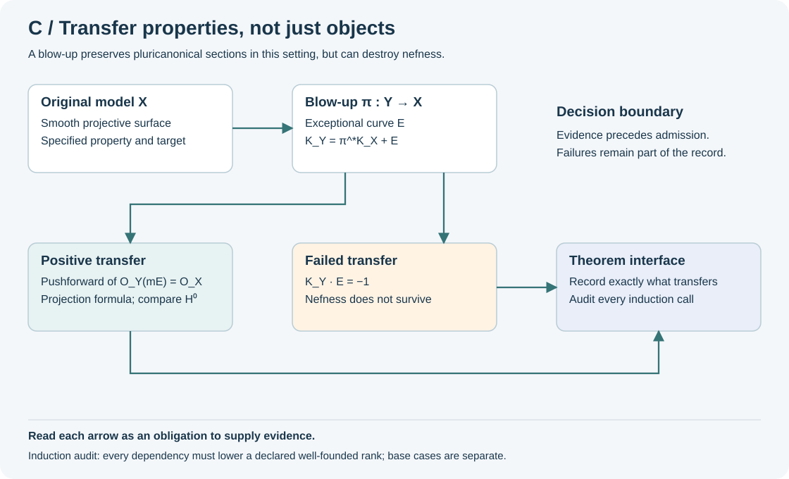

[English original](/posts/2026/08/agent-system/birational-geometry-agent/) · [中文课程总览](/posts/2026/12/Agent-System-zh/)

这一章检验的是：一次几何构造是否真正推进了原始目标。先重建一个已知 reduction 及其证明，再考察改变假设后哪些步骤仍然成立。所谓 spiraling induction 并不是额外的证明原则；它同样需要精确命题、base cases 和 well-founded 的依赖顺序。

**阅读路线：**下面先介绍进阶设计；如需具体对照，可先读[blow-up 的负面例子](#first-task-a-blow-up-and-the-return-to-the-original-surface)，再返回完成研究作业。

## 研究工作坊 C：跨模型、跨归纳阶段组织定理

**预备知识：**divisors、line bundles、光滑射影曲面上的 intersection theory，以及核心课程中的依赖记录。**提交成果：**一组带有模型变换论证的定理，注明适用范围，并给出每次递归调用都严格降低 rank 的归纳顺序。后面的负面 blow-up 案例只是起步测试。

### 1. 同一次变换，可以破坏一种性质而保留另一种

设 $\pi:Y\to X$ 是代数闭域上光滑射影曲面的一点 blow-up，$E$ 为 exceptional curve。后面将算出 $K_Y\cdot E=-1$，因此 $K_X$ 的 nefness 不会自动传给 $K_Y$。另一方面，pluricanonical sections 的空间却保持不变：

$$
H^0(X,mK_X)\cong H^0(Y,mK_Y)
\quad(m\geq1).
$$

这要求架构作出一个重要区分：不能笼统地把模型变换标成“安全”或“不安全”。每一条 transfer rule 都针对特定对象及其特定性质。section spaces 与 nefness 需要不同的论证。

### 2. 完整推导保持性

选取相容的 canonical divisors，使 $K_Y=\pi^*K_X+E$。对 $j\geq1$，有 exact sequence

$$
\begin{gathered}
0\to\mathcal O_Y((j-1)E)\to\mathcal O_Y(jE)
\\ \to\mathcal O_E(-j)\to0.
\end{gathered}
$$

这里 $E\cong\mathbb P^1$，且 $\mathcal O_E(E)\cong\mathcal O_{\mathbb P^1}(-1)$。最后一项没有非零 global sections。因为 $E$ 被映到一个点，它在 $\pi$ 下的 direct image 为零。由 direct image 的 left exactness，得到

$$
\pi_{\ast}\mathcal O_Y((j-1)E)
\cong\pi_{\ast}\mathcal O_Y(jE).
$$

对于以 normal 空间为目标的 proper birational morphism，有 $\pi_{\ast}\mathcal O_Y=\mathcal O_X$；这里 $X$ 光滑，因而 normal。归纳可得 $\pi_{\ast}\mathcal O_Y(mE)=\mathcal O_X$。再用 projection formula：

$$
\begin{gathered}
\pi_{\ast}\mathcal O_Y(mK_Y)\\
\cong\mathcal O_X(mK_X)\otimes\pi_{\ast}\mathcal O_Y(mE)\\
\cong\mathcal O_X(mK_X).
\end{gathered}
$$

取 global sections，就得到所需同构。注意，这里不需要所有 higher direct images 都消失。额外引入那个更强的待证条件，只会增加工作，并不服务于当前目标。

这个计算是 [Kollár 2017 年草稿 *Families of varieties of general type*](https://web.math.princeton.edu/~kollar/book/modbook20170720) §1.2 中 exceptional-divisor pushforward 机制的特殊情形。上面的曲面证明展开了来源审查需要确认的具体要素，并没有声称任意奇异空间或 analytic modifications 都满足同样的 transfer theorem。

### 3. 为结果写出接口约定

| 组成部分 | 必须记录的内容 |
|---|---|
| 输入对象 | 光滑射影曲面、point blow-up、exceptional curve、整数 $m\geq1$ |
| 使用的事实 | canonical-divisor 公式、normal 目标上的 pushforward、projection formula、$E$ 上负次数 line bundle 的 section vanishing |
| 输出 | 指定 global section spaces 的同构 |
| 不允许顺便推出的结论 | $K_Y$ 的 nefness，或关于族的 base change 命题 |
| 触发重新审查的变化 | singularities、几何范畴、中心、系数类型或 relative setting 的改变 |

最后一行与真实研究直接相关。逐纤维维数相同，并不足以证明参数空间上的 sheaf isomorphism。对 line bundles 的计算，也不能自动处理非 Cartier 的 canonical divisor。每个推广都需要新的命题版本和新的衔接引理。

### 4. 让 spiraling induction 真正 well-founded

设定理组包含 $A_{d,q}$ 与 $B_{d,q}$，其中 $d,q$ 为非负整数。假设已提出以下依赖：当 $q>0$ 时，$A_{d,q}$ 使用 $B_{d,q-1}$ 及明确列出的低维结果；随后 $B_{d,q}$ 使用 $A_{d,q}$。在 $q=0$ 时，必须另给边界论证，不能调用不存在的前驱。

赋予 lexicographic ranks：

$$
\rho(A_{d,q})=(d,q,0),\qquad
\rho(B_{d,q})=(d,q,1).
$$

上述每个前驱都具有更小的 rank：低维步骤降低 $d$，$B_{d,q-1}$ 降低 $q$，而同一对参数下，$A_{d,q}$ 排在 $B_{d,q}$ 之前。还必须提供 $d=0$ 的边界证明与所有 $q=0$ 的过渡论证。只有每个 implication 都另有证明时，这才构成合法的 well-founded 依赖计划。

如果在证明 $A_{d,q}$ 时反过来调用 $B_{d,q}$，就违反了这个顺序，形成循环。声称“复杂度变小”不够，必须定义复杂度的取值与严格下降关系。在实际 MMP 证明中，rank 必须对应来源里的真实参数；这里的双指标练习不是某个具名定理的证明。

[](/images/agent-system-zh/advanced-geometry.svg)

### 5. 研究级 Codex 作业

每个模型建立一份对象记录，每种声称能够传递的性质建立一份 transfer record。先重现 nefness 不保持的计算与 pluricanonical sections 保持的计算。然后从可查阅文献中选择一个真实的归纳定理，并提供有关证明段落。

要求 Codex 把每次定理调用整理成一行，记录调用者、被调用者、完整假设、参数代入及 rank 比较。同 rank 的辅助结果，必须已有独立证明；否则标记为未解决。最后改变一个假设，实际尝试第一个受到影响的 transfer 或 induction 步骤。

提交物必须含数学证明和真实的调用审查。图上写着递减标签，并不能证明箭头对应的 implication。一个局部 transfer 成功，也不能确立整个定理组。

<a id="first-task-a-blow-up-and-the-return-to-the-original-surface"></a>

## 第一个任务：blow-up 后如何回到原曲面的问题

设 $X$ 是代数闭域上的光滑射影曲面，$\pi:Y\to X$ 是光滑点的 blow-up，$E$ 为 exceptional curve。canonical divisor 公式为

$$K_Y=\pi^*K_X+E.$$

由 $E^2=-1$ 与 $(\pi^*K_X)\cdot E=0$，得到 $K_Y\cdot E=-1$。因此即使 $K_X$ 是 nef，$K_Y$ 也不是 nef。具体可取 $X$ 为 abelian surface，其 canonical bundle 平凡。

这个对照说明：换到光滑 birational model，不会保留所有 positivity 条件。只记录“birationally equivalent”会丢失证明所必需的信息。

这里展示的是参考论证，不是某次自动研究的运行结果。学生需要从可检查的来源或证明中，论证 blow-up 公式与 intersection identities。

## 先理解计算，再设计流程

本节使用光滑射影曲面上的基本 divisor 与 intersection number 知识。系统设计的核心不依赖于重建整套曲面理论：**一个 pullback 对象的性质，不会自动成为同一模型上另一个对象的性质。**

在射影曲面上，divisor 是 nef，意味着它与每条 integral curve 的交数非负。因此，只需一条交数为负的曲线，就能否定 nefness。$E$ 是有决定意义的检验对象，并非结论出来后随意挑选的例子。

记录中必须区分三个 divisors：

| Divisor | 所在空间 | 作用 |
|---|---|---|
| $K_X$ | 原曲面 $X$ | 原始 positivity 假设中的对象 |
| $\pi^*K_X$ | blow-up 后的曲面 $Y$ | 原对象的 pullback |
| $K_Y$ | 曲面 $Y$ | 新曲面自身的 canonical divisor |

后两项虽然位于同一曲面，却相差 $E$。由 canonical-divisor 公式与 intersection 的双线性，

$$
\begin{aligned}
K_Y\cdot E
&=(\pi^*K_X+E)\cdot E\\
&=(\pi^*K_X)\cdot E+E^2\\
&=0-1=-1.
\end{aligned}
$$

pullback 项的交数为零，是因为 $E$ 被收缩为一个点：projection formula 将其转化为 $K_X$ 与零 pushforward 曲线类的配对。另一项 $E^2=-1$ 来自这个 blow-up 的 exceptional-curve 公式。完整的来源重建必须说明这些输入及 canonical-divisor 公式为何成立，最后的算术不能替代这项审查。

若 $X$ 是 abelian surface，平凡的 canonical bundle 保证 $K_X$ nef，而上述计算证明 $K_Y$ 非 nef。被否定的仅是“canonical divisor 的 nefness 经这次 blow-up 保持”这一 implication；$Y$ 的光滑性和 $X$ 上原有的 nefness 都没有被否定。

### 有用的修正仍然是另一个命题

公式给出 $K_Y-E=\pi^*K_X$。减去 exceptional 项后，确实得到另一个对象，但这不能证明 $K_Y$ nef。报告若改为讨论 $K_Y-E$，就应标明新命题，不能宣称原目标已获修复。

实验中要求一份四行审查：精确的错误 implication、用于检验它的曲线、导出矛盾的计算，以及仍成立的修正对象恒等式。随后故意从公式中删掉 exceptional 项，请审查者找出缺失的输入。这是在检查系统是否理解对象变化，而不是记住“blow-up 不好”这一口号。

三个 blow-up 恒等式的可检查来源，见 [Sam Frengley 的 algebraic surfaces 讲义](https://samfrengley.github.io/teaching/DRAFT-notes/alg-surfaces-notes.html) Proposition 7.6 的 (3)–(5)。使用前要匹配光滑曲面与 point blow-up 的假设。

## 从空 Codex 文件夹开始

```text
创建 OBJECTS.md、TARGET.md、REDUCTIONS.md、SOURCES.md、REVIEW.md。
记录 X、Y、π、E、各自的假设，以及每个映射的方向。
每条 divisor 恒等式都注明它在哪个空间上成立。
审查命题：K_X 的 nefness 蕴含 K_Y 的 nefness。
检查 intersection 计算中使用的每条恒等式。
不能悄悄把 K_X 的 pullback 替换成 K_Y。
分别保留原始错误命题与修正后的结论。
```

这次实验的架构，就是对象记录、拟议 implication、证据，以及针对该 implication 的审查。无需额外增加 agent 角色。

## 成功的运行应当展示什么

系统应识别 exceptional correction $E$，算出负交数，并拒绝拟议的 nefness 保持性；不能反而断言原来的 $X$ 具有非 nef 的 canonical divisor。它还应说明究竟哪条断言被反驳，哪些原始假设未变。

加入两种损坏变体：在 canonical divisor 公式中漏掉 $E$；把 $Y$ 上的 intersection 命题当成 $X$ 上的命题。要求审查定位具体错误，而不只输出“不正确”。

## 第二个任务：审查真实的 induction package

从自己的文献中选取具体定理及证明，提供相关命题与段落。不要只给出大定理的名字，就要求 Codex 重建证明。

```text
依据这份来源证明创建 INDUCTION.md。
为每条命题记录完整假设与参数值。
为每次调用记录所有必须共同成立的前提。
明确 base cases，以及使依赖关系 well-founded 的顺序。
区分同维辅助步骤和低维结果的调用。
若某个参数没有下降，指出哪条更早确立的命题允许这一步。
标记循环依赖，不能悄悄补写论证将它修掉。
```

纯逻辑练习可采用：$A_n$ 依赖 $B_{n-1}$，$B_n$ 依赖 $A_n$，并已给出 $B_0$。按 $B_0,A_1,B_1,A_2,B_2,\ldots$ 排列。只有各 implication 分别得到证明，这才是合法依赖结构；去掉 $B_0$，整个构造就失去起点。这个练习本身不是 birational geometry 的定理。

## 完成重建后，再尝试研究推广

每次只改变原几何论证的一个假设，定位它实际在哪里被使用。考察失效步骤是否有替代方案，并实际尝试该方案。并排保留原命题与新命题。在 divisor、fiber 或 model 上完成了局部计算，仍需给出返回原目标的论证。

提交来源重建、对象与依赖记录、改变的假设、尝试过的替代引理，以及剩余问题的精确说明。某条路线的负面结果可以很有价值；画满未证箭头的图，并不是可直接复用的证明蓝图。

[方法选择实验](/posts/2026/08/agent-system-zh/proof-sketch-system/) · [课程总览](/posts/2026/12/Agent-System-zh/)
