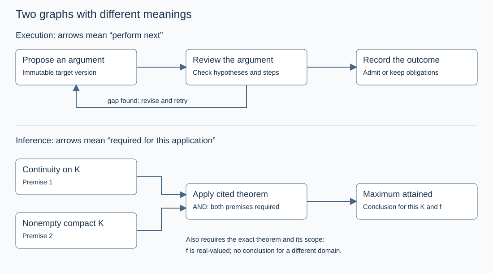

[English original](/posts/2026/08/agent-system/design-principles/) · [中文课程总览](/posts/2026/12/Agent-System-zh/)

数学推理系统必须在变换问题、搜索论证和积累知识时，保留问题的原意。更强的模型扩大了可承担的搜索范围，却不能省去这些说明：证明了什么？使用哪些前提？结论怎样回答原问题？

本系列是关于那些持久的设计问题。 智能体框架和提示是可替换的机制。架构是数学工作和证据的组织。

## 一个暴露架构的小问题

考虑故意错误的猜想：开区间 $(0,1)$ 上的每个连续实值函数都达到最大值。一个执行单元调用了极值定理；另一个提出$f(x)=x$作为反例。 执行单元之间的投票毫无意义。定理应用需要紧致性，但缺少。反例需要两项检查：连续性和未能达到最大值。对于每个$x\in(0,1)$，点$(x+1)/2$仍然在区间内并且具有较大的值。

一个好的系统记录了对原万能命题的反驳。可能会在$[0,1]$上单独提出修复后的命题。它不得默默地用已修复的命题替换原始问题并报告成功。

这个简单例子用于检查缺失假设，不是衡量研究能力的 benchmark。当缺失的是 projectivity，或缺少从 birational model 回到原对象的论证时，同样的接口区别仍然必要。

## 两张图，两种含义

上图描述随时间发生的动作，审查发现问题后可以返回重试；下图描述数学推理，其中 continuity 与 compactness 必须共同满足，才能应用所列定理。任何一个输入箭头都不能独自支持结论。

因此，实现应存储推理作为结论以及所需前提及其理由的列表。简单的有向边无法表达两个替代证明和一个证明所需的两个前提之间的差异。使用推理记录或有向超图。普通的有限证明依赖关系应该是非循环的； 归纳需要显式的 well-founded 论证，而不是伪装成递归任务的循环。

## 模型改进中幸存的六个边界

**语义边界。** 目标具有量词、域和假设。重新措辞它会创建一个提议的等效项命题，其等效项本身可能需要证明。结构化的 schema 保留字段；它本身无法确定这些字段的含义相同。

**推理边界。**每一步都携带自己的全部前提。只有把缺失的 implication 明确列出，一个看似可行的方法才成为 proof plan。条件性工作是有用的，前提是条件始终可见。

**证据边界。**例子、计算、检索结果、非形式化审查和 formal proof terms 支持不同类型的断言。每次检查都应注明范围；即使得到 formal proof，仍需审查 axioms 以及编码命题是否对应原意。参见 [Lean 的 axioms 文档](https://lean-lang.org/doc/reference/latest/Axioms/)。

**转换边界。** 传递到一个新对象会产生两个待解决事项：在那里建立假设并将所得结论传回。例如，有关限制的结果不会自动成为有关环境对象的结果。

**持久性边界。** 研究结果是版本化知识。如果前提发生变化，系统必须识别受影响的论证。它应该在检查替代方案时暂停它们的使用，而不是得出所有下游命题都是假的结论。

**决策边界。**调度器决定下一步投入哪个未解决问题、何时停止。这是有限资源下的选择，不是逻辑推导。一个值得尝试的路线，不会因此自动成为有效证明。

## 什么是属于人类的？

这些是研究系统的职责，并不是人与机器之间永久不变的分工。研究者可以委托规划、批评乃至架构设计，但系统仍应公开目标、证据规则，以及谁有权改变它们。不必人工批准每个引理；对研究范围和发表决策，则应有明确的决策规则。

不要通过说人工智能永远不会执行其功能来为组件辩护。通过它强制执行的数学或操作约束来证明它的合理性。功能更强大的模型可以组合多个执行单元，但它仍然必须保留条件结果和完整证明之间的区别。

##  在扩展之前构建

从 [ 动手实验室 ](/posts/2026/08/agent-system-zh/hands-on-lab/) 开始：构造一个小型待解决事项记录表，运行故障案例，并仅在状态转换工作后添加智能体。然后阅读 [foundations](/posts/2026/08/agent-system-zh/foundations/)、[planning](/posts/2026/08/agent-system-zh/plan-and-execute/) 和 [verification](/posts/2026/08/agent-system-zh/verification-gate/)。 [研究工作流程](/posts/2026/08/agent-system-zh/research-workflow/)将这些想法应用于依赖于文献的研究。

模式词汇借鉴了 Gulli 的 *Agentic Design Patterns*。 [Anthropic的工作流程讨论](https://www.anthropic.com/research/building-effective-agents)提供了固定和动态选择的执行路径的工程帐户。这里的数学接口约定和练习是建议的设计，而不是现有实现解决开放问题的断言。

---

[系列指南](/posts/2026/12/Agent-System-zh/)·[贯穿课程的案例](/posts/2026/08/agent-system-zh/research-cases/)·[实验室](/posts/2026/08/agent-system-zh/hands-on-lab/)
