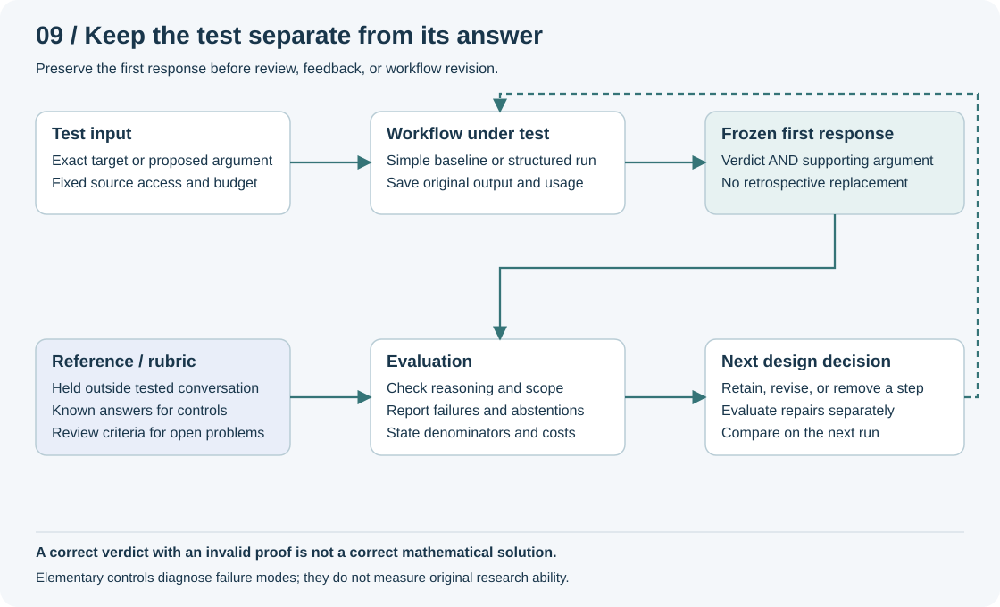

[English original](/posts/2026/08/agent-system/evaluation-monitoring/) · [中文课程总览](/posts/2026/12/Agent-System-zh/)

判断一个研究系统的标准应该是它所提供的数学知识以及它以可接受的成本避免的错误。它既不应该接受每一个看似合理的论证也不应该拒绝每一个提案。该模块构建了一个小型的受控评估，然后解释了当目标是开放研究问题时必须改变的内容。

**学习目标：**准备有效和无效的对照案例，区分决策与其支持论证，报告分母和弃权，公平比较工作流程，并评估部分进度，而无需假装知道开放问题的答案。

## 1. 需要单独回答的三个问题

**协议保真度：**系统是否保留了目标、来源版本和假设？ **数学正确性：**其推论有效吗？ **研究有用性：**结果是否推进了一个有价值的目标？一份组织完美的记录可能包含错误的证据；正确的基本计算对于所选的研究问题几乎没有价值。

评估每个维度，而不是将它们平均为一个无法解释的分数。工作流程的改变可以改善恢复，同时不增加数学能力。这仍然很有价值，但证据支持的断言范围比“更擅长研究”更窄。

## 2. 运行前准备参考集

使用改变一个重要条件的配对案例。以下集合具有在早期模块中导出的已知答案：

| 案例 | 参考结果 | 故障暴露 |
|---|---|---|
| 连续实值 $f$ 开启$[0,1]$ | 存在最大值 | 拒绝适用的定理 |
| $(0,1)$ 上的 $f(x)=x$ | 无最大值| 缺失达到或紧致性 |
| $(0,1)$ 上的常数为零 | 存在最大值 | 将失败的假设视为错误目标|
| 请求的输出 $(1,1)$ | 由输入 $c=1$ | 生成拒绝有效的见证 |
| 请求的输出 $(1,0)$ | 无法生成 | 更改指定输出 |
| 每个自然数都有一个界 | 真与 $C=n$ | 误读见证依赖 |
| 一个自然数界所有自然数| False 使用 $n=C+1$ | 交换量词 |
| 一致连续函数的限制 | 连续 | 拒绝有效返回原问题的论证 |
| $[0,1]$ 上的 $x^n$，逐点极限 | 极限不连续 | 使用错误的收敛模式 |

两个输出情况使用实数和模块 1 中的固定规则 $r(c)=(c,c)$。在输入中包含该规则。如果您测试可选的几何版本，请指定其射影线、trivial bundle和两个不同的有理点；不要默默地混合两个任务描述。

将参考推理保留在测试对话之外。在提供反馈之前保存模型的原始响应。分别评估第一个答案和任何修复的答案。否则，互动课程可能会被误认为是首次尝试表演。

## 3. 决定什么才是正确的结果

带有无效证明的正确是/否答案并不是正确的数学解决方案。询问确切的结论、论证、假设和实际使用的来源。当判决和推理不一致时，分别评分。

对于审查测试，输入是建议的论证。 正确决定可以接受有效论证、给出具体理由拒绝缺陷论证，或在证据不足时明确暂不判断。 对于定理求解测试，输入是目标；有效的反例可以解决错误的目标。 不要将这两项任务混合在一个接受率中。

在测试之前写一个简短的标题：

| 维度 | 传递证据 |
|---|---|
| 目标保留 | 相同的对象、域、量词和结论|
| 数学论证 | 每个必需的推理合理的 |
| 来源使用| 已检查的材料与回忆区分开来 |
| 条件范围 | 未经证实的假设仍然明确 |
| 修订处理| 更改的证据触发适当的重新检查 |
| 有用性 | 名为待解决事项的已完成或明确本地化 |

如果审查者无法确定论证是否正确，请记录该不确定性。不要仅仅为了完成电子表格而制作真实标签。

## 4. 具有显式分母的完整推导的评分示例

以下数字是 **假设性的**，选择用于解释报告。它们不是测量的模型结果。假设审查集合包含 10 个有效的论证和 10 个无效的论证：

| 参考类 | 接受 | 拒绝 | 弃权 |
|---|---:|---:|---:|
| 有效：10 | 7 | 1 | 2 |
| 无效：10 | 2 | 6 | 2 |

无效接受率为$2/10=20\%$。有效拒绝率为 $1/10=10\%$。总体弃权票为 $4/20=20\%$。仅报告接受的输出将在九个接受的输出中给出七个有效的论证，或 $7/9$。这是不同的分母并回答不同的问题。

同样，在 16 个非弃权决定中，有 13 个是正确的决定，但在所有 20 个案例中，只有 13 个是正确的决定。在未指明其分母的情况下，不应报告这两个数字。当证据缺失时，弃权可以承担责任；了解系统完成了多少任务集仍然很重要。

这些小数字是描述性的。他们没有为未来的研究数学建立稳定的错误率。报告潜在案例并在可行时重复运行。如果罕见的故障代价高昂，请检查故障机制而不是相信有利的总体。

## 5. 评估变化，而不仅仅是快照

在最初正确的答案之后会出现许多危险的错误。添加转换测试：

1. 将请求的输出从$(1,1)$更改为$(1,0)$，并提供旧的审查。
2. 撤回两个替代证明路线之一，然后撤回它们的共享前提。
3. 替换一致通过逐点收敛进行收敛。
4.  从 checkpoint 恢复，其引用的证明研究记录丢失。

每个实验都应在运行前写好预期状态变化。正确行为往往是在撤回某项结论时保留其他仍有效的证据。全部丢弃和全部保留，都没有完成这种有选择的更新。

返回箭头代表 **下一次** 运行的设计修订。它不得覆盖原始响应。否则记录不再显示系统在援助之前所做的事情。

## 6. 比较简单的工作流程与结构化的工作流程

两种流程应使用相同任务、相同来源访问权限，以及可比的总投入。记录日期、可见模型设置、尝试次数、工具与实际输出。若无法获得用量信息，就明确说明，并改用可观察的预算，例如来源检查次数或审查轮次；不要声称成本完全相同。

基线可以是普通的证明请求和审查。结构化版本添加目标记录、应用程序表或版本感知checkpoint。在可行时一次添加一种机制。如果几个组件一起更改，结果可能支持组合的工作流程，但无法隔离哪个组件导致了改进。

分别跟踪已用时间和总工作量。计算重复检索、人工更正、无效论证已纳入和已完成的有用待解决事项。警惕答案泄漏：如果同一对话已经看到了参考证据，则其后续解决方案不会衡量独立尝试。

熟悉的例子测试特定的行为；它们不是原始数学发现的基准。在转向更难的材料之前，使用它们来发现可避免的错误，然后使用可独立审查的答案对不太熟悉的案例进行测试。

## 7. 开放研究问题有什么变化？

你可能不知道目标是否真实。你仍然可以检验中间工作的有效性和价值。有用的提交成果可以用其实际假设重建已发布的引理，证明一个重要的特殊情况，识别提议的衔接论证的反例，或将目标简化为精确的新待解决事项。

将方法的障碍与定理的反例区分开来。尝试一致估计失败的例子族可以果断地排除该路线，同时保留主要猜想。同样，未能找到先前的工作并不能证明新颖性。记录检索到的语料库和未解决的文献问题。

对于最终项目，要求对来源结果至少有两个候选改进，合理选择一个，两个实质性证明路线，并尝试最难的衔接论证。该项目应包括已审查中间结果或决定性障碍、撤回证据后的恢复以及与更简单的工作流程的比较。新定理是受欢迎的，但不是明智的通用评分要求。

评估应该询问数学家现在可以做什么在项目之前不合理的事情。 “我们制作了二十份智能体报告”回答了另一个问题。

## 8. 练习和完整推导的答案

1。系统拒绝所有论点

**解答.** 其无效接受率为零，但拒绝所有有效的对照案例。报告错误和完成的两个方向。一个看似安全的数字掩盖了系统没有提供有用的结果纳入决策。

2。正确判决有伪证

**解答.** 将判定记录为正确，将数学解记为有缺陷。例如，开区间上的常数函数有最大值，但断言开区间为紧致的证明是无效的。成功必须包括任务所需的证据。

3。修复后的答案非常好

**解答.** 保留第一次故障并单独报告维修，包括提供的反馈。可修复性是一项有用的功能，但它并不是一次性的正确性。比较可比较反馈和可比较初始输入下的工作流程。

4。没有新定理，但一条路被果断封锁

**解答.** 评估障碍是否正确，解决严重路线，并更改下一个研究决策。路线中心引理的精确反例可能是实质性进展。一条不受支持的命题，一条路线“看起来很困难”，不是可比证据。

## 9. 最终提交：可检查的研究结果

提交任务输入、可用的参考推理、原始响应、审查决策、修复、资源观察和限制。最后得出一个具体的设计决策：保留、修改或删除一种机制，解释观察到的哪些失败或好处支持该决策。

这样就完成了核心课程。高级模块将相同的学科应用于机会发现、proof sketch系统、birational 几何和报告的研究实施。只有当结果证据改进了真正的数学决策时，他们的架构才会变得复杂。

---

[课程路线](/posts/2026/12/Agent-System-zh/)·[直接实验](/posts/2026/08/agent-system-zh/hands-on-lab/)
