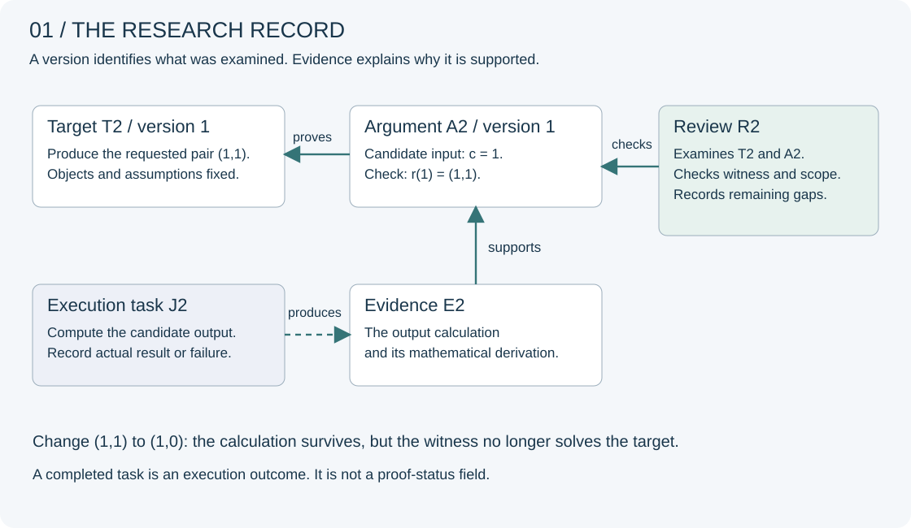

[English original](/posts/2026/08/agent-system/foundations/) · [中文课程总览](/posts/2026/12/Agent-System-zh/)

*实验指令、文件结构与可执行代码保留英文原文，可直接复制；正文用中文解释其目的与验收标准。*

数学研究系统必须在方法、证据和结论不断变化时，仍然保留任务的原意。本模块建立一种可检查的表示方式：从简单逻辑出发，完整分析常数函数的例子，再直接在 Codex 中构建研究记录。最后的可选部分把这一计算连接到几何。

**课程安排：**可安排 60–90 分钟的讲解与讨论，再另设实验环节。这是建议的教学安排，并非实测视频时长。第 1–4 节建立核心概念，第 5–7 节连接研究问题，第 8–10 节提供实践与评估。

**学习目标：**区分命题与论证；在多步推理中追踪假设；识别目标变化；解释修订后哪些证据仍然有效；建立可供他人审查的 checkpoint。无需编程；主例只使用实数与等式，几何部分可选。

<a id="1-why-conversation-history-is-not-a-mathematical-state"></a>

## 1. 为什么对话历史不是数学状态

设想一次对话从“这个 section 能否延拓？”开始。尝试几次之后，助手回答：“存在一个非零 section，所以问题解决了。”这些话都与主题相关，但最后的结论可能回答了另一个问题。

关键不只是记忆不足。系统可以保存对话里的每个字，却仍然没有区分“这个指定的 section”和“存在某个 section”。如果目标本身表示错了，增加上下文也无法修复。

一份研究状态应让新读者不必重读整段对话，就能回答四个问题：精确任务是什么？各个结论由什么支持？哪些假设尚未消解？输入改变后，哪些地方需要重新考虑？

对话记录作为审计追踪仍然很有价值。状态记录是对该踪迹的结构化解释，其本身可能是错误的。保持来源论证可用，以便检查解释。

<a id="2-context-proposition-and-justification"></a>

## 2. 背景、命题和理由

简单地写出一个数学判断：

$$\Gamma\vdash P.$$

这里 $P$ 是正在考虑的命题，$\Gamma$ 包含论证可用的对象、定义和假设。在本章中，符号描述了预期的数学支持；将其写入 Markdown 文件不会调用证明检查器。

例如， Γ 可能指定 [0,1] 上的实值连续函数 f。命题 P 表示 f 达到最大值。如果域更改为 (0,1)，则上下文发生更改，并且必须重新考虑之前的定理应用。函数 f(x)=x 为开区间上相应的一般断言提供了一个反例。

记录假设有两种方式：在包含 P 的上下文中推出 Q，或者明确写出 P 蕴含 Q。不能一面悄悄去掉 P，一面把 Q 记成无条件成立。

<a id="a-chain-of-conditional-conclusions"></a>

### 条件结论链

假设可用的论证建立 P 蕴含 Q 且 Q 蕴含 R。如果假设 P，则以 P 为条件获得 R。如果稍后证明 P，则可以使用证明来解除该假设。如果 P 从工作上下文中撤回，有条件的蕴涵可能仍然有用，但 R 不再具有相同的无条件支持。

官方的 Lean 文本给出了对命题、证明、蕴涵和假设的形式化处理。该模块非正式地使用了这些区别； 形式化检查位于模块 6 中。请参阅 [ 命题和证明](https://lean-lang.org/theorem_proving_in_lean4/Propositions-and-Proofs/)。

<a id="quantifiers-are-part-of-the-task"></a>

### Quantifiers 是任务的一部分

将这些断言与自然数进行比较：

$$\forall n\;\exists C:\ n\le C,$$

$$\exists C\;\forall n:\ n\le C.$$

第一个命题成立，取 C=n 即可。第二个命题不成立：给定 C 后，取 n=C+1。若记录只写“存在一个界”，就丢失了区分真命题与假命题的参数依赖。

**讨论：**论文写“存在常数 C”时，C 允许依赖哪些变量？凡是这种依赖会影响下一步推理，就应明确记录。

<a id="3-a-complete-worked-example-can-one-constant-give-two-prescribed-values"></a>

## 3. 一个完整例子：一个常数可以给出两个规定值吗？

核心想法很简单：**找到对象还不够，它必须满足题目指定的条件。**先用普通实数做完整计算，随后再解释它与 section lifting 的联系。不懂代数几何，也能理解这一系统设计问题。

<a id="step-1-state-the-rules-of-the-problem"></a>

### 步骤 1. 陈述问题的规则

我们可以选择**常数函数**。一旦我们选择了它的值 $c$，该函数在任何地方都具有该值。特别是，在名为 $p$ 和 $q$ 的两个不同点处，其值为

$$
f(p)=c,\qquad f(q)=c.
$$

这里把允许使用的函数限定为常数函数，是题目规则的一部分。若允许任意函数，就成了另一个问题，不能混为一谈。

我们的任务是找到一个允许使用的函数，使它具有以下**指定值**：

$$
f(p)=1,\qquad f(q)=0.
$$

“指定”表示数值已经是问题的一部分。不能为了让问题容易一些，就把要求中的零换成一。

<a id="step-2-test-a-proposed-answer"></a>

### 步骤 2. 测试建议的答案

假设助手提出常数函数 $f(x)=1$。这是一个允许的函数，并且它是非零的。但我们必须检查这两个要求：

| 点 | 所需值 | 建议函数值 | 匹配吗？ |
|---|---|---|---|
| $p$ | $1$ | $1$ | 是 |
| $q$ | $0$ | $1$ | 否|

因此这个候选答案不满足要求。若报告“存在非零函数，所以任务完成”，就犯了错误：存在性没有保证它取到题目指定的值。

换一个常数可以吗？要满足 p 点的要求，必须 c=1；要满足 q 点的要求，必须 c=0。不存在同时满足这两个等式的实数。这说明所有允许的函数都无法解决当前目标，而不只是第一个候选失败。

<a id="step-3-compare-three-questions-that-sound-similar"></a>

### 步骤 3. 比较三个听起来相似的问题

现在将第二个规定值更改为 1。常数函数 $f(x)=1$ 确实满足这两个要求。将此新任务与原始任务分开：

| 任务 | 精确问题 | 答案 |
|---|---|---|
| T1 | 常数函数能否在 p 处取 1、在 q 处取 0？ | 不能：两个值必须相等 |
| T2 | 常数函数能否在两点都取 1？ | 能：取常数 1 |
| T3 | 是否存在非零常数函数？ | 存在：取常数 1 |

T2 与 T3 恰好可以用同一个例子回答，但仍然是不同的问题，且都没有解决 T1。对话即使在三个任务之间快速切换，也必须保留这些区别。

<a id="step-4-give-the-calculation-a-reusable-notation"></a>

### 步骤 4. 为计算指定可重用的符号

让 $r$ 的意思是“读出两点的值”。其输入是所选常数$c$；它的输出是一对观察值：

$$
r(c)=(c,c).
$$

例如，$r(0)=(0,0)$、$r(1)=(1,1)$ 和 $r(2)=(2,2)$。每个输出都有相同的条目。相反，任何具有相同条目的对（例如 $(a,a)$）都是通过选择 $c=a$ 生成的。

$r$ 的 **image** 表示它可以产生的输出的集合。这里，该集合完全由具有相同条目的对组成。有时称为对角线，因为这些对位于平面中的直线 $y=x$ 上。

给定所需的对 $s$，**lift** 是生成它的输入 $c$。要检查的方程是

$$
r(c)=s.
$$

这就是“提升”在计算中的全部含义：从规定的输出向后推算到允许的输入。 $s=(1,1)$ 对有一个提升； $s=(1,0)$ 没有。只找到一些输入而不检查其输出是不够的。

<a id="where-sections-enter-the-story"></a>

###  section从哪里进入故事

有一个几何情境，其中允许的函数恰好就是常数，因此得到同一个映射 r，以上结论也完全不变。下面的对照表帮助读者理解后续模块的几何语言。

| 几何示例中的语言 | 此计算中的含义 |
|---|---|
| 平凡 line bundle 的 global section | 整个空间上允许的函数 |
| 两点上的一个section | 规定的一对值 $(a,b)$ |
| 限制 | 读取这些点处的函数值 |
| 提升指定 section | 查找产生精确对的允许函数 |

这个解释仅针对当前的 trivial bundle 例子；一般 bundle 的 sections 不一定是普通的标量值函数。参加核心实验不需要先掌握下方的几何论证。

<details markdown="1">
<summary>可选几何形状：为什么射影线示例给出了这个映射</summary>

令 $k$ 为域，令 $X=\mathbb P^1_k$ 为射影线，令 $L=\mathcal O_X$ 为平凡的 line bundle，并令 $D$ 由两个不同的 $k$ 有理点 $p,q$ 组成。该bundle的 global section 是 $X$ 上的regular function。 $D$ 上的一个section 是 $k$ 中的一对值。

重要的几何事实是 $X$ 上的全局正则函数是常数。这是为熟悉仿射图的读者提供的计算。通过其坐标为 $t$ 和 $u$ 的两个标准仿射图覆盖 $X$。在它们的重叠部分，$u=1/t$。

一个 global regular function 在第一张 affine chart 上由多项式 $f(t)$ 表示，在第二张上由多项式 $g(u)$ 表示。两者在重叠处表示同一函数，因此必须满足

$$
f(t)=g(t^{-1}).
$$

左侧只有 t 的非负次幂，右侧只有非正次幂。比较 Laurent polynomials 的系数，所有非常数项都必须为零，所以这个函数是常数。

将常量 $c$ 限制为 $p$ 和 $q$ 会生成 $(c,c)$。因此几何限制映射正是

$$
r:k\longrightarrow k^2,\qquad c\longmapsto(c,c).
$$

取 $k=\mathbb R$ 就回到前面的数值计算。同一论证适用于任意 field，因为 $1\ne0$。

<a id="what-the-research-system-should-save"></a>

### 研究系统应该保存什么

保持目标、候选、测试和结论清晰：

```text
Target T1: find c such that r(c) = (1,0), where r(c) = (c,c).
Candidate: c = 1.
Test: r(1) = (1,1), which is not the required pair.
Candidate decision: this witness fails.
General argument: every output has equal entries; (1,0) does not.
Target decision: no lift exists under these rules.
Reusable result: (a,b) lifts exactly when a = b.
```

注意两个结论的区别：一次代入只排除了一个候选；利用所有输出两坐标相等的性质，才排除了全部候选。一次失败尝试本身不能证明无解。

**快速检查：**是$(3,3)$ 提升吗？ $(3,2)$ 吗？第一个提升选择$c=3$；第二个不能是提升，因为它的条目不同。如果您可以解释这些答案以及为什么 T3 无法解决 T1，您就拥有了下一个 section 所需的数学思想。

<a id="4-the-five-records-and-their-responsibilities"></a>

## 4. 五项记录及其职责

最小设计使用命题、论证、证据、审查记录和执行任务。它们可以是一个文件的 section。仅当大小或协调需要时，单独的文件才变得有用。

| 记录 | 基本内容 | 通过区分防止错误 |
|---|---|---|
| 命题 | 对象、假设、量词、结论、版本 | 回答附近的问题 |
|论证| 结论、联合前提、推理、开放步骤| 将断言视为其自身的理由 |
| 证据 | 证明文本、来源段落、计算、实际工具输出 | 用置信标签替换支持|
| 审查 | 确切的命题和论证检查、结果、范围 | 相关变更后重新使用批准|
| 任务 | 请求的操作、输入版本、执行结果 | 将超时与反驳混淆 |

对于 T1，命题在规则 $r(c)=(c,c)$ 下要求输入 $c$ 和 $r(c)=(1,0)$。 论证解释了每个可能的输出都有相同的条目。证据是建立该规则及其结果的计算。 审查检查论证是否寻址所请求的对。任务可能会要求助手描述所有可能的输出；未能完成该任务并不表明所请求的输出是不可能的。

引用可以证明论文中确实写了某个命题，却不一定证明该命题适用于这里。工具日志可以表明程序运行过，却不一定表明输出具有预期的数学含义。证据需要解释，也需要适用范围。

[](/images/agent-system-zh/course-research-records.svg)

*箭头命名记录之间的关系，而不是证明定理的步骤。 审查与确切的目标版本和论证版本相关。更改后的 section 需要再次检查该关系。*

<a id="why-a-single-verified-flag-fails"></a>

### 为什么单个“已验证”标志失败

同一命题可能有两个论证，其中只有一个接受过审查；审查通过的论证也可能仍依赖假设；形式化检查还可能验证了误译后的命题。一个“verified”标记无法区分这些情况。

分别记录流程状态、证据类型和数学范围。例如：“已审查；非形式化论证；以 P 为条件。”这样既提供信息，也不会把普通审查冒充 formal assurance。

<a id="5-dependencies-belong-to-arguments"></a>

## 5. 依赖项属于论证

假设 A1 使用 P 和 Q 一起证明 T。另一个论证 A2用R证明T。支持条件是：P和Q支持A1，或者R支持A2。只建立P是不够的，也没有必要两条路线都走完。

| 可用前提 | A1 可用？ | A2 可用？ | T 的支持 |
|---|---|---|---|
| 仅 P | 否 | 否 | 现有论证均不能支持 T |
| P 和 Q | 是 | 否 | 由 A1 支持 |
| 仅 R | 否 | 是 | 由 A2 支持 |
| P、Q、R | 是 | 是 | 两条路线均可用 |

这是依赖关系图必须传达的语义内容。从 P 到 T 的未标记箭头会错误地表明仅 P 就足够了。 论证节点或明确的联合前提组避免了这种歧义。

该表假设推论本身是有效的。簿记不能提供他们的证据。如果后来发现 A1 无效，则即使到 T 的路由丢失，P 和 Q 也可能保持为真并可重用。

同样，P 暗示 Q，Q 暗示 P 不会在没有起点的情况下建立任何一个命题。逻辑依赖和执行任务的顺序是不同的结构。对话可能会在不添加前提的情况下多次重新讨论某个问题。

<a id="6-versions-and-identity-what-changed-mathematically"></a>

## 6. 版本和身份：数学上发生了什么变化？

版本控制很有用，因为审查记录有一个主题。将请求的输出从 $(1,1)$ 更改为 $(1,0)$ 会更改该主题。在保留其定义的同时更改符号可能不会改变命题，但系统必须证明对应关系的合理性，而不是从类似的措辞中推断出对应关系。

区分三个变化：

- **E编辑：** 标点符号或表示方式发生变化，但不改变含义。如果以后的自动化依赖于它，请检查声明的等价性。
- **数学：**域，section，假设或结论更改。创建新的命题版本并重新考虑受影响的应用程序。
- **Evidential：** 引用的结果已更正或论证已撤回。 命题在其支持发生变化时可以保持不变。

identifier 是引用标识，不是数学不变量。content hash 检测文本变化，而不检测命题是否等价。等价命题可以写得不同；相同文字也可能在不同上下文中使用不同定义。记录必须保存解释这些标识所需的上下文。

<a id="a-useful-revision-experiment"></a>

### 有用的修改实验

审查 T2 使用输入 $c=1$：根据要求，其输出为 $(1,1)$。然后将请求的输出更改为 $(1,0)$ 并保留旧的审查。计算 $r(1)=(1,1)$ 仍然正确，但不再符合请求。描述所有输出的规则也仍然存在。撤回该输入求解新目标的断言时重复使用那些计算。

<a id="7-from-the-example-to-a-research-reduction"></a>

## 7. 从示例到研究简化

**第一次阅读时可选。** 这个 section 显示了相同的问题如何出现在高级几何中。如果 line bundle 和上同调不熟悉，请继续 section 8 中的实验室。section 3 中的数字图足以进行核心练习。

对于有效的 Cartier divisor D 和 line bundle L，限制序列为

$$0\longrightarrow L(-D)\longrightarrow L\longrightarrow L|_D\longrightarrow0.$$

关联的上同调序列将可提升的 section 与连接映射 $\delta$ 的核标识在一起。因此指定 $s$ 提升恰好与 $\delta(s)=0$ 相同。 $H^1(X,L(-D))$的消失足以使每一个阻碍为零，但它比一个section的阻碍的消失要强。

在研究记录中，保留这些待解决事项之间的区别：

1. E确定该序列适用于指定的对象。
2. 如果选择了该路线，则证明一个充分的消失定理。
3. 或者确定特定的δ(s) s.
4.  使用 exactness 返回到提升目标。

这个 sequence 来自 effective Cartier divisor 的 ideal sequence 与 locally free sheaf L 的 tensor product。由 exactness 识别 kernel，才是实际机制，不能只说一句“标准 lifting argument”。本章已经完整计算了基本例子；应用到新情境时，仍需重新检查假设。

更丰富的研究系统将存储来源的适用性、转换和替代方法。它们都依赖于保留此处介绍的更简单的区别。首先实现一个大型框架并不能弥补失去它们的损失。

<a id="8-laboratory-build-and-challenge-the-representation"></a>

## 8. 实验室：建立并挑战代表性

使用新的对话或 Codex 中的专用文件夹。在给出纠正提示之前保存初始输出。这些说明定义了一个实验；它们并不是Codex已经通过的证据。

<a id="round-a-construct-the-record"></a>

### A轮：构造记录

```text
Create RESEARCH.md for real numbers with the given map r(c) = (c,c).
Create three distinct targets: produce (1,0), produce (1,1),
and find any nonzero input c. Supply arguments, not just verdicts.
Test each proposed input by computing its output.
Distinguish rejecting one candidate from ruling out every candidate.
Separate the given rule from the conclusions you derive.
```

**检查：**三个目标全部出现；每个建议的输入都会根据所需的输出进行检查；使用平等进入规则证明不可能性是合理的。 **可选扩展：**添加射影线解释并要求图表计算解释为什么其global section是常量。

<a id="round-b-introduce-a-bad-witness-and-a-stale-review"></a>

### B轮：引入一个坏的见证和一个过期审查

```text
For r(c) = (c,c), the requested output is (1,0). Test the input c = 1.
Compute its output and compare both entries with the requested pair.
Now take a review approving c = 1 for the old target (1,1).
Determine whether that review also approves it for the new target (1,0).
Identify exactly what survives and what requires a new justification.
Preserve the initial incorrect proposal and its diagnosis.
```

**预期结果：** $r(1)=(1,1)$，因此输入无法产生$(1,0)$。先前的计算仍然有效，但旧的批准并没有解决修改后的问题。

<a id="round-c-test-assumptions-and-alternatives"></a>

### C轮：测试假设和替代方案

```text
For a separate logical exercise, stipulate valid implications
(P and Q) implies T, and R implies T.
Report support with P only, with P and Q, and with R only.
Then assume rather than establish R. Preserve that assumption in T's status.
Do not claim the stipulated implications were independently proved.
```

**Inspect：** 结果与依赖关系表匹配，并且条件范围保持显式。

<a id="round-d-recover-from-a-checkpoint"></a>

### D轮：从checkpoint恢复

要求 Codex 保存确切的目标、论证、假设、拒绝的见证和下一个问题。仅使用该记录开始另一个对话。在允许进一步研究之前询问 T1-T3 的当前状态。将重建结果与保存的证据进行比较。成功的文件写入并不意味着成功的数学恢复。

<a id="9-exercises-with-worked-answers"></a>

## 9. 使用完整推导的答案进行练习

<details markdown="1">
<summary>练习 1 — 诊断目标变化</summary>

任务要求输入产生指定的输出 $s$。响应仅提供非零输入 $c$。必须检查哪些附加方程？

**答案.** 检查$r(c)=s$。非零并不能建立这种平等。对于 $r(c)=(c,c)$，输入 $c=1$ 生成 $(1,1)$，而不是 $(1,0)$。在可选的几何解释中，该等式表示 global section 限制为指定 section。

</details>

<details markdown="1">
<summary>练习 2 — 保留条件范围</summary>

假设 P。您有论证 P 意味着 Q，Q 意味着 R。保存的摘要显示“R 已建立”。修复它。如果稍后添加 R 的独立证明会发生什么变化？

**解答.** 以 P 为条件记录 R，以两个蕴涵论证作为支持。 R 的独立证明给出了第二条无条件路线。撤销假设 P 会消除第一条路线的可用性，但不会使独立证明失效。

</details>

<details markdown="1">
<summary>练习 3 — 对修订进行分类</summary>

来源修正将假设 H 添加到先前用于建立 Q 的定理中。现在 Q 必须为假吗？

**解答.** 否。申请需要重新考虑。如果 H 在当前设置下成立，则修正后的定理可能仍然适用。否则该路由具有开放的待解决事项。另一个论证可能会独立建立 Q。这些簿记更改都不能单独提供 Q 的反例。

</details>

<details markdown="1">
<summary>练习 4 — 推广完整推导的计算</summary>

将输出规则扩展到 $m$ 条目：输入 $c$ 生成 $(c,\ldots,c)$。哪些请求的输出是可能的？单独对待 $m=1$。如果输出规则改变，必须重新考虑什么？

**解答.** 对于$m\geq1$，可以精确地产生其条目全部相等的输出。对于 $m=1$，任何请求的值 $a$ 均由 $c=a$ 生成。不同的规则需要对可能的输出进行新的计算。 **可选几何：** 更改 line bundle 可以更改 global section 和限制映射，因此不得在没有理由的情况下重复使用仅常量计算。

</details>

<details markdown="1">
<summary>练习 5 — 为自己的数学设计一个记录</summary>

选择涉及指定函数、输出、界或参数的证明步骤。如果您了解几何形状，divisor 或 section 是另一种选择。写下它的确切目标，一个论证，以及附近的一个诱人的命题。确定会使论证的当前审查无效的更改。

**答案指南。** 这里没有通用目标。令人满意的提交内容命名了数学对象和假设，提供了实际的推理，并给出了影响结论的具体区别。 “模型可能会产生幻觉”并不是局部故障分析。有意义的更改的一个示例是替换指定 section、更改消失定理中的 divisor 扭曲或交换依赖量词的顺序。

</details>

<a id="10-assessment-and-design-limits"></a>

## 10. 评估和设计限制

提交研究记录、初始和更正的辅助输出、checkpoint 比较以及练习 5 的解决方案。首先评估数学保真度。即使格式完美，解决错误目标的记录也会失败。

强大的提交可以保留精确的对象，解释每个声明的结论，跟踪各个步骤的假设，有选择地诊断过期审查，并将实际执行与预期答案区分开来。如果诚实地确定了确切的差距，充分的提交可能仍然不完整。不受支持的确定性并不比显式开放的待解决事项有所改进。

十行证明不需要五个数据库。先用一份 Markdown 文档；只有当论证变长、来源需要独立版本，或多个任务反复干扰状态时，再拆分。表示方式也有维护成本：冗余记录可能彼此偏离。保留一个权威命题版本，让审查引用它。

schema 和实验室协议是课程设计建议。他们的数学例子有上面的推导；必须观察他们在特定助理会话中的行为。随着人工智能的进步，这种区别仍然很重要：更强大的生成改变了记录生成的效率，而不是推理有效的原因。

<a id="reading-and-continuation"></a>

## 阅读和继续

命题、假设与证明之间的逻辑区别，见官方 [Lean 教程](https://lean-lang.org/theorem_proving_in_lean4/Propositions-and-Proofs/)。关于几何中指定 section 的作用，见 Stacks Project 的 [effective Cartier divisors 与带有 regular section 的 invertible sheaves 之间的对应](https://stacks.math.columbia.edu/tag/01X0)。这个对应涉及 regular sections，并不表示任意 section 都是 regular。

下一个模块使用此处开发的记录来选择研究行动并代表联合前提和替代路线。将 RESEARCH.md 向前提出，而不是开始一个新的不相关的示例。

[课程路线图](/posts/2026/12/Agent-System-zh/)·[下一步：规划和搜索](/posts/2026/08/agent-system-zh/plan-and-execute/)
