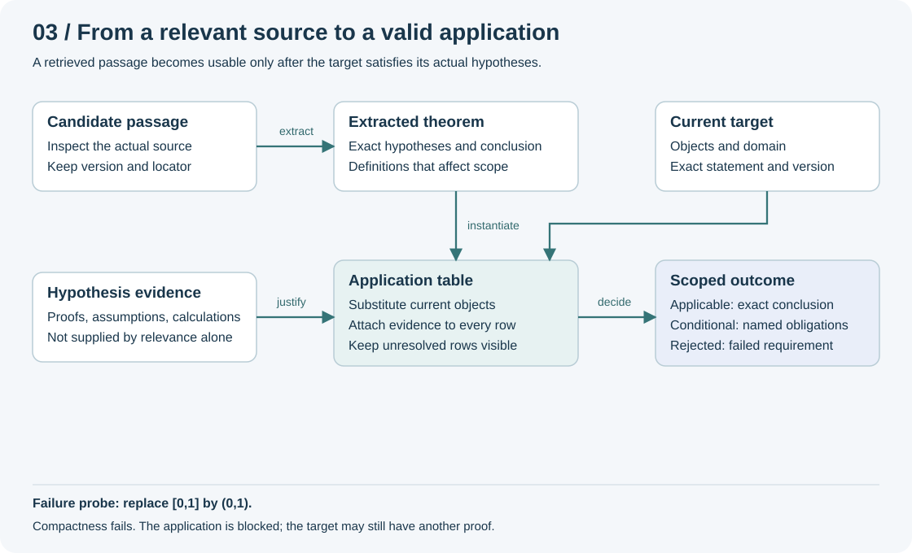

[English original](/posts/2026/08/agent-system/knowledge-retrieval/) · [中文课程总览](/posts/2026/12/Agent-System-zh/)

*实验指令、文件结构与可执行代码保留英文原文，可直接复制；正文用中文解释其目的与验收标准。*

相关论文只是起点。要在证明中使用它，必须定位精确定理，把其中的对象对应到当前对象，并验证假设。本模块将这一数学实践组织成可委托、可复查的研究流程。

**学习目标：**区分检索和应用；建立假设表；诊断近似匹配；并决定何时更多的搜索不如证明缺失的条件有用。模块 1-2 是先决条件。主要例子只需要基本的实际分析；几何扩展重用了提升问题。

**课程路线：** 完成 第 1–4 节，运行来源应用实验室，并完成练习。 提交成果是一项合理的申请，也是一项被拒绝或有条件的接近匹配的申请，有足够的证据让其他人重现该决定。

<a id="1-why-an-accurate-quotation-is-still-insufficient"></a>

## 1. 为什么准确的报价仍然不够

假设来源状态：非空紧致空间上的连续实值函数达到最大值。您的目标涉及开区间上的连续函数。当申请无效时，报价可以完全准确。缺少的步骤不是来源的另一个总结；它是您的域的紧致性。

将来源定理示意性地写为 $H_1\land H_2\land H_3\Rightarrow C$。应用它需要将您的对象替换为命题以及实例化假设的证明。名称本身并不能建立替换：来源的 $X$ 可能是射影、光滑，或者在与 $X$ 不同的字段上定义。

因此有两个单独的记录。 **源记录**说明了所检查的来源断言的内容以及断言的位置。 **应用程序记录**说明了为什么可以在此处使用该断言。一个定理可能有多种应用；一个正确的定理可能有几个无效的应用。将这些记录分开保存可以在本地进行修复。

<a id="2-a-complete-application-attainment-of-a-maximum"></a>

## 2. 完整的申请：达到最高

令 $f:[0,1]\to\mathbb R$ 连续。我们想要一个点 $x_{\ast}\in[0,1]$，使得每个 $y\in[0,1]$ 都为 $f(y)\leq f(x_{\ast})$。

| 来源要求 | 替换 | 证据 |
|---|---|---|
| 非空空间| $X=[0,1]$ | $0\in X$ |
| 紧致性 | $[0,1]$ 上的常见拓扑| $\mathbb R$ 中的闭有界区间 |
| 实值映射 | 指定的 $f$ | 其声明的余域|
| 连续性 | 此连续性 $f$ | 目标的显式假设 |

结论是从这些行共同得出的。它建立的是存在性，而不是唯一性或计算过程。例如，常数函数将每个点作为最大化器。

理解定理为何成立很有帮助。像 $f([0,1])$ 是实数中非空的 compact 子集，因此有界且闭。设其上确界为 M。对每个正整数 n，可在像中选出大于 M−1/n 的点；这些点趋于 M。由闭性，M 仍在像中，因此可选一个原像作为最大值点。

这个解释揭示了为什么仅有界是不够的：有界图像可能会省略其上界。这也解释了为什么一个仅仅证明有界性的来源不能默默地提供成就。

现在将域更改为 $(0,1)$ 并设置 $f(x)=x$。该函数是连续的并且有上界，但没有最大值。给定任意$x\in(0,1)$，点$y=(x+1)/2$仍然属于$(0,1)$并且满足$y>x$。我们既有一个不适用的定理，也有一个针对所提出的一般结论的反例。这些都是不同的发现。

若改用开区间上的常数函数 $g(x)=0$，compactness 假设依然不满足，但最大值确实存在。**定理假设不满足，只是否定这次应用，不能单独反驳目标。**另一种论证可能成功。

<a id="3-the-source-to-application-architecture"></a>

## 3. 来源到应用程序架构

[](/images/agent-system-zh/course-source-application.svg)

将图表视为证据管道。搜索产生候选者，而不是前提。提取后会生成带有定位器的命题。应用步骤还需要其假设的目标和独立证据。其输出要么是合理的结论，要么是名为待解决事项的条件应用，要么是带有原因的拒绝匹配。

对于小型项目，使用三个普通文档：

```text
SOURCES.md
  S1: title, author, version/date, exact locator, inspected passage
  statement and definitions needed to interpret it

APPLICATIONS.md
  A1: target T3-v1; source S1-v1
  substitution; each hypothesis and its evidence
  exact conclusion; unresolved obligations

SEARCH-LOG.md
  question searched; sources actually opened
  promising and rejected candidates; next search or proof action
```

这些文件不强制正确性。他们让助理的决定变得可见。从一份申请开始；仅当记录的大小或重复使用有帮助时，才将记录拆分为更多文件。将相同的定理复制到许多摘要中会为版本分歧创造另一个机会。

来源定位器应该是可恢复的：定理编号、section、指定版本中的页面或稳定标识符。不要发明丢失的定位器。提供的摘录可以支持其规定范围内的应用程序，但应标记为提供的，而不是根据整篇论文进行独立检查。

<a id="4-check-the-exact-object-not-just-the-theorem-name"></a>

## 4. 检查确切的对象，而不仅仅是定理名称

在模块 1 中，关于线性函数输出的断言不能自动应用于仅允许常数的问题。 “函数”和“两个值”一词匹配，但允许的输入不同。 来源应用程序需要相同的对象级精度。

以下扩展显示了几何中的这个问题。它是可选的；最大的示例提供了下面实验室所需的一切。

<details markdown="1">
<summary>高级连接：错误线束的消失定理</summary>

<a id="the-wrong-line-bundle"></a>

### 错误 line bundle

返回 line bundle $L$ 和 $X$ 上的effective Cartier divisor $D$。 限制序列是

$$
0\longrightarrow L(-D)\longrightarrow L\longrightarrow L|_D\longrightarrow0.
$$

相应 cohomology sequence 表明，$H^1(X,L(-D))=0$ 足以保证 $L\vert_D$ 的每个 section 都可 lift。证明 $H^1(X,L)=0$ 的定理讨论的是另一个对象。漏掉 twist 是数学上的不匹配，即使论文也出现了“vanishing”和“line bundle”这两个词。

应用表应标识环境类别、确切的层、上同调度以及实际来源定理的所有正性或正则性假设。不要使用从其他消失定理中记住的通用列表来填充这些行。从您想要使用的定理中提取列表。

如果$L(-D)$的正性未解析，则将其另存为待解决事项。接下来至少有三个明智的行动：证明积极性；找到假设较弱的定理；或者放弃全局消失并计算特定 section 的阻塞。该表有助于在这些操作中进行选择，因为它定位了困难。

这种区别对于发现研究机会也很重要。论文的射影定理可能会建议凯勒扩展，但共享关键字不会传输结果。一个有用的提案使用射影性确定了精确的证明步骤，并提供了可以实际测试的替代品论证。

</details>

<a id="5-a-laboratory-in-chatgpt-or-codex"></a>

## 5. ChatGPT或Codex的实验室

使用您可以合法访问和理解的定理段落。对于第一次运行，上面的最大定理就足够了。对于第二个，从您授权的研究语料库中的论文中选择一个定理。保持任务范围窄：一个应用程序，而不是整个领域的文献调查。

```text
Create a source record and an application record for the supplied passage.
Target: [write the exact statement and objects].
Extract the theorem's hypotheses, conclusion, and necessary definitions.
For each instantiated hypothesis, give evidence or mark it unresolved.
Distinguish text I supplied from sources you actually inspected.
Do not repair the target without recording a separate proposed target.
Return the exact conclusion this application would justify.
```

首先自己检查目标和来源记录。然后改变一个假设：将闭区间替换为开区间。要求修改申请而不删除原始申请。成功的响应会撤回紧致性证据，并将“该定理不可用”与“该函数没有最大值”区分开来。测试 $f(x)=x$ 和 $g(x)=0$。

在研究过程中，请助理找出最难解决的假设，并提出下一步行动并提供具体的结果。 “搜索更多论文”太模糊了。 “检查这个可访问的来源的定理 2.3，看看它的正性条件是否适用于这种扭曲”是可以审查的。如果无法访问来源，则该操作仍不完整。

在规定的范围用完后停止一轮搜索。记录语料库、查询、检查的来源和未解决的待解决事项。没有匹配的有界搜索意味着在该搜索中没有找到适用的定理；它不是不存在的定理或新颖性的证明。

<a id="6-exercises-and-worked-decisions"></a>

## 6. 练习和完整推导的决策

<details markdown="1">
<summary>1。 A bounded image: what is missing?</summary>

一份报告证明了连续函数具有有界图像，并得出其上界已达到的结论。识别丢失的衔接论证。

**解答.** 有界性为非空图像提供有限上界，但不会将该上界置于图像中。图像的封闭性将提供衔接论证。 $(0,1)$ 上的映射 $f(x)=x$ 给出了上界不存在的有界图像。有界结果仍然存在；成就不跟随。
</details>

<details markdown="1">
<summary>2。一个失败的假设，一个正确的结论</summary>

给出一个非紧域和具有最大值的连续函数。其基于紧致性的应用程序应获得什么状态？

**解答.** 在$(0,1)$上，常数函数$0$处处达到最大值。基于紧致性的应用是不适用的，而直接的论证证明了目标。分别记录这些；将目标标记为 false 会将论证与其结论混为一谈。
</details>

<details markdown="1">
<summary>3。正确来源，错误扭转</summary>

来源证明消失为 $L$。目标需要 $L(-D)$ 的消失。系统可以重用来源记录吗？

**解答.** 是的，作为记录的来源命题。它可能不会重复使用该应用程序作为新变化的支持。要么再次实例化该定理并建立 $L(-D)$ 的假设，要么找到另一个论证。这是应用程序故障，不一定是来源错误。
</details>

<details markdown="1">
<summary>4。什么时候停止检索？</summary>

在检查了五个相关来源后，所有可用的命题都需要相同的未经证实的阳性条件。下一个有用的任务是什么？

**解答.** 将该条件隔离为数学待解决事项并在易于处理的示例中或在当前假设下尝试它。只有通过特定的测试替代方案才能证明更多的检索是合理的。报告应保留搜索的内容，以便另一个会话不会重复相同的五个近似匹配。
</details>

<a id="7-what-to-submit"></a>

## 7. 提交什么

提交来源段落和定位器、对象替换、假设证据、确切结论和失败的变体。添加实际的对话或文件输出，以便审查者可以将生成的记录与其输入进行比较。以上数学推导仅供参考答案；它们并不是衡量任何助手可靠性的标准。

长期需要掌握的能力是辨认：**哪条定理，正被应用到哪些对象上，依据又是什么。**

---

[课程路线图](/posts/2026/12/Agent-System-zh/)·[直接实验](/posts/2026/08/agent-system-zh/hands-on-lab/)·[下一模块](/posts/2026/08/agent-system-zh/reasoning/)
