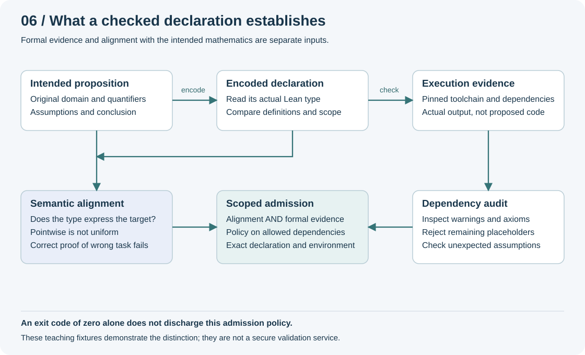

[English original](/posts/2026/08/agent-system/lean-formalization/) · [中文课程总览](/posts/2026/12/Agent-System-zh/)

*实验指令、文件结构与可执行代码保留英文原文，可直接复制；正文用中文解释其目的与验收标准。*

**实际问题：**当智能体返回Lean代码时，什么证据可以证明在另一个证明中使用其结果是合理的？

该模块通过一个小的数学错误引入了形式化：交换两个量词。您将阅读证明状态，完成证明，并将被拒绝的论证与两个已编译但未根据我们的政策确定其声明结果的文件进行比较。

**预备知识：**模块 1–5 与基本证明写作；无需已有 Lean 经验。**提交成果：**完成的证明文件，以及说明实际编码命题、依赖和剩余信任假设的简短报告。

[下载完整的练习项目](/files/lean-reasoning-lab.zip)。它使用核心 Lean，没有 mathlib 或模型 API。

<a id="1-a-statement-worth-getting-exactly-right"></a>

## 1. 命题值得完全正确

对每个自然数 n，都存在自然数 C 使 n≤C，取 C=n 即可。但不存在一个自然数同时界住所有自然数：给定 C 后，取 n=C+1 就会违反这个界。

$$
\forall n\in\mathbb N\;\exists C\in\mathbb N:\ n\leq C.
$$

这并不意味着一致命题

$$
\exists C\in\mathbb N\;\forall n\in\mathbb N:\ n\leq C.
$$

第一个见证可能取决于 $n$。第二个必须适用于每个 $n$。这是 [ 案例 B](/posts/2026/08/agent-system-zh/research-cases/) 中均匀性误差的基本版本。形式化使这种区别成为检查者看到的命题的一部分。

```lean
theorem pointwiseBound : ∀ n : Nat, ∃ C : Nat, n ≤ C := by
  intro n
  exact ⟨n, Nat.le_refl n⟩
```

把 theorem declaration 看成接口约定：`Nat` 固定论域，`∀` 与 `∃` 固定 quantifier order，`by` 之后的内容构造证明。

| 位置 | 已有信息 | 剩余目标 |
|---|---|---|
| `intro n` 之前 | 尚未引入自然数 | `∀ n : Nat, ∃ C : Nat, n ≤ C` |
| `intro n` 之后 | 任意 `n : Nat` | `∃ C : Nat, n ≤ C` |
| `exact …` 之后 | witness `n` 及证明 `n ≤ n` | 没有剩余目标 |

`intro` 引入 universally quantified variable。`⟨n, Nat.le_refl n⟩` 同时提供 witness 及其满足要求的证明。tactics 帮助构造 proof term；检查针对的是这个 term 及其 proposition，而不是 tactic 文本看起来是否有说服力。

<a id="2-a-proof-that-the-uniform-version-fails"></a>

## 2. 一致版本失败的证明

```lean
theorem noUniformBound : ¬ ∃ C : Nat, ∀ n : Nat, n ≤ C := by
  intro h
  cases h with
  | intro C hC =>
    exact Nat.not_succ_le_self C (hC (Nat.succ C))
```

假设建议的一致界存在。提取其值 `C` 以及每个自然数至多为 `C` 的断言 `hC`。将该断言应用于 `Nat.succ C`。它与 `Nat.not_succ_le_self C` 相矛盾。

**运行前暂停：**指向在*看到建议的界之后选择反例*的确切表达式。它是`hC (Nat.succ C)`。这种依赖性解释了数学原理。

通过不断变化的上下文来阅读证明：

| 步骤 | 新信息 | 剩余任务 |
|---|---|---|
| `intro h` | 假设存在统一的界 | 推出 `False` |
| `cases h` | 特定的 `C` 及 `hC : ∀ n, n ≤ C` | 利用这些信息推出 `False` |
| `hC (Nat.succ C)` | 得到 `C + 1 ≤ C` 的证明 | 与自然数的序性质矛盾 |
| `Nat.not_succ_le_self C` | 得到 `¬ (C + 1 ≤ C)` 的证明 | 将其应用于刚才的不等式 |

这里使用否定作为蕴涵到 `False`。最后一行将禁止的不等式提供给了它无法成立的证明。关于 `C` 不需要计算任何数值：论证适用于从 `h` 中提取的任意界。

这也解释了一种常见的错误修复：若把 existential witness 改成依赖 n 的数，就又证明了 pointwise 命题，而不是 uniform 命题。后者要求先选 C，再引入 n。官方[quantifiers 教程](https://lean-lang.org/theorem_proving_in_lean4/Quantifiers-and-Equality/)介绍这些规则；这里把它们落实到实际 proof states。

<a id="3-run-the-laboratory"></a>

## 3. 运行实验室

使用[官方Lean安装说明](https://lean-lang.org/install/)和支持Lean的编辑器。解压项目并打开其目录。 `lean-toolchain` 文件固定 **Lean 4.19.0** 以实现再现性；这是一个教学版本，而不是关于最新版本的断言。第一次运行可能会下载它。

```text
lake build
lake env lean Formalization.lean
lake env lean fixtures/Broken.lean
lake env lean fixtures/Incomplete.lean
lake env lean fixtures/ExtraAxiom.lean
```

`lake build` 仅构建已完成的库。 `Exercises.lean`和故意损坏的校准案例是分开的。直接运行每个校准案例，或要求 Codex 运行相同的命令并保留实际输出。损坏的校准案例预计会失败。不需要 Python 包装器。

| 文件 | Lean 4.19.0 上的已记录行为 | 可以得出的结论 |
|---|---|---|
| `Formalization.lean` | 编译通过；两个声明的 axiom report 均为空 | 这两个编码命题的证明已在该环境中检查 |
| `Solutions.lean` | 编译通过；两个声明的 axiom report 均为空 | 可作为练习的参考解答 |
| `fixtures/Broken.lean` | type mismatch，编译失败 | 任意 P 的证明不能直接填入任意 Q 的目标 |
| `fixtures/Incomplete.lean` | 带警告编译；报告 `sorryAx` | 仍含占位证明 |
| `fixtures/ExtraAxiom.lean` | 编译通过；报告 `inventedBound` | 结果依赖于额外假定的 bound |

这些结果是使用固定工具链在本地运行的。成功的回归运行意味着校准案例的行为符合预期。它确实 **不** 意味着每个示例都包含可接受的证明。

<a id="4-compilation-and-admission-answer-different-questions"></a>

## 4. 编译和结果纳入回答不同的问题

运行这些命令并比较它们的输出：

```text
lake env lean fixtures/Broken.lean
lake env lean fixtures/Incomplete.lean
lake env lean fixtures/ExtraAxiom.lean
```

第一个文件提供 `hP : P`，其中需要 `Q`。第二个使用 `sorry`。第三个将所需的界声明为公理，然后使用它。仅仅检查进程退出代码就会错过后两种情况。

Lean 提供 `#print axioms theoremName` 来公开声明的公理依赖性。我们完成的基本示例不需要任何东西。这并不能证明普遍的“拒绝每条公理”政策是合理的：其他发展故意使用标准基础，例如选择。说明项目允许的基础并审核意外的添加。请参阅官方 [axiom 参考 ](https://lean-lang.org/doc/reference/latest/Axioms/)。

操作记录应绑定原始命题、形式化声明、确切的来源和依赖项版本、验证输出和审查者决策。如果这些输入中的任何一个发生变化，请重新考虑结果纳入决策。没有此证据的 `formal-checked` 之类的标签只是文本。

<a id="5-the-boundary-formalization-does-not-remove"></a>

## 5. 边界形式化并没有消除

[](/images/agent-system-zh/course-formal-evidence.svg) 分开

两个不同的输入在结果纳入处相遇。其一是形式化声明在所选环境和依赖策略下进行检查的证据。另一个是语义比较，表明声明说明了研究任务的意图。成功的检查器运行本身无法提供第二次比较。

假设当您请求一致界时，智能体形式化了逐点命题。第一个命题的正确证明仍然没有达到你的目标。在接受结果之前，比较预期的和编码的命题：域、量词顺序、假设、定义和结论都很重要。

还要将这些手工检查的教学文件与任意生成的来源区分开来。执行生成的 Lean 代码并信任其显示的消息不是安全验证服务。生产系统需要隔离执行、受控依赖性以及适合其威胁模型的验证。官方 [ 证明验证指南](https://lean-lang.org/doc/reference/latest/ValidatingProofs/) 解释了更强大的检查程序及其信任边界。它当前的工具可能与这个固定的教学项目不同。

这些直接的校准案例运行是演示，而不是那些更强大的程序的实现。

<a id="6-a-useful-first-formalization-project"></a>

## 6. 一个有用的第一个正式化项目

打开 `Solutions.lean` 之前完成 `Exercises.lean`：

1.  通过选择后继者来证明 `∀ n : Nat, ∃ C : Nat, n < C`。练习文件将 `n` 提供为论证。
2.  重新构建不存在最大自然数的证明。
3.  运行文件并检查两个公理报告。解释为什么退出代码为零是不够的，而 `sorry` 仍然存在。
4.  编写非形式化和形式化命题的两列比较。解释见证如何依赖于输入。
5.  提交简短的结果纳入报告：精确声明、工具链、依赖项、检查器输出、语义对齐和决策。

**成功标准：**两个完成后的证明都能实际编译，且不含占位证明；axiom reports 符合声明的规则；对非形式化目标与 formal statement 的比较没有改变问题原意。

<a id="work-with-codex-without-giving-away-the-mathematical-task"></a>

###  与 Codex 一起工作，而不放弃数学任务

要求一个小的、可检查的改变和实际的执行记录：

```text
Read the pinned Lean project and the existing exercise declarations.
Explain the mathematical statement before editing a proof.
Complete one exercise without changing its declaration or adding axioms.
Run it with the pinned toolchain and retain the real command output.
Inspect its axiom dependencies and compare the result with the original task.
If execution is unavailable, report proposed code, not a checked proof.
```

当发生错误时，请助理在改变策略之前解释该位置的目标和可用假设。任意策略搜索最终都可以成功，但是阅读证明状态可以告诉您助手是否证明了正确的命题。拒绝将所需结果添加为假设或更改量词顺序的修复。

您不需要学习通用编程来进行此练习。您确实需要阅读该命题，检查一些证明状态，并了解执行证据所确定的内容。委托语法并不能免除选择正确的数学命题的责任。

<a id="questions-to-answer-before-opening-the-solutions"></a>

### 打开解决方案之前要回答的问题

<details markdown="1">
<summary>为什么严格逐点界使用后继？</summary>

对于固定自然数 $n$，选择 $C=n+1$。 所需的性质是 $n<n+1$。 Choosing $C=n$ worked for a non-strict bound but fails for this strict one. 见证及其性质的证明都必须更改。 提供的解决方案使用有关后继订单的相应基本事实。
</details>

<details markdown="1">
<summary>为什么文件可以编译但结果不可接受？</summary>

不完整的校准案例包含一个占位符，在依赖项中由 `sorryAx` 表示。额外公理校准案例假设界而不是证明它。检查器可以接受与此类假设相关的推导，而课程的结果纳入策略将其作为无条件解决方案拒绝。检查警告和依赖项，而不仅仅是退出代码。
</details>

<details markdown="1">
<summary>空公理报告是否证明语义对齐？</summary>

不可以。逐点命题的证明可以没有公理，但仍然无法满足对一致界的请求。检查声明，包括域、假设、定义和量词顺序。检查不同的真命题并不能完成预期的问题。
</details>

<details markdown="1">
<summary> 研究中首先应该形式化什么论证？</summary>

选择一个结果明确的衔接论证，其先决条件可以用可用的定义来表示。在提交之前评估翻译工作。当带有非形式化证明的接口是明确的时，一个小的形式化引理是有用的；不应将其作为整篇论文的验证进行宣传。
</details>

<a id="7-moving-toward-research-mathematics"></a>

## 7. 走向研究数学

对于更大的开发，[Lean](https://leanprover-community.github.io/mathematics_in_lean/) 中的数学教授 Lean 和 mathlib 的数学使用。从一个小引理开始，其定义和先决条件已经存在于库中。将项目工具链和依赖项修订固定在一起。图书馆的可用性和翻译工作是项目选择的一部分。

一个有用的进展是：阅读现有的形式化命题，填写简短的证明，使用正确的假设重用库定理，然后在研究论证中形式化一个脆弱的衔接论证。高级几何定理可能需要大量缺失的基础设施。形式化的局部引理是有价值的部分进展，但不能证明整个非形式化手稿。

持久的设计原则是保持**预期命题、编码命题、证明证据和结果纳入决策**可区分。未来的人工智能可能会自动化更多的构建。对于评估其产出，这些区别仍然是必要的。

[返回课程](/posts/2026/12/Agent-System-zh/)

[下一条：恢复研究状态](/posts/2026/08/agent-system-zh/memory-management/)
