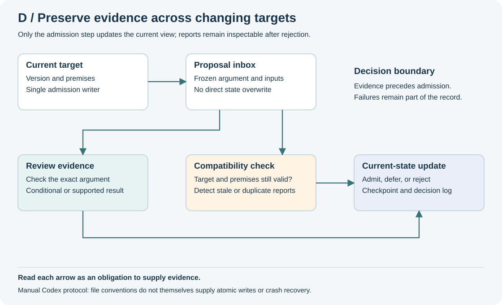

[English original](/posts/2026/08/agent-system/math-research-case-study/) · [中文课程总览](/posts/2026/12/Agent-System-zh/)

*实验指令、文件结构与可执行代码保留英文原文，可直接复制；正文用中文解释其目的与验收标准。*

把现有研究系统当作设计问题的来源，而不是必须照搬其复杂度的模板。本章搭建并评估一个小型 Codex 工作流程；它不声称复现当前 Danus 或 Rethlas，也不把历史版本中的本地 API 名称当成现成可用的规范。

**阅读路线：**从下面的工作坊开始进行高级设计；需要时，使用 [参考事件和预期状态变化 ](#a-reference-episode-with-expected-state-changes) 作为具体校准。在对照案例之后完成研究作业。

<a id="research-workshop-d-design-a-persistent-research-system-and-test-its-failure-behavior"></a>

## 研究工作坊 D：设计一个持久的研究系统并测试其故障行为

**预备知识：**核心课程和一个来源相关数学项目。 **提交成果：** 版本化的研究工作区、可重现的故障实验以及识别哪种架构机制改变了哪些观察到的行为的比较。本章后面的基本情节是诊断对照案例，而不是研究基准。

<a id="1-learn-from-reported-systems-without-conflating-their-evidence"></a>

### 1. 从报告的系统中学习，而不混淆他们的证据

[Danus v2](https://arxiv.org/abs/2607.06447v2) 描述了围绕共享 fact-graph memory 组织的规划与并行证明搜索，在 admission 前检查拟议断言。[Rethlas–Archon v2](https://arxiv.org/abs/2604.03789v2) 描述了 informal reasoning 与 Lean formalization 的分工。两者引出不同问题：如何维护不断演化的 proof state，以及如何把 informal discoveries 与正式检查的 declarations 联系起来。

本工作坊将这些问题组合成一个设计提案。它不声称这些组件在现有系统中都不存在，也不声称一个基于提示词的工作区已经优于它们。这样的比较需要明确的实现版本和条件匹配的运行记录。

<a id="2-separate-proposals-reviews-and-current-state"></a>

### 2. 区分提案、审查记录与当前状态

使用单个权威的当前状态文档并保留支持研究记录。提案写入收件箱，审查引用确切目标和论证版本，结果纳入步骤仅在检查这些版本是否仍然适用后更新当前视图。 执行单元的报告不应直接覆盖当前目标。

```text
TARGET.md                 current target and version
inbox/                    proposals with target and premise versions
arguments/                complete argument texts; old revisions retained
reviews/                  scope, findings, and exact reviewed inputs
DECISIONS.md              admitted, conditional, rejected, or stale reports
STATE.md                  supported conclusions and open obligations
CHECKPOINT.md             recovery entry point with artifact locations
```

这些目录可以直接在 Codex 中创建和使用，无需编排程序。但目录规则仍是可能被违反的协议，必须通过实验检查。如果并发写入互相覆盖，Markdown 约定并不能提供 transaction guarantee。课程实验采用单一 admission writer；更强的并发保证应作为需要单独实现的扩展。

<a id="3-admission-is-a-state-transition-with-preconditions"></a>

### 3. 结果纳入是有前提条件的状态转换

在应用审查之前，请将其目标版本、论证版本、前提版本和证据策略与当前记录进行比较。如果任何相关项目发生变化，报告可能保持历史正确性，但必须重新评估以供当前使用。

| 收到的结果 | 当前条件 | 允许的状态变化 |
|---|---|---|
| 已审查论证 | 精确输入仍匹配，假设已消解 | 纳入其支持的结论 |
| 使用未证引理的有效 implication | 引理仍是假设 | 仅允许条件性使用 |
| 旧目标的审查 | 目标发生实质变化 | 保留报告，重新检查适用性 |
| 重复报告 | 相同决定已记录 | 不新增独立支持路线 |
| 某个前提被撤回 | 可能仍有其他路线 | 先重新计算支持关系，再改变目标状态 |

此过程类似于在提交更新之前检查先决条件。在仅 Codex 的实验室中，这是一种需要观察的行为，而不是自动原子操作。

<a id="4-a-concrete-stale-result-experiment"></a>

### 4. 具体过期-结果实验

时刻一，任务研究次数不超过一的多项式插值，并证明两个不同点上的任意目标值都可实现。时刻二，目标改为次数不超过零。时刻三，针对旧目标的审查通过报告才到达。

旧定理仍然正确，却不能证明新 degree bound 下的普遍可解性。系统应保留线性插值证明，重新检查它的应用，并计算常数函数的兼容条件。不能删除有效数学、悄悄改回 degree bound，或把过期批准当成新证明。

现在将相同的旧报告提交两次。它的两次交付只是一项证据，而不是独立的佐证。然后删除适用性记录，同时保留定理。恢复应准确识别丢失的内容：保留来源定理，但不支持将其用于当前目标。

[](/images/agent-system-zh/advanced-research-state.svg)

<a id="5-evaluate-through-controlled-removal-of-components"></a>

### 5. 通过受控移除组件进行评估

比较同一数学材料的三种配置：普通对话、没有显式结果纳入过程的版本化记录以及具有上述过程的版本化记录。保持来源访问权限和工作量津贴具有可比性。运行有效的对照案例和旨在生成过期证据的更改。

记录无效重用、仍然有效的数学错误拒绝、恢复保真度、有用的已完成待解决事项、人工更正和总体努力。保留第一响应。如果修复需要评估者提供缺失的引理，请报告该帮助，而不是将其数学归因于体系结构。

然后逐个移除组件：不比较版本，是否会错误使用过期批准？不追踪替代路线，是否会在撤回一个前提时丢弃仍有支持的结论？如果有无组件都同样失败，就不能据此声称组件有用；一次成功也只支持那次实际观察。

<a id="6-upgrade-the-benchmark-beyond-classroom-controls"></a>

### 6. 升级课堂之外的标杆对照案例

选择已发布的论证，其证明涵盖多个来源结果。冻结一项重建任务和两个假设变体。包括一种具有已知故障的变体以及审查者必须调查其状态的变体。将参考材料与解决对话分开，同时为两个比较系统提供平等的授权来源访问权限。

对于开放目标，单独评估中间结果，而不是从最终的散文中标记整个运行成功。需要一项来源应用程序审核、一项新引理尝试、一项撤回实验和一项新会话恢复。仅当编码的衔接论证相关且可执行时，才包含实际的 Lean 研究记录。最终报告必须说明哪些结论是非形式化、形式化、有条件的或未解决的。

高级技能是设计一个系统，该系统可以出于正确的数学原因改变想法，同时保留有效的工作。未来的模型可能会简化实现，但这些实验测试的区别仍然是必要的。

## 进阶扩展：自主 formal admission 路径

为持久化工作区增加固定 specification 库、候选区、受控 validation 环境和 accepted theorem library。生成者可以修改候选，但不能改写 specification 或 acceptance policy，让失败尝试变成“通过”。validation receipt 绑定精确记录与环境；admission 消费这个 receipt，而不是候选的成功宣言。

复用模块 6 的五项测试，再加入中断与重放：证明保存后尚未验证就中断，恢复时应仍为 pending；已纳入的 receipt 再次送达，不能变成第二个独立证明；definition 改变必须重新检查。先展示实际行为，再声称文件组织能保障它。

因此，capstone 可以同时维护自主 formal lane 与开放的 informal research。specification 确立后，formal lane 无需日常人工 proof review。这是设计目标与实验任务，不是已经复现的具名系统功能，也不是优于 Danus 或 Rethlas 的实测结论。

<a id="the-task-and-baseline"></a>

## 任务和基线

选择一个可以检查的简短数学论证，加上两个损坏的版本：一个缺少假设，一个缺少返回蕴涵。如果您需要受控的起点，请使用前面项目中的提升或 blow-up 实验。

首先要求普通聊天解决或审查每个任务。保留其完整输出、来源访问权限、日期和工作预算。这是您的基线。不要为重新设计的工作流程提供额外的来源材料，并将差异完全归因于架构。

<a id="build-the-smallest-useful-system"></a>

## 构建最小的有用系统

```text
Create a research workspace using Markdown only.
Use TARGET.md for exact versioned targets, ARGUMENTS.md for alternative routes,
REVIEWS.md for reviews of identified argument versions, and CHECKPOINT.md
for the state needed to resume without this conversation.
Investigate one task. Record the actual argument and remaining obligations.
Do not promote a proposal merely because it has been repeated or approved.
```

这些文件提供明确的接口：目标进入调查，论证进入审查，已审查结果可能仅在其记录范围内支持另一个步骤。在考虑分工工作之前，您可以在一次对话中操作所有这些内容。

<a id="separate-proposal-and-review"></a>

## 单独提案和审查

提供新的审查对话，准确的命题、论证和来源。要求它识别失败的推论和缺失的前提。即使报告不同意提案，也要保留报告。单独的对话不能保证独立，并且可能会出现相同的错误。

非形式化审查是容易出错的数学证据。 “正确”等标签不是 Lean 证书。如果使用Lean，则保留编码后的命题、环境、实际检查输出和公理审计；还将编码的命题与预期的数学进行比较。

<a id="challenge-the-workflow"></a>

## 挑战工作流程

| 人为干预 | 要检查的行为 |
|---|---|
| 审查后改变假设 | 针对新命题重新考虑旧审查 |
| 撤回两条独立路线之一 | 另一条有效路线仍支持目标 |
| 撤回全部现有支持 | 目标变成未解决，而非自动变成错误 |
| 送达延迟报告 | 复用前检查它对应的目标版本 |
| 只凭 checkpoint 重启 | 保留目标、假设与未解决事项 |
| 未运行工具却询问 formal status | 如实说明缺少执行证据 |

运行这些干预措施并保留实际响应。请求正确行为的提示并不是该行为发生的证据。

<a id="a-reference-episode-with-expected-state-changes"></a>

## 具有预期状态变化的参考情节

使用模块 1 中的实数规则 $r(c)=(c,c)$。以下是手动导出的测试规范，而不是观察到的 Danus、Rethlas 或 Codex 的记录。

| 事件 | 实际可用的证据 | 预期状态 |
|---|---|---|
| V1 要求产生 $(1,1)$ | 规则与候选 $c=1$ | 检查 $r(1)=(1,1)$ 后纳入解答 |
| V2 改为要求 $(1,0)$ | 旧计算仍可保留 | 旧 witness 不解决 V2 |
| 旧批准报告到达 | 报告针对 V1 | 保留与 V1 的关联，不把批准移给 V2 |
| 刻画全部可能输出 | 两坐标总相等 | 通过一般论证证明 V2 无解 |
| 保存 checkpoint 后重启 | 规则、目标、论证与审查 | 恢复 V1 已解决、V2 已被反驳及各自理由 |

第二行和第四行出现了一个重要的区别。失败的见证仅表明该候选不起作用。第四行提供了候选答案无法工作的普遍原因。测试 $c=1$ 后立即声明不可能性的系统碰巧在这里得出了正确的答案，但尚未证明其合理性。

使用第二条规则 $q(c)=(c,1-c)$ 测试该弱点。同一候选产品 $c=1$ 现在生产 $(1,0)$。更改规则会改变问题，因此旧的等分项论证不再适用。记忆中的否定判决不应该在这次干预中幸存下来。

<a id="attribute-an-improvement-to-a-mechanism"></a>

### 归因于机制的改进

将基线与仅添加显式目标版本的版本进行比较。如果新的运行捕获了过期审查但仍然将候选失败误认为是不可能的，请准确报告这一点。版本记录寻址身份；它没有提供缺失的通用论证。

然后添加一个审查问题：“该证据是否拒绝一个候选答案，或所有可能的候选答案？”再次测试这两个规则，保留第一个响应。如果同时添加多个机制，您可以评估组合的工作流程，但无法从该实验中分离出它们各自的效果。

避免将这五个事件的事件转化为看起来令人印象深刻的成功率。报告事件、预期转换、实际转换和数学原因。更多案例和重复运行可以稍后支持更广泛的经验断言。

<a id="what-to-inspect-in-a-named-implementation"></a>

###  在命名实现中要检查什么

对于 Danus 或 Rethlas 的版本，您实际上可以通过提案、证据、审查、重用和修订来检查、跟踪一个结果。询问哪个研究记录标识了目标，论证标识了目标，条件假设如何存在，以及当先前接受的前提被撤回时会发生什么。分别记录代码或文档位置和实际运行证据。

如果无法找到某个特征，则将其标记为在检查的材料中未找到；不要断定没有版本有它。该项目教授审计程序。它不会为任何一个命名系统提供未记录的功能断言。

<a id="decide-whether-more-coordination-helps"></a>

## 确定更多协调是否有帮助

如果来源检查和替代证明可以单独进行，请尝试不同的 Codex 任务或对话。修复可比较的总工作量和来源访问权限。计算重复的工作、经过的时间、接受的错误、错过的有效论证以及有用的部分结论。当协调不增加任何价值时，单一执行单元系统是有效的结果。

<a id="how-to-make-a-responsible-comparison-with-a-named-system"></a>

## 如何与命名系统进行负责任的比较

要直接与 Danus 或 Rethlas 进行比较，请获取可访问、可识别的版本并记录其配置。使用类似的工具和资源运行相同的案例。将一篇论文支持的断言与您自己运行的观察结果分开。如果您无法执行指定的系统，则仅比较架构选择，而不衡量断言的优越性。

一份有用的最终报告说明了重新设计的工作流程发现了哪些故障，错过了哪些故障，以及增加的机制的成本。它可能会得出这样的结论：普通的聊天对于一项任务来说就足够了。目标是改进数学工作，而不是更大的智能体角色集合。

[从零开始 Codex 设置](/posts/2026/08/agent-system-zh/codex-research-studio/) · [研究机会项目](/posts/2026/08/agent-system-zh/research-opportunity-system/) · [课程路线图](/posts/2026/12/Agent-System-zh/)
