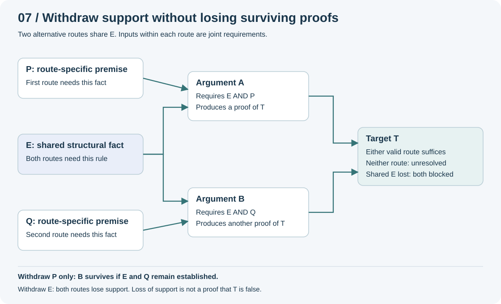

[English original](/posts/2026/08/agent-system/memory-management/) · [中文课程总览](/posts/2026/12/Agent-System-zh/)

*实验指令、文件结构与可执行代码保留英文原文，可直接复制；正文用中文解释其目的与验收标准。*

研究 checkpoint 应该让新的会话重建已知的内容、为什么支持它以及什么仍然是有条件的。保存每条消息是不够的：下一个读者仍然可能将废弃的路线与当前定理混淆，或者丢失有用引理的假设。

**学习目标：**维持替代论证，在不反应过度的情况下传播撤回，在不放弃数学范围的情况下压缩上下文，并在新的对话中测试恢复。实用的提交成果是在故意改变证据后仍然存在的 checkpoint。

<a id="1-memory-is-a-claim-about-the-research-state"></a>

## 1. memory是一个关于研究状态的断言

假设对话的结论是无法生成所请求的输出。后来的总结说“没有允许的输入”。文件仍然存在，但数学发生了变化。对于基本规则 $r(c)=(c,c)$，存在大量输入；故障涉及产生规定的输出 $(1,0)$。在几何版本中，这些输入是 global section。

每一个总结都是对证据的解释。它可能会引入新的错误。保留完整的论证并使用显式对象和量词编写摘要。 紧致命题之类的“每个输出都有相同的条目，因此 $(1,0)$ 被排除”比关于不存在的模糊结论更短、更忠实。

有用的记忆分为三层。 **当前视图** 说明目标、支持的结果和下一步操作。 **支持记录**通过论证和来源解释每个结果。 **history** 保留修订、失败的尝试和撤回。新会话通常以当前视图开始，并根据需要打开支持记录；当有争议的假设再次出现时，历史至关重要。

<a id="2-work-through-a-withdrawal-with-two-routes"></a>

## 2. 通过两种途径完成撤回

设 $T$ 为目标，并假设已建立两个有效的蕴涵：

$$
\begin{aligned}
(E\land P)&\Rightarrow T,\\
(E\land Q)&\Rightarrow T.
\end{aligned}
$$

这里 $E$ 是共享结构事实，而 $P$ 和 $Q$ 支持替代路由。对于本协议练习，蕴涵是规定的输入，而不是新证明的数学定理。读取$E$作为共享规则，其适用性已经过检查； $P$ 和 $Q$ 是两个论证使用的不同附加事实。例如，两个计算可以使用允许输入的相同模型。如果该模型错误，则两项计算都需要重新考虑。可选的几何解释采用 $E$ 编码限制序列、$P$ 全局消失和 $Q$ 零阻碍指定 section。

| 事件 | 路线 A：$E,P$ | 路线 B：$E,Q$ | $T$ 的状态|
|---|---|---|---|
| 已建立所有三个前提 | 可用 | 可用 | 任一路由均支持|
| $P$ 的证据已撤回 | 不可用 | 可用 | 仍受 B 支持|
| $Q$ 现在仅假定 | 不可用 | 有条件 | 在 $Q$ 上有条件，且 $E$ 成立|
| 对 $Q$ 的支持也已撤销 | 不可用 | 不可用 | 未解决|
| 恢复 $P$，但撤回 $E$ | 不可用 | 不可用 | 未解析 |

最后一行至关重要。两条路由不能提供针对共享前提故障的保护。将它们算作独立的证明会掩盖共同的依赖性。

撤回意味着当前记录不再提供所声称的证据。它不一定证明前提是错误的。 来源可能被错误引用，文件可能丢失，或者计算可能需要修复。记录原因，以便下一次会议知道是否恢复证据、修复论证或寻求不同的定理。

[](/images/agent-system-zh/course-memory-withdrawal.svg)

读取从前提到论证到目标的图表。一个论证的输入是联合要求；两个论证是替代品。这种差异决定了撤回的作用。

<a id="3-how-to-update-the-state-without-inventing-a-conclusion"></a>

## 3. 如何在不发明结论的情况下更新状态

当前提发生变化时，首先确定哪个论证引用了确切的版本。重新评估那些论证，然后得出依赖于它们的结论。在将结论标记为不支持之前，请检查其其他路线。仅在支撑实际发生变化的地方继续下游。

这是一个数学过程，而不是实现图数据库的需求。对于小型项目，包含论证 ID 和前提 ID 的表就足够了。 Codex 可以帮助维护它，但必须根据实际证明检查结果表。

有两个常见错误。 **Under-withdrawal** 在其唯一的支持消失后留下可用的结果。 **Over-withdrawal** 丢弃仍然具有有效替代论证的结果。两种损害研究：第一种引入了错误的确定性；第一种引入了错误的确定性。第二个浪费工作并且可以隐藏可靠的路线。

有条件的论证也需要同样护理。如果仅假设$H$建立$P$，则经过$P$的路由继承$H$。没有假设的“$P$ 已证明”的摘要是不可接受的压缩。相反，如果第二条路线证明了没有 $H$ 的目标，则即使第一条路线保持有条件，也可以无条件保留该目标。

<a id="4-write-a-checkpoint-another-researcher-can-resume"></a>

## 4. 写一个 checkpoint 其他研究员可以恢复

使用这个小结构：

```text
CHECKPOINT.md
  Target: exact statement, objects, version, intended scope
  Current conclusions: each with argument ID and remaining assumptions
  Alternatives: available routes and the first unresolved obligation in each
  Withdrawals: affected evidence, reason, consequences, surviving support
  Evidence locations: source passages, proof files, actual tool outputs
  Next action: one concrete question and the artifact that answers it
```

checkpoint 应该链接到完整的证明，而不是将它们压缩到任意字数限制中。当支持文件太大时，将详细信息放入支持文件中，但在当前视图中的每个结论旁边保留条件假设。在读者决定打开哪个证明之前需要这些。

下一步有效的操作是“使用来源 S2 检查引用的正性定理是否适用于 $L(-D)$”。 “继续证明”并不能确定未解决的数学任务。如果之前的尝试失败了，请提供决定性的原因和证据，这样下次会议就不会以新的名称重复它。

<a id="5-a-fresh-session-recovery-experiment"></a>

## 5. 新鲜会话恢复实验

在第一次对话中，将两条路由表交给助手并要求其创建记录。一次一个地介绍事件。每次事件发生后，保存新的当前状态，同时保留旧的证据。不要仅仅要求所有五行的最终摘要；测试更新是否正确发生。

然后打开一个新对话并仅提供 checkpoint 及其链接的研究记录。在 Codex 中，这些可以是工作空间文件；在聊天接口中，您可以提供相同的文本。此实验不需要自定义memory服务。

```text
Reconstruct the research state from these files before proposing new work.
State the exact target, each supported conclusion, and remaining assumptions.
Explain which arguments survive the latest withdrawal and why.
Identify missing or conflicting evidence instead of filling it from memory.
Then propose one next action tied to an unresolved obligation.
``` 相关的下一个行动

将重建与预期状态进行比较。检查目标、量词、版本、共享前提、幸存替代方案和条件假设。令人信服的研究计划并不能弥补不正确的重建。

对于更难的测试，请省略链接的证明文件。 固有回复识别了缺失的证据并限制了其结论。它可能会报告 checkpoint *claims* 结果是已审查，但不应假装检查了缺失的论证。恢复文件并查看状态是否因正确原因而发生变化。

<a id="6-exercises-and-worked-answers"></a>

## 6. 练习和完整推导的答案

<details markdown="1">
<summary>1。一路失败：目标必须撤回吗？</summary>

**解答.** 仅当没有剩余可用支撑时。在表中，撤回 $P$ 会禁用 A，而建立的 $E$ 和 $Q$ 会保持 B 可用。保留失败的路由进行诊断，无需降级独立支持的目标。
</details>

<details markdown="1">
<summary>2。两条路由失败：目标是否为假？</summary>

**解答.** 否。目前的证据已不能证明这一点。反驳需要有否定的证据或有效的反例。 “未解决”和“假”必须保持不同的状态。
</details>

<details markdown="1">
<summary>3。忠实压缩两点计算</summary>

**解答.** 写入：“通过实际输入和规则 $r(c)=(c,c)$，可以精确地生成等项对。因此无法生成 $(1,0)$，而每对 $(a,a)$ 都由 $c=a$ 生成。”这保留了阻塞和阳性病例。
</details>

<details markdown="1">
<summary>4。丢失的来源文件会留下什么？</summary>

**解答.** 先前的记录引用它的历史事实仍然存在。数学结果是否仍然可用取决于其他可用证据和项目规定的结果纳入政策。请勿编造缺失的段落。区分无法重现来源审计和定理中已证实的错误。
</details>

<a id="7-apply-this-to-a-live-research-project"></a>

## 7. 将其应用到实时研究项目中

选择一个具有至少两个尝试证明的引理，或一个具有争议引用的证明。构建暴露争议的最小依赖表。撤回有争议的支持并确定接下来的内容。这通常会产生比重读整个对话更好的研究计划：它揭示了精确的引理，对其进行修复将恢复最有用的结论。

提交更新跟踪、checkpoint、新鲜会话重建和比较。衡量成功的标准是各个会话之间的数学连续性。更强大的模型可以从更少的文本中重建更多内容，但它仍然需要区分假设、证据和结论。

---

[课程路线图](/posts/2026/12/Agent-System-zh/)·[直接实验](/posts/2026/08/agent-system-zh/hands-on-lab/)·[下一模块](/posts/2026/08/agent-system-zh/multiple-agent-cooperation/)
