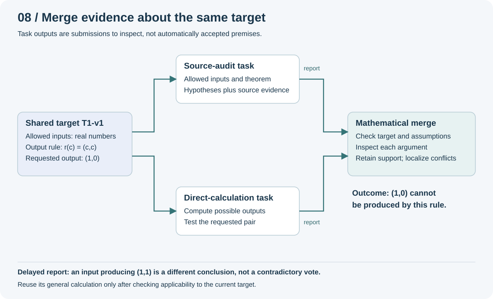

[English original](/posts/2026/08/agent-system/multiple-agent-cooperation/) · [中文课程总览](/posts/2026/12/Agent-System-zh/)

*实验指令、文件结构与可执行代码保留英文原文，可直接复制；正文用中文解释其目的与验收标准。*

当各个部分产生可以正确组合的证据时，划分研究工作是有用的。更多执行单元并不自动意味着更多的数学进步。该模块从顺序工作流程开始，然后询问单独的任务或对话何时改善其证据或经过的时间。

**学习目标：**选择有用的工作分工，指定交接，合并有关同一目标的报告，并将分工工作与更简单的基线进行比较。您可以通过普通对话或 Codex 工作空间来完成实验室；不需要自定义多智能体实现。

<a id="1-divide-by-mathematical-obligation"></a>

## 1. 除以数学待解决事项

对于规定输出问题，两个有用的任务是检查一般可解性定理是否适用以及直接计算实际输出。他们回答不同的问题。第一个可以确定每个请求的输出都是可能的；即使一般定理不可用，第二个也可以确定所选的输出。

将此与要求三个执行单元“更加仔细地思考提升”进行对比。他们的报告可能会重复相同的不受支持的断言，使用不同的目标，并且产生很少的可合并的内容。研究员、评论家和专家等职称不指定数学输出。

任务应识别其输入、允许的范围、预期的研究记录和停止条件。对于来源审核，研究记录是包含已检查的来源位置的假设表。对于计算来说，它是一个显式映射或见证以及它解决目标的证明。对于审查，它是本地化的推理报告。

<a id="2-a-complete-merge-example"></a>

## 2. 一个完整的合并示例

使用模块 1 的实数规则 $r(c)=(c,c)$。目标 T1 询问输入是否产生 $(1,0)$。一项任务审核提出的一般定理；另一个计算可能的输出。

来源审计任务报告：“所提出的定理要求允许线性多项式，而该目标仅允许常数。此应用程序不会解决 T1。”计算任务证明每个输出都有相等的条目：

$$
r(c)=(c,c).
$$

$(1,0)$ 对具有不相等的条目，因此没有输入产生它。合并结果是该计算支持的否定答案。一旦另一个有效的论证解决了目标，定理路线的失败不会使目标无法解决。

在可选几何中，输入为 global section，输出规则为限制。相同的合并原则适用；下面的数值实验不需要这种解释。

现在介绍第三份报告：“输入 $c=1$ 生成 $(1,1)$。”这对于 $(1,1)$ 是正确的，但与关于 $(1,0)$ 的否定答案并不矛盾。有用的合并会在比较结论之前检查对象。它可以将第三份报告保留为积极的对照案例，同时拒绝将其作为对 T1 的支持。

最后，假设可以生成每个请求的对的报告断言。这确实与等分计算相冲突。合并必须检查论证并定位错误；它无法通过计算批准数或平均置信度来解决冲突。

[](/images/agent-system-zh/course-evidence-merge.svg)

合并中的箭头意味着“检查报告”，而不是“已接受的前提”。只有已审查数学内容才能支持该目标。

<a id="3-the-handoff-contract"></a>

## 3. 切换接口约定

在开始任何工作之前请使用下表：

| 任务 | 输入 | 所需输出 | 当 |
|---|---|---|---|
| 来源审计时停止| 目标版本、允许的输入、候选段落 | 替换和假设证据 | 应用程序合理、被阻止或来源不可用 |
| 直接计算 | 相同目标和显式对象| 可能的输出和请求输出的结果 | 计算已完成或仍存在精确差距 |
| 审查 | 冻结论证和支持材料| 接受的推论和局部缺陷 | 每个实质性步骤都有规定的处置 |
| 合并 | 报告加上当前目标 | 可重用支持、冲突、开放待解决事项 | 每份报告的范围和影响均占 |

为每个任务提供相同的目标快照。 来源审核执行单元不需要收到所需证明的有说服力的草案；它确实需要确切的对象和假设。 审查者需要完整的论证而不仅仅是作者的结论。限制不相关的上下文可能会有所帮助，但忽略必要的数学数据会造成人为的失败。

以下是最小的来源审计任务：

```text
Task S, target T1-v1, supplied source S2-v1.
Determine whether this theorem applies to the exact objects in TARGET.md.
Return a hypothesis table, exact conclusion, and source locations inspected.
Do not solve other branches or update the shared target.
If a hypothesis is unresolved, identify one concrete test of that hypothesis.
```

对于计算任务，用要计算的显式映射替换定理应用。要求其输出具有相同的目标版本。这足以演示架构而无需实现调度程序。

<a id="4-merge-mathematics-before-merging-prose"></a>

## 4. 先合并数学再合并散文

按此顺序检查报告。首先比较目标：域、对象、请求的输出和量词。接下来比较假设和来源版本。然后检查实际的论证及其剩余间隙。最后决定它的贡献：完成、条件结果、阻碍、可重用引理或没有新的支持。

这个顺序可以防止一个常见的错误：在发现其成分涉及不同的问题之前就生成了完善的合成。关于错误目标的报告可能仍然包含有用的数学，但转移它需要新的适用性检查。

保留原始报告。如果合并重写了他们的结论，那么原因应该是可见的。特别是，一份报告中缺失的假设不得由另一份也仅仅假设该假设的报告默默地提供。结合两个假设并不成立任何一个。

必要时使用简单的冲突记录：

```text
Conflict C1
  Report A: all outputs have equal entries, with explicit calculation
  Report B: every requested pair can be produced, using a theorem about linear polynomials
  Same objects and target? Check before treating as contradiction
  Disputed step: whether the theorem allows the constants-only input constraint
  Next action: inspect that exact hypothesis; preserve both original reports
```

<a id="5-revision-while-work-is-in-flight"></a>

## 5. 工作进行中进行修改

当任务仍在处理旧快照时，将 T1 从 $(1,0)$ 更改为 $(1,1)$。当其报告到达时，不要覆盖其版本标签。对旧请求输出的否定判决并不能回答新问题，但等值计算可以回答：$(1,1)$ 位于图像中。

这是对异步工作的一个小而现实的测试。延迟的报告并不一定毫无价值；其可重复使用的内容必须与其过期的结论分开。当研究项目更改 divisor、删除假设或在品种模型和 birational 模型之间切换时，也会出现同样的问题。

对于课程练习，请在单独的对话中手动执行相同的事件序列。并行执行是可选的。重点是在添加并发之前了解正确的切换和合并需要什么。

<a id="6-compare-with-sequential-work"></a>

## 6. 与顺序工作比较

首先在一个连续会话中运行来源审核、计算和合并。然后在相当的总工作预算和相同的来源访问权限下重复执行单独的任务。在任一运行之前指定预算：例如，固定数量的来源检查和审查轮次。记录实际使用情况（如有）；将不可用的代币或成本数据标记为不可用。

将经过的时间与总努力分开测量。并行工作可以更快地完成，同时会重复搜索并增加成本。计数有用的完成的待解决事项，无效的结论已纳入，重复的工作，以及未解决的冲突。更大的文本量并不是一种改进。

不保证单独的对话是独立的。 执行单元可能会错误地使用相同的定理或共享误导性的输入。有用时使 **evidence** 多样化：将一般定理应用与直接示例进行比较，或将非形式化证明与合适的形式化引理进行比较。添加相同的投票是较弱的干预。

<a id="7-exercises-and-worked-answers"></a>

## 7. 练习和完整推导的答案

<details markdown="1">
<summary>1。 1个执行单元被屏蔽；另一个解决了目标</summary>

**解答.** 纳入在审查成功的论证后得到支持的结论。保留被封锁的路线。完成并不要求每一条提议的路线都成功，并且不能仅仅因为目标已经确定而将受阻的路线描述为已被证明。
</details>

<details markdown="1">
<summary>2。两个执行单元都假设相同的缺失引理</summary>

**解答.** 他们的合并结果仍然以该引理为条件。共同的前提是一个未解决的依赖关系，而不是佐证。将任务分配给引理本身或找到避免它的路线。
</details>

<details markdown="1">
<summary>3。旧报告有一个有用的一般计算</summary>

**解答.** 保留原假设下的计算。将其显式应用于当前目标并创建新的结论记录。不要仅仅因为两个任务中出现相同的品种而转移旧的判决。
</details>

<details markdown="1">
<summary>4。 执行单元什么时候是更好的架构？</summary>

**解答.** 当任务紧密相关时，上下文切换主导工作，或者划分的运行在可比较的资源下没有添加任何有用的证据。选择更简单的工作流程是成功的设计结果，而不是构建复杂系统的失败。
</details>

<a id="8-submission"></a>

## 8. 提交

提交任务接口约定、未经编辑的报告、合并决策、延迟报告测试和顺序比较。解释分拆的一项具体收益或成本。持久的设计问题是真正不同的数学工作可以在哪里独立进行以及其证据如何返回到共同的目标。

---

[课程路线图](/posts/2026/12/Agent-System-zh/)·[直接实验](/posts/2026/08/agent-system-zh/hands-on-lab/)·[下一模块](/posts/2026/08/agent-system-zh/evaluation-monitoring/)
