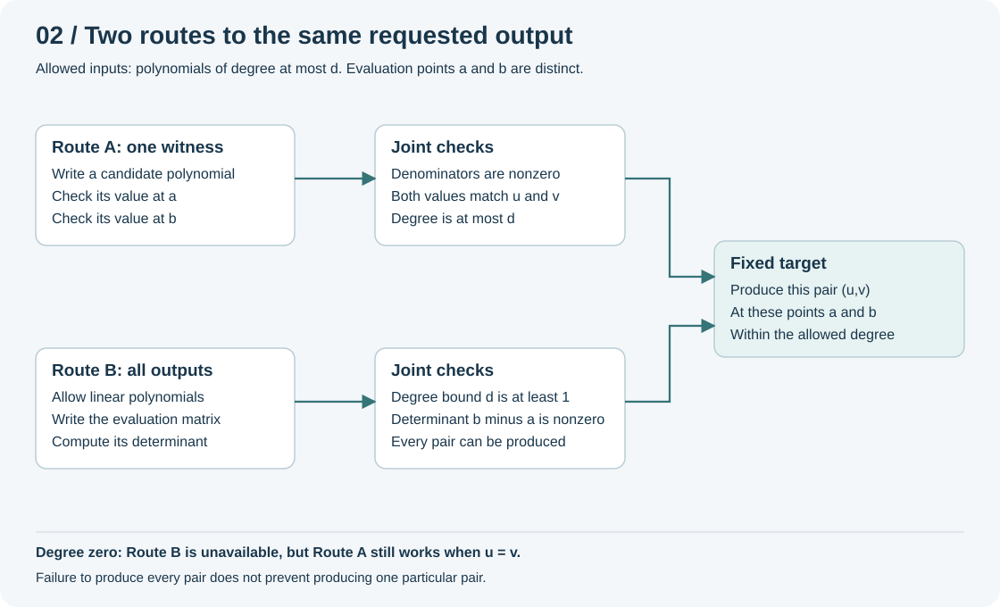
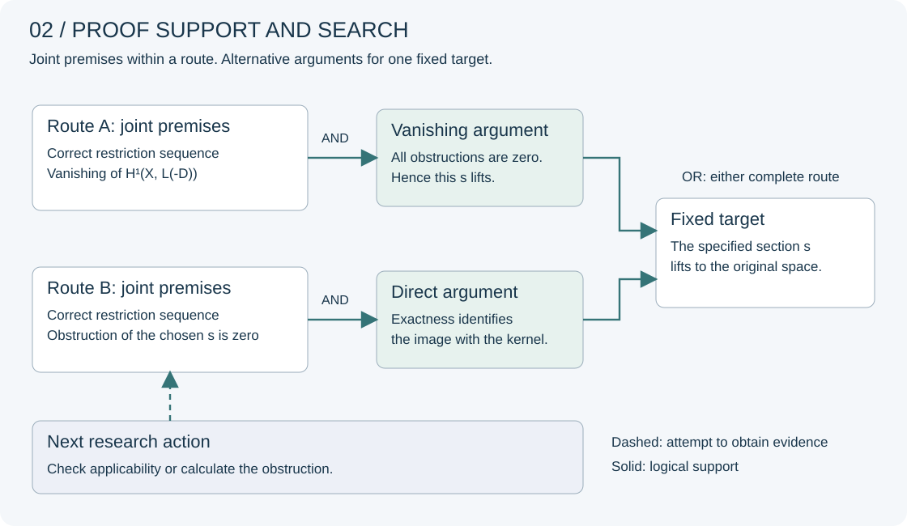

[English original](/posts/2026/08/agent-system/plan-and-execute/) · [中文课程总览](/posts/2026/12/Agent-System-zh/)

*实验指令、文件结构与可执行代码保留英文原文，可直接复制；正文用中文解释其目的与验收标准。*

规划意味着决定下一步要追求哪个缺失的数学理由。单独的任务列表并不能表达哪些结果实际上暗示了目标。本课程通过完整的插值问题来发展这种区别，然后将其转移到几何研究中。带来模块 1 中的命题和论证记录。

**学习成果：** 您应该能够证明分解的合理性，在不混淆充分必要条件的情况下比较路线，选择信息丰富的下一步行动，并在路线失败时保留有用的结果。使用完整推导的计算进行讲座，并使用四轮实验室进行单独的练习。

<a id="a-complete-example-before-the-architecture"></a>

## 架构之前的完整示例

回忆模块 1：常数 $c$ 生成 $(c,c)$ 对。现在我们问当我们允许使用线性多项式而不仅仅是常数时会发生什么变化。第一次阅读时，您可能会认为所有数字都是真实的；相同的计算适用于任何字段。 “原像”是产生所请求输出的输入，“满射”意味着可以产生所述目标空间中的每个输出。

令 $k$ 为一个字段，并令 $a,b\in k$ 不同。给定 $u,v\in k$，求次数最多为 $d$ 的多项式 $f$ 满足

$$f(a)=u,\qquad f(b)=v.$$

数值、评价点、度约束都属于目标。匹配值但超出允许程度的公式并不能解决问题。

<a id="first-route-construct-and-check-a-witness"></a>

### 第一条路线：构造并检查见证

对于 $d\ge1$，考虑

$$f(t)=u\frac{t-b}{a-b}+v\frac{t-a}{b-a}.$$

分母非零，因为 $a\ne b$。在 $t=a$ 中，第一个分数为 1，第二项为零，因此为 $f(a)=u$。在 $t=b$ 中，第一项为零，第二个分数为 1，因此为 $f(b)=v$。每个被加数最多有一个度数。因此见证满足度数约束。

这给出了三个显式的待解决事项：表达式已定义，它具有所需的值，并且具有允许的程度。仅当包括这些检查时，“构造插值多项式”才成为证明计划。

<a id="second-route-solve-a-linear-system"></a>

### 第二条路线：求解线性系统

写入 $f(t)=c_0+c_1t$。评估方程变为

$$\begin{pmatrix}1&a\\1&b\end{pmatrix}
\begin{pmatrix}c_0\\c_1\end{pmatrix}
=\begin{pmatrix}u\\v\end{pmatrix}.$$

行列式是 $b-a\ne0$。该矩阵是可逆的，因此每对值都有一个原像。对于更大的度数界，这种最多一度的解决方案仍然可用。

这个论证证明的不仅仅是一对的存在性：评估图是满射的。当后续任务需要许多对时，它的额外通用性可能会很有用。如果只有一对重要，则显式见证可能是较短的路线。

<a id="a-boundary-case-changes-the-decision"></a>

### 边界情况改变决定

对于 $d=0$，每个允许的多项式都是常数。当 $u=v$ 时，正好存在一个解。 $(1,1)$、提升和 $(1,0)$ 对则没有。所有 $k^2$ 上的满射性都是假的，但某些指定的对仍然具有原像。

这种边界情况是规划的教训：更强路线的失败并不意味着所选目标的失败。这正是模块 1 的规则 $r(c)=(c,c)$。几何解释是可选的。

<a id="work-backward-then-verify-forward"></a>

##  向后工作，然后向前验证

逆向推理询问什么对于目标来说就足够了。前向检查询问所提出的充分条件是否确实成立。完整的分解需要两者。

例如，为了显示 $[0,1]$ 上的连续实值函数达到最大值，规划者可能会提出极值定理。生成的待解决事项包括连续性、实值性和非空紧致域。 来源定理仅在其假设得到检验后才提供结论。

如果域变为$(0,1)$，则紧致性路由不再适用。仅此一点并不能说明特定函数是否达到最大值：常零函数可以达到最大值，而 $f(x)=x$ 则不能。

在安排子任务之前，问： **如果列出的每个子任务都成功，原来的目标会遵循吗？** 如果需要额外的定理或转移论证，它属于计划。

Lean 的官方 [ 战术教程](https://lean-lang.org/theorem_proving_in_lean4/Tactics/) 说明了定理应用如何创建剩余目标。我们的非形式化计划使用类似的区别，但仍然需要数学审查； Markdown 目标列表不是内核检查的证明。

<a id="two-routes-to-one-specified-output"></a>

## 到一个指定输出的两条路由

保持目标固定：通过评估不同点 $a,b$ 处允许的多项式来生成请求的对 $(u,v)$。

| 路线 | 必须一起检查的内容 | 结果 |
|---|---|---|
| 直接见证 | 公式定义；两个值匹配；允许度数 | 生成此请求对 |
| 一般可解性 | 度数界允许线性多项式；评估矩阵是可逆的 | 每对都可以产生，包括这一对 |

对于零度，一般路线会失败，因为常数不能产生每一对。对于使用常量 $1$ 的 $(1,1)$，直接路由仍然成功。这就是为什么更强的路由失败不能被视为指定目标的失败。

[](/images/agent-system-zh/course-elementary-routes.svg)

两条路线以同一问题结束。每条路线都需要进行自己的所有检查；完成来自不相关目标的检查并不能提供证据。

<details markdown="1">
<summary>高级连接：几何形状上的相同规划区别</summary>

<a id="optional-geometry-two-routes-to-a-section-lift"></a>

### 可选几何形状：两条路线至一个section 提升

对于 line bundle $L$ 和effective Cartier divisor $D$，限制序列给出连接图 $\delta$。 exactness 表示指定 section $s$ 提升正好是 $\delta(s)=0$。

| 路线 | 一起需要的前提 | 结论 |
|---|---|---|
| 消失 | 正确的限制序列； $H^1(X,L(-D))=0$ | $D$ 提升 |
| 上的每个 section 直接阻塞 | 正确的限制序列； $\delta(s)=0$ | section $s$ 提升 |

每行内的前提都有联合要求。行之间有用于证明 $s$ 提升的替代方法。 消失路由失败，直达路由可用；它并不否认可举升性。

对于射影线上的两点示例，直接计算可区分 (1,1) 和 (1,0)。仅仅说“申请消失”的计划并没有完成这项工作。

[](/images/agent-system-zh/course-proof-routes.svg)

* 实线箭头表示所有输入可用后对齐的推理。虚线箭头是对研究工作的请求：它产生候选结果，而不是自动支持结论。两条路由必须涉及相同的目标版本。*

</details>

<a id="the-dependency-rule"></a>

## 依赖规则

当至少一个合理的论证的所有前提都得到支持或明确假设时，结论就得到支持。如果 $P\Rightarrow Q$ 和 $Q\Rightarrow P$，则 $P$ 和 $Q$ 都没有起点。重复执行不会添加逻辑前提。

对于索引的论证，有限依赖跟踪不是归纳的证明。假设 $B_0$ 成立，并且对于每个 $n\ge1$，可以证明以下蕴涵：

$$B_{n-1}\Rightarrow A_n,\qquad A_n\Rightarrow B_n.$$

然后是依赖项纳入的顺序

$$B_0,\ A_1,\ B_1,\ A_2,\ B_2,\ldots.$$

通用蕴涵和基本案例证明了归纳的合理性。检查有限的实例列表并不能取代待解决事项。

<a id="choose-an-action-that-can-change-the-assessment"></a>

## 选择可以更改评估的操作

假设插值任务省略了次数界。寻找更复杂的定理还为时过早：确定允许的程度将普遍可解的问题与具有兼容性条件的问题区分开来。

| 行动 | 它可以产生的证据 | 它影响的决策 |
|---|---|---|
| 澄清程度界 | 精确目标规范 | 是否允许线性插值 |
| 代入建议的多项式 | 其值的验证或失败 | 见证是否有效|
| 检查其程度 | 与目标的兼容性 | 见证是否解决了实际任务 |
| 计算行列式 | 评价的满射性 | 是否每对都可解 |
| 测试零度情况 | 必要的兼容性条件 | 是否有一般断言 overstated |

目的不是为每个动作分配虚构的概率。说明不确定性、行动、合理预算以及其可能的结果将如何改变计划。简短的决定性计算可能比另一次广泛的搜索更有用。

对于研究问题，信息性操作可能会检查消失定理的确切正性假设，证明最难引理的限制版本，或测试可能打破一致估计的族。来自特殊情况的实证证据并不能证明一般定理，但可以揭示一般证明所需的机制。

<a id="distinguish-rejection-uncertainty-and-exhaustion"></a>

## 区分拒绝、不确定性和疲惫

一个反例可以反驳所提出的衔接论证。未经验证的来源假设留下了一个未解决的适用性问题。超时记录操作失败。这些结果需要不同的后续步骤。

在插值问题中，具有不等值的零度给出完全否定的答案。在提升问题中，无法验证消失定理导致该路线无法解决。中断的计算根本无法提供任何数学结论。

重新计划时保留有用的结果。如果候选多项式具有正确的值但次数过多，则保留插值恒等式作为不同次数界的结果。不要将其作为原始任务的解决方案来呈现。如果来源检查失败，请保留不依赖于失败应用程序的任何有效定义和精确序列计算。

当决定性必要条件不满足时，停止分支。当商定的预算用完时，停止有界实验并导出剩余的缺口。仅用论证来声明原始任务完成，以获得其确切结论或有效反驳。范围明确的部分结果很有价值，无需重命名为完整解决方案。

<a id="laboratory-four-rounds-in-codex"></a>

## 实验室：Codex 进行四轮

在给出纠正提示之前保存初始响应。这些提示指定了实验；它们不是成功跑步的记录。

<a id="round-1-compare-real-routes"></a>

### 第1轮：比较真实路线

```text
For distinct a,b in a field k, find a polynomial of degree at most d
with prescribed values u,v at a,b. Compare an explicit witness with
a linear-system argument. State each prerequisite and check every step.
Treat degree zero separately. Keep the same target across both routes.
```

**Inspect:** 上述两个推导提供了参考答案。助理必须检查分母、评价和度数；没有这些检查的正确公式是不完整的提交。

<a id="round-2-expose-a-false-inference"></a>

### 第2轮：揭露虚假推理

```text
A proposed argument says: the space of constants and k² are both nonzero,
therefore evaluation from constants to k² is surjective.
Locate the failed inference and compute the actual image.
Test the pairs (1,1) and (1,0), without changing the allowed degree.
```

**检查：**图像是对角线。突然允许一次多项式的修正改变了任务。将原来的故障和修复的部分分开保存。

<a id="round-3-test-grounding"></a>

### 第3轮：测试接地

```text
We have valid implications A implies B and B implies A, but neither
antecedent is established. Report what follows.
Add an independent proof of A as stipulated evidence, then withdraw it.
Explain each change without claiming the stipulated proof was checked.
```

**Inspect：** 最初仅蕴涵可用。独立的支持允许这两个结论；它的退出使循环没有起点。多个批准报告并不能提供这一点。

<a id="round-4-attempt-a-bounded-research-plan"></a>

### 第4轮：尝试有界研究计划

选择您所在领域的一个定理应用并提供其实际的来源。允许三种实质性行动，例如假设审核、边界计算和引理尝试。每次操作后，记录数学上发生的变化以及保持开放的内容。不要将重新措辞计划视为另一个既定结果。

提交实际的论证或计算，而不仅仅是完成操作的摘要。这一轮没有承诺的积极结果：精确诊断的阻塞可能是最有用的结果。

<a id="exercises-and-worked-answers"></a>

## 练习和参考解答

<details markdown="1">
<summary>1。计算已完成的子任务是否可以衡量进度？</summary>

一条路线需要 P 和 Q。P 已被证明，助手报告已完成 50%。该评估缺少什么？

**解答.** Q 可以基本上包含整个研究难度。该计划还需要从 P 和 Q 到目标的合理蕴涵。计数可以记录为操作信息，但它不能测量到证明的数学距离。报告确切的剩余obstruction。

</details>

<details markdown="1">
<summary>2。当评估点重合时会发生什么变化？</summary>

在插补任务中设置$a=b$。分析相等和不相等的规定值。

**解答.** 如果 $u\ne v$，同一输入不能同时具有两个值，因此没有函数满足要求。如果是 $u=v$，只要允许常量，常量 $u$ 就起作用。早期的公式是未定义的，因为它的分母消失了；等值情况下的真实结论并不能修复该公式。

</details>

<details markdown="1">
<summary>3。满射性失败能否解决指定的提升任务？</summary>

**解答.** 否。固有图像仍可能包含指定元素。对角图像包含 $(1,1)$，不包括 $(1,0)$。正确的下一个问题是所选对的成员资格，除非其他论证已经决定了。

</details>

<details markdown="1">
<summary>4。哪个归纳形态有起点？</summary>

将 $B_{n-1}$ 中的 $A_n$ 和 $A_n$ 中的 $B_n$ 与 $B_n$ 中的 $A_n$ 和 $A_n$ 中的 $B_n$ 进行比较。假设$B_0$成立。

**解答.** 第一个模式支持顺序 $B_0,A_1,B_1,A_2,B_2,\ldots$，只要证明了一般的蕴涵。在第二种模式中，$B_0$ 没有为 $A_1$ 和 $B_1$ 的相互依赖提供起点。称其为归纳并不成立。

</details>

<details markdown="1">
<summary>5。设计用于一致估计的探头 </summary>

每个对象都有单独的界，并且整个系列需要一个界。下一步有用的行动可以建立什么？

**答案指南。** 检查常数的依赖性，寻找迫使它们生长的家族，或证明对精确限制的亚家族的一致估计。一个反例可以拒绝所提出的一般衔接论证。有限的许多例子并不能证明整个家族的一致性。准确说明调查改变了哪些评估。

</details>

<a id="assessment-and-design-limits"></a>

## 评估和设计限制

提交两次插值论证、无效推理诊断、循环实验和有界研究行动日志。最有力的意见解释了为什么选择一项行动、其实际证据证实了什么，以及为什么下一个计划发生了变化。

不要将每个算术运算变成一项管理任务。 当一个 proof obligation 具有可单独检查的命题、可复用的结果、不同证据来源，或值得独立尝试时，再将其拆开。 过度分解会增加维护成本，并可能在许多已完成的简单任务背后隐藏停滞的硬引理。

本章中的数学例子有推导。会话协议是一个设计方案，其行为必须经过测试。参考答案中的正确数学并不能证明助手可靠地遵循协议。

<a id="continue-with-the-research-record"></a>

## 继续研究记录

同时使用 (1,1) 和 (1,0)。然后删除一条路线的证据并询问还剩下哪些替代方案。单独测试循环 P/Q 示例。提交实际计划、行动和修改情况；与数学参考进行比较，而不是接受自信的完成标签。

---

[课程路线图](/posts/2026/12/Agent-System-zh/)·[直接实验](/posts/2026/08/agent-system-zh/hands-on-lab/)·[下一模块](/posts/2026/08/agent-system-zh/knowledge-retrieval/)
