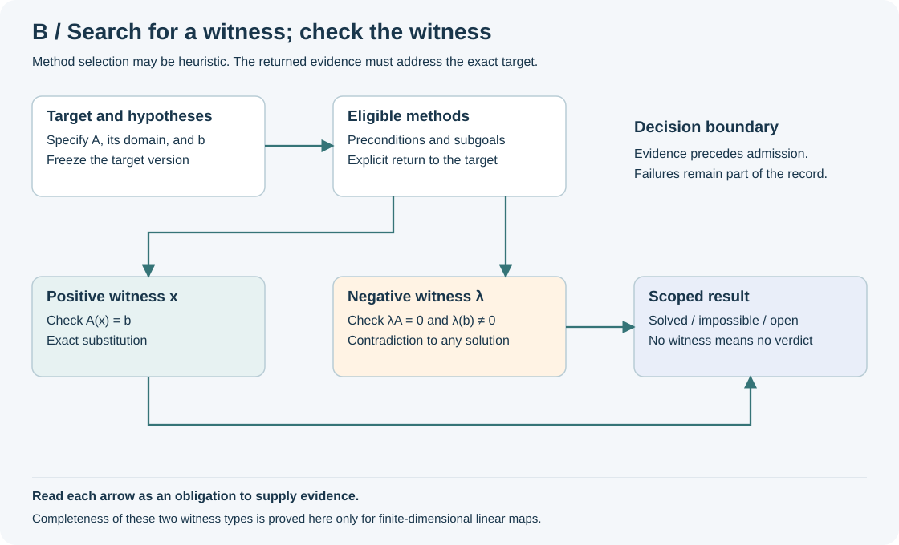

[English original](/posts/2026/08/agent-system/proof-sketch-system/) · [中文课程总览](/posts/2026/12/Agent-System-zh/)

*实验指令、文件结构与可执行代码保留英文原文，可直接复制；正文用中文解释其目的与验收标准。*

有用的方法推荐，最终必须落实到一次数学论证的实际尝试。本项目要求 Codex 比较不同路线，识别决定成败的 proof obligations，并真正着手处理其中一个。无需先编写编排软件。

**阅读路线：**从下面的工作坊开始进行高级设计；使用[首先了解没有几何形状的方法选择问题](#first-understand-the-method-selection-problem-without-geometry)作为需要时的具体校准。在对照案例之后完成研究作业。

<a id="research-workshop-b-search-for-proofs-that-carry-checkable-evidence"></a>

## 研究工作坊 B：搜索带有可检查证据的证据

**预备知识：**模块 2–6、线性代数；几何扩展还使用 sheaf cohomology。**提交成果：**两种适用方法的搜索记录、一个明确的成功 witness 或 obstruction，以及说明证据究竟解决了什么的审查。后面的入门例子例子介绍基本想法，本节解释一般机制。

<a id="1-the-result-of-a-method-is-more-than-a-proposed-verdict"></a>

### 1. 方法的结果不仅仅是提出的结论

设 $A:V\to W$ 是 field k 上有限维向量空间之间的线性映射。给定 $b\in W$，任务是求解 $Ax=b$。有两类值得寻找的证据：

- **Positive witness：**给出 x，并精确检查 $Ax=b$。
- **Negative witness：**给出 $\lambda\in W^*$，检查 $\lambda\circ A=0$ 且 $\lambda(b)\ne0$。

negative witness 直接证明无解：若 $Ax=b$，则 $\lambda(b)=\lambda(Ax)=0$，与其非零性矛盾。这是有完整依据的反驳，不是“没有找到 x”而已。

当 b 不在 image 中时，为什么一定存在这样的 negative witness？先选取 image 的一组基，加入 b，再扩充成 W 的基。定义线性泛函 λ：在 image 的基向量上取零，在 b 上取一，其余基向量上也取零。因此，在有限维情形，这两类 witness 覆盖了全部情况。

适用范围不可省略。对于无限维拓扑向量空间之间的映射，还需考虑 linear functional 是否连续、image 是否闭。不能把这里的有限维论证直接当作任意函数空间上的定理。

<a id="2-an-exact-obstruction-can-guide-the-search"></a>

### 2. 精确的obstruction可以指导搜索

对实数上的映射 $A(x,y)=(x+y,x-y,2x)$，取 $\lambda(a,b,c)=c-a-b$，则 $\lambda\circ A=0$。目标 $(3,1,5)$ 的 obstruction 等于一，所以无解；目标 $(3,1,4)$ 的 obstruction 等于零，并且有正向 witness $(2,1)$。

本例中，λ 的 kernel 恰好等于 的 image，因为显式解证明了充分性。一般而言，找到一个在 image 上为零的 functional，只给出一个必要条件。要得到完整的 solvability criterion，全部条件必须精确刻画 image。一个有用的 obstruction，不一定就是完整判据。

系统应返回见证及其验证论证，而不仅仅是“可解决”一词。对于近似数值计算，请指定范数、容差和误差估计。一个小的残差可以指导猜想，但它本身并不能产生精确的解或形式化证明。

<a id="3-the-geometric-version-compute-the-actual-obstruction"></a>

### 3. 几何版本：计算实际的 obstruction

设 $X=\mathbb P^1_k$，D 是 $m\geq1$ 个互异 k-rational points 的和，$L=\mathcal O_X(d)$，其中 $d\geq0$。把这些点放在同一 affine chart 中，并选取相容的 fiber trivializations。global sections 此时对应次数不超过 d 的多项式，restriction 就是在这些点求值。

标准上同调计算给出

$$
\begin{aligned}
h^0(\mathcal O_X(n))&=\max(n+1,0),\\
h^1(\mathcal O_X(n))&=\max(-n-1,0).
\end{aligned}
$$

这些公式是 [Stacks Project, Lemma 30.8.1](https://stacks.math.columbia.edu/tag/01XS) 在 projective line 上的特殊情形。restriction sequence 的 kernel sheaf 是 $\mathcal O_X(d-m)$。因为 $H^1(\mathcal O_X(d))=0$，long exact sequence 将 evaluation map 的 cokernel 识别为 $H^1(\mathcal O_X(d-m))$。所以

$$
\dim\operatorname{coker}(r)=\max(m-d-1,0).
$$

所有目标值组都能 lift，当且仅当 $d\geq m-1$。低于这个阈值时，某个指定值组仍可能 lift；它在 cokernel 中的 class 才是精确的 obstruction。

在 $\mathbb R$ 上取三个 affine points $0,1,2$，并设 $d=1$。写出 $f(t)=u+vt$，则它的取值满足

$$
f(2)-2f(1)+f(0)=0.
$$

因此，$(a,b,c)$ 可 lift 当且仅当 $c-2b+a=0$；反向只需取 $u=a$、$v=b-a$。在相同几何假设下，$(0,1,2)$ 是可解的正面对照，$(0,1,3)$ 是不可解的负面对照。这里 obstruction space 为一维，上述表达式在选定识别后给出它的一个非零线性坐标。

这是定理应用、exact sequence 和显式计算之间的完整衔接论证。在更难的研究问题中，计算类似的障碍可能是中心研究任务而不是常规阶段。

<a id="4-architecture-for-method-selection"></a>

### 4. 方法选择的架构

[](/images/agent-system-zh/advanced-proof-search.svg)

method record 包含适用条件、生成的子目标、返回原目标的 implication、预期证据与停止条件。只有条件已经成立，或被明确保留为假设时，该方法才具备使用资格。随后根据仍需完成的工作比较方法；相关性本身不等于适用性。

选定路线后，区分构造证据与检查证据。是否使用不同执行单元可以灵活决定，但检查接口不能省略：对 positive witness 做代入；对 negative witness 检查 annihilation 与 nonzero pairing。方法超时只留下未解决任务，不能当成 negative witness。

<a id="5-build-and-defend-the-system-in-codex"></a>

### 5. Codex中系统的构建与维护

创建 `TARGET.md`、`METHODS.md`、`WITNESSES.md` 和 `CHECKS.md`。先重现有限维论证与两个三点对照，再改变 degree bound 或 evaluation points，重新检查适用性。最后换成自己研究中依赖文献的引理，实际尝试其决定性子目标。

答辩应展示：一个成功 witness、一个精确 obstruction、一个因假设不满足而被排除的方法，以及一个尚未完成的研究衔接步骤。说明哪些判断是 informal 的，哪些确实经过软件检查。仅列出似乎可行的方法，不算完成本工作坊。

<a id="first-understand-the-method-selection-problem-without-geometry"></a>

## 首先理解没有几何的方法选择问题

模块 1 使用一个输入 $c$ 来生成 $(c,c)$。这是一个更难的对照案例，具有两个未知数和三个输出条件。让

$$
A(x,y)=(x+y,\ x-y,\ 2x).
$$

对于指定的输出$(a,b,c)$，判断是否存在输入。 “找到一个方法”不是提交成果：我们需要一个适用的方法和一个计算来解决这个输出。

<a id="route-1-solve-for-the-input-then-check-the-unused-condition"></a>

### 路线1：求解输入，然后检查未使用的条件

前两个方程给出 $x=(a+b)/2$ 和 $y=(a-b)/2$。将这些值代入第三个方程。它的左侧变为 $2x=a+b$，因此当 $c=a+b$ 时第三个要求恰好成立。

这就证明了必要性和充分性：

$$
(a,b,c)\text{ is obtainable}\quad\Longleftrightarrow\quad c=a+b.
$$

单独的必要性会拒绝不兼容的输出，但不会为兼容的输出构建解决方案。充分性由 $x$ 和 $y$ 的显式公式提供，并检查所有三个方程。

<a id="route-2-identify-an-obstruction-before-solving"></a>

### 路线 2：在解决之前识别obstruction

自 $(x+y)+(x-y)=2x$ 起，$A$ 的每个输出都满足“第三个条目等于第一个条目加第二个条目”。将建议输出的障碍定义为

$$
o(a,b,c)=c-a-b.
$$

如果该数字不为零，则不可能输出并且没有理由搜索输入。如果为零，则路线 1 中的公式确定这是唯一的obstruction。阻塞测试是准确的，因为我们证明了相反的情况；定义一个必须消失的量并不能单独证明测试的完整性。

对于 $(3,1,4)$，obstruction为零。输入 $(2,1)$ 有效，因为直接替换给出 $(3,1,4)$。对于 $(3,1,5)$，obstruction是 1，因此没有输入起作用。更改最终条目后重新使用 $(2,1)$ 将解决旧任务，而不是新任务。

<a id="what-the-two-method-cards-should-contain"></a>

###  两种方法卡应包含什么内容

| 方法 | 果断工作 | 选择它的最佳理由 | 它不能跳过什么 |
|---|---|---|---|
| 构建候选| 求解前两个方程 | 需要具体的见证 | 检查第三个方程 |
| 测试兼容性 | 评估$c-a-b$ | 许多提议的输出需要快速拒绝 | 在要求精确标准之前证明零阻塞就足够了 |

这些路线共享数学。不要将它们宣传为统计上独立的证据。它们的价值在于它们暴露了不同的故障点，并且可以被选择用于不同的即时任务。

请 Codex 首先使用此示例创建以下四个文件。将其指定为 $(3,1,4)$，然后仅将第三个条目修改为五个。要求它保留旧的见证，重新计算其输出，并将候选失败与不可能证明区分开来。这些是参考结果，而不是测量的 Codex 运行的记录。

<a id="from-this-calculation-to-the-geometric-project"></a>

### 从此计算到几何工程

在下一个任务中，global section 扮演输入角色，限制扮演$A$ 角色，指定 section 扮演$(a,b,c)$ 角色。连接同态提供了障碍。先进的工作正在证明这种机制适用于给定的几何对象；逻辑结构是刚刚导出的。

**几何扩展的先决条件：** line bundle，effective Cartier divisor，以及短 exact sequence 的上同调序列。如果这些不熟悉，请完成线性示例并使用模块 3-5 来设计审查其方法卡。

<a id="the-controlled-mathematical-task"></a>

## 受控数学任务

设 X 为projective variety，L 为 line bundle，D 为effective Cartier divisor，L 的指定 section 仅限于 D。确定该特定 s 提升是否为 L 的 global section。从 exact sequence 开始工作

$$0\to L(-D)\to L\to L|_D\to0.$$

连接映射给出了精确的标准：s 提升当且仅当其在连接同态下的图像为零。整个基团 H1(X,L(-D)) 的消失是足够的，但对于该指定 section 不是必需的。

因此，有两条完全不同的路线：证明充分的消失定理，或计算 s 的阻碍。在没有检查其假设的情况下推荐消失并不是方法选择的成功。

<a id="build-the-workspace-in-codex"></a>

## 在Codex中构建工作区

```text
Create TARGET.md, METHODS.md, ATTEMPTS.md, and REVIEW.md.
Record X, L, D, and the specified section s exactly.
Compare two routes: sufficient cohomology vanishing and direct obstruction.
For each route list prerequisites, applicable source results, and missing steps.
Do not change 'this section lifts' into 'some section lifts'.
Choose one decisive mathematical calculation and carry it out in ATTEMPTS.md.
Keep failed attempts and distinguish supplied facts from checked arguments.
```

这套小型架构承担四项职责：保留目标、比较适用方法、尝试关键衔接步骤，以及审查结果。文件使这些责任可以检查；指令本身并不能强制执行。

<a id="a-worked-case-with-a-decisive-answer"></a>

## 完整推导的案例有决定性的答案

取 X 为域 k 上的射影线，L 为平凡丛，D 为两个不同的 k 有理点之和。识别 D 上的 section 与 k² 中的对。 L 的 global section 是常数，因此限制将 c 发送到 (c,c)。

因此 (1,1) 提升和 (1,0) 不会。两者具有相同的环境几何数据。仅查看品种 line bundle 或广泛方法标签的策略无法区分它们。直接限制计算即可。

```text
Carry out the two-point calculation from the stated definitions.
Explain why all global sections of the trivial bundle on the projective line
are constants, citing or supplying the needed justification.
Compute the restriction image and test both sections separately.
Then explain why failure of a sufficient vanishing condition alone would
not prove that either specified section fails to lift.
```

上面的数学答案是参考计算。 Codex 运行已经重现了它，这不是断言。保存实际响应并检查其推理。

<a id="move-from-the-control-to-research"></a>

## 从对照案例移动到研究

在您理解的证明中选择提升步骤。提供实际的命题和来源摘录。需要消失路线的适用性表和直接路线的明确障碍目标。尝试在您的预算范围内尝试最能改变评估结果的未解决步骤。

拒绝将其主要困难隐藏在“标准论证”中的证明计划。当条件计划的缺失引理准确并且返回目标的蕴涵是合理的时，条件计划仍然有用。

<a id="evaluation-and-submission"></a>

## E评估并提交

测试两个 section，然后更改目标版本并呈现旧的审查。检查助手是否保留了指定 section 并且没有重复使用不相关的判决。与使用相同证据和时间预算提出证明方法的普通请求进行比较。

提交确切的目标、两种方法卡、完整的尝试计算、审查结果以及剩余的待解决事项。没有尝试衔接论证的说服性方法列表不会通过。

[构建基础工作区](/posts/2026/08/agent-system-zh/codex-research-studio/) · [课程路线图](/posts/2026/12/Agent-System-zh/)
