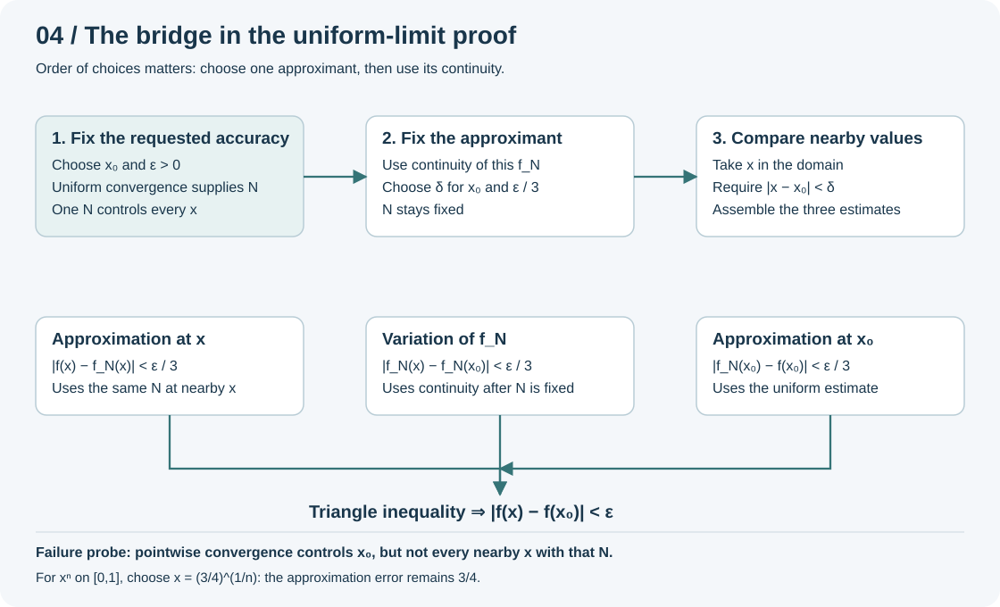

[English original](/posts/2026/08/agent-system/reasoning/) · [中文课程总览](/posts/2026/12/Agent-System-zh/)

*实验指令、文件结构与可执行代码保留英文原文，可直接复制；正文用中文解释其目的与验收标准。*

只有解决新问题能够推进原问题，reduction 才有价值。数学研究的难点常在返回原问题的论证：passing to a limit、从模型下降、移除辅助假设，或恢复 uniformity。本模块要求先把这一步写清楚并检验，再大规模求解较容易的子问题。

**学习目标：**区分等价变换与单向 implication；追踪各项选择的依赖；证明返回原问题的 implication；当这一衔接失败时，保留仍有效的部分结果。主例来自实分析，最后再连接几何研究。

<a id="1-write-the-return-argument-before-delegating-the-new-task"></a>

## 1. 在委派新任务之前写入返回论证

设 T 为原目标，R 为拟议的替代问题。若已证明 R 蕴含 T，解决 R 就足够。若只知道 T 蕴含 R，那么 R 只是必要条件：R 不成立可以否定 T，但 R 成立未必能确立 T。两个方向都成立，才是等价变换。

对规则 $r(c)=(c,c)$，指定 $(a,b)$ 可实现，当且仅当 $a=b$。若存在输入，两坐标都等于该输入；反过来，若相等，取 $c=a$ 即可。这两个论证分别证明了 reduction 的两个方向。

要求可以生成 **每个** 对将是更强的和错误的。该故障不会阻止特定对 $(1,1)$ 的生产。转换后的任务可能比原来的需求更多。

一个好的系统可以存储新的待解决事项及其与原始版本的关系。 “尝试更强的一般定理”是一种研究行为。 “该定理暗示了这些假设下的目标”是数学依赖性。将它们分开可以让系统在不改变已证明的情况下改变其计划。

<details markdown="1">
<summary>高级连接：阻碍提升一段</summary>

在几何解释中，所需的输出是指定 section $s$，输入是限制为 global section。对于有效的限制 exact sequence，exactness 给出 $s$ 可提升当且仅当 $\delta(s)=0$ 时。整个障碍空间的消失是更强的充分条件。未能证明空间消失并不能证明特定obstruction不为零。请参阅模块 1 的可选几何对象和假设。
</details>

<a id="2-full-example-approximating-a-continuous-function"></a>

## 2. 完整示例：逼近连续函数

假设 $f_n:[0,1]\to\mathbb R$ 是连续的并且收敛到函数 $f$。我们要证明 $f$ 是连续的。这是一个现实的模式：构造更简单的近似值，在那里建立性质，然后传递到极限。

“收敛”这个词隐藏了决定性的假设。逐点收敛意味着对于每个 $x$ 和每个 $\varepsilon>0$，可以根据 $x$ 和 $\varepsilon$ 选择阈值：

$$
\begin{gathered}
\forall x\;\forall\varepsilon>0\;\exists N\;\forall n\geq N:\\
|f_n(x)-f(x)|<\varepsilon.
\end{gathered}
$$

一致收敛在选择 $x$ 之前设置相同的阈值：

$$
\begin{gathered}
\forall\varepsilon>0\;\exists N\;\forall x\;\forall n\geq N:\\
|f_n(x)-f(x)|<\varepsilon.
\end{gathered}
$$

两个公式中，x 都取自 [0,1]，n 和 N 都是自然数。区别在于 N 能否依赖 x。明确写出这一依赖，比只说 uniform convergence “更强”更有用。

<a id="3-the-return-bridge-under-uniform-convergence"></a>

## 3. 一致收敛下的返回原问题的论证

固定 $x_0\in[0,1]$ 及 $\varepsilon>0$。由 uniform convergence，可选同一个 N，使每个 $x\in[0,1]$ 都满足

$$
|f_N(x)-f(x)|<\varepsilon/3.
$$

固定 N 后，函数 $f_N$ 在 $x_0$ 连续，所以存在 $\delta>0$，使定义域内满足 $\vert x-x_0\vert<\delta$ 的 x 都有

$$
|f_N(x)-f_N(x_0)|<\varepsilon/3.
$$

三角不等式现在给出

$$
\begin{aligned}
|f(x)-f(x_0)|
&\leq |f(x)-f_N(x)|\\
&\quad+|f_N(x)-f_N(x_0)|\\
&\quad+|f_N(x_0)-f(x_0)|\\
&<\varepsilon.
\end{aligned}
$$

这证明了 $x_0$ 的连续性，包括端点处适当的相对拓扑解释。由于 $x_0$ 是任意的，因此 $f$ 是连续的。

注意，证明并不需要所有函数共享一个 continuity modulus。我们先选 N，再使用这一个函数的连续性。若要求先证明 equicontinuity，就引入了比当前证明更强的待证条件。选择顺序告诉我们哪些工作真正必要。

[](/images/agent-system-zh/course-return-bridge.svg)

该图的箭头记录了证明所使用的选择和估计。底部警告标识了较弱收敛假设停止提供所需证据的确切位置。

<a id="4-a-failed-bridge-with-useful-surviving-results"></a>

## 4. 失败的衔接论证，但留下了有用的结果

取正整数 n，令 $f_n(x)=x^n$。每个函数在 [0,1] 上连续。对 $0\leq x<1$，其值趋于零；在 x=1 处，其值恒为一。因此 pointwise limit 是

$$
f(x)=\begin{cases}0,&0\leq x<1,\\1,&x=1.\end{cases}
$$

极限在 1 处不连续。例如 $x_j=1-1/j$ 趋于 1，但这些点上的函数值为零，而 $f(1)=1$。

收敛不是一致。对于每个 $n\geq1$，选择 $x_n=(3/4)^{1/n}<1$。那时，

$$
|f_n(x_n)-f(x_n)|=3/4.
$$

因此，没有一个阈值可以使整个域中的所有错误都小于 $1/2$。这是针对所需一致估计的直接见证，而不仅仅是对极限不连续性的上诉。

哪些结果仍可使用？近似函数连续，pointwise limit 已被识别，而且对每个固定的 a<1，在 [0,a] 上都有 uniform convergence，因为 $0\leq x^n\leq a^n$。这些都是有效的部分结果，却没有解决整个 [0,1] 上的连续性目标。若改目标，必须明确记录新定义域。

<a id="5-a-transformation-record-you-can-actually-use"></a>

## 5. 您可以实际使用的转换记录

| 字段 | 极限例子中的内容 |
|---|---|
| 目标 | f 在指定定义域上连续 |
| 替代任务 | 构造连续近似，并证明 uniform convergence |
| 返回原问题的论证 | 上面的三项误差估计 |
| 选择的依赖 | N 依赖 ε；δ 依赖已固定的 N、x₀、ε |
| 仍需提供的证据 | 实际成立的 uniform error bound |
| 失败测试 | $x^n$ 在 1 附近的行为 |
| 保留下来的路线 | 对每个固定 a<1，在 [0,a] 上 uniform convergence |

记录很短，因为证据本身存在其他地方。其目的是防止系统仅仅因为两者使用相同的名词而报告近似问题解决了原始问题。

对于几何变换，用具体映射替换近似过程，例如 birational morphism、finite cover、restriction 或 deformation。写明两边的对象，再陈述所需 transfer theorem。pullback divisor 的性质与新模型的 canonical divisor 的性质不同；辅助构造只有在与目标的关系得到证明时才有用。

<a id="6-build-and-stress-test-the-workflow-in-codex"></a>

## 6. 在 Codex 中构建工作流程并进行压力测试

创建 `TARGET.md`、`TRANSFORMATIONS.md` 和 `ARGUMENTS.md`。为助手提供具有指定收敛假设的连续性目标。使用此指令：

```text
Propose at most two reductions of the exact target.
For each, write the transformed obligation and the implication back.
Track which choices may depend on which variables.
Prove the return implication or identify its first missing inference.
Before extending the construction, test that inference on a simple example.
Keep partial results separate from completion of the original target.
```

跑三轮。首先提供一致收敛性并要求充分证明。接下来用逐点收敛代替它，而不改变期望的结论。最后提供$x^n$并要求通过计算实际建立的最强结论。更正前保存每个响应。

审查助手是否识别出与参考证明相同的失败依赖项。仅仅说“需要一致”的响应是不完整的：它应该解释估计如何必须保持在 $N$ 之后选择的附近点，并为较弱的断言提供反例。

对于研究问题，请在 **一个** 衔接论证上使用相同的工作流程。询问什么证据可以解决小案子。如果简化假设一个与目标一样强的开放猜想，则该图并没有减少工作；它已经重新安置了它。标记该依赖关系并重新评估路线。

<a id="7-exercises-with-worked-answers"></a>

## 7. 使用完整推导的答案进行练习

<details markdown="1">
<summary>1。 一致连续极限是否需要收敛？</summary>

**解答.** 足够了，没有必要。在$[0,1]$上，定义$g_n(x)=\max(0,1-n^2\vert x-1/n\vert)$为$n\geq2$。每一个都是连续的。在 $0$ 处，它为零，并且在每个固定的 $x>0$ 处，其支撑最终位于 $x$ 的左侧，因此逐点极限为零。然而$g_n(1/n)=1$，阻止一致收敛。这与返回定理并不矛盾：充分条件不需要在每个成功的实例中都成立。
</details>

<details markdown="1">
<summary>2。局部均匀性是否解决了端点问题？</summary>

**解答.** 一致 $x^n$ 在每个 $[0,a]$ 上与 $a<1$ 的收敛证明了在低于 $1$ 的点处极限的连续性。它不提供 $1$ 的邻域估计。缺失的端点正是不连续发生的地方。 “对于每个较小的区间”不得压缩为“在整个区间”。
</details>

<details markdown="1">
<summary>3。哪个方向足以解决目标？</summary>

假设目标意味着数值不等式。助理确定了不平等并宣布成功。

**解答.** 仅检查了必要条件。系统需要该论证的逆向蕴涵来求解目标。违反必要条件就会阻碍目标的实现；满意的人可以帮助确定工作的优先顺序，但无法完成它。
</details>

<details markdown="1">
<summary>4。下一个研究预算该花在哪里？</summary>

近似构造已完成，但获得一致界的所有尝试都取决于相同的未知估计。

**解答.** 将估计值命名为决定性的衔接论证。在显式族上进行测试，检查常数是否依赖于近似指数，并寻找证明或失败的示例。在不解决估计的情况下产生更多近似值并不能消除障碍。
</details>

<a id="8-submission-and-design-judgment"></a>

## 8. 提交和设计评审

提交一份完整的返回证明、一份弱化的衔接论证的反例以及一份幸存的部分结果的记录。包括实际的实验轨迹。精心设计的系统可以使最难解决的蕴涵尽早可见，从而改变研究计划。即使未来的模型自动化围绕它的每个例行构建，这仍然很有价值。

---

[课程路线图](/posts/2026/12/Agent-System-zh/)·[直接实验](/posts/2026/08/agent-system-zh/hands-on-lab/)·[下一模块](/posts/2026/08/agent-system-zh/verification-gate/)
