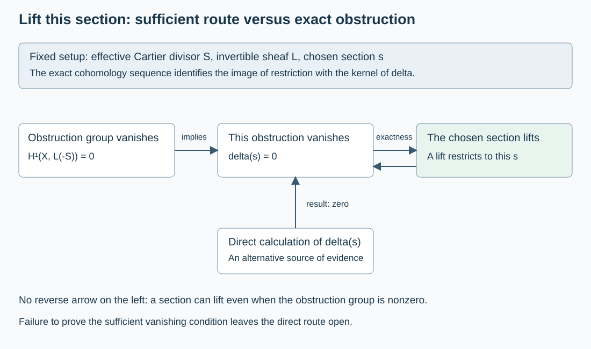

[English original](/posts/2026/08/agent-system/research-cases/) · [中文课程总览](/posts/2026/12/Agent-System-zh/)

本系列中的示例具有不同的工作。基本最大示例是缺失假设的基础检查。以下三种情况揭示了更深层次的架构要求：在对象之间传输结果、通过近似保留量词以及组织归纳。没有一个被作为新的研究定理提供。

## 情况 A. 产生指定的输出，而不仅仅是一些输出

从实数和规则 $r(c)=(c,c)$ 开始。选择 $c=1$ 会生成 $(1,1)$。它不会产生所请求的对 $(1,0)$。事实上，没有输入可以产生该对，因为每个输出都有相同的条目。

这区分了三个问题：是否存在输入，是否产生 $(1,1)$，以及是否产生 $(1,0)$？前两个答案是肯定的；第三个是不。用一个问题替代另一个问题的系统可以报告有效的计算作为错误目标的解决方案。

保存准确的输出规则、请求的对、候选输入以及实际与请求的输出的比较。模块 1 逐步完成此示例。下面的几何图形给出了具有相同结构的研究背景，并且在第一次阅读时是可选的。

高级连接：几何中的提升 指定 section

### A section 在较小的空间上无需扩展

令$X$为一个 scheme，令$S\subset X$为effective Cartierdivisor，并令$L$为$X$上的invertible sheaf。固定非零 section $s\in H^0(S,L\vert _S)$。研究任务是提升这个特殊的section到$X$。

$S$ 的理想序列，用 $L$ 张量，给出

$$
0\longrightarrow L(-S)\longrightarrow L\longrightarrow i_*(L|_S)\longrightarrow0.
$$

这里 $i:S\hookrightarrow X$ 是包含项。相关的上同调序列包含

$$
H^0(X,L)\longrightarrow H^0(S,L|_S)
\xrightarrow{\delta} H^1(X,L(-S)).
$$

exactness 表示 $s$ 提升正是 $\delta(s)=0$。更强的条件 $H^1(X,L(-S))=0$ 就足够了，但对于这个特定的 section 到提升来说不是必需的。 非零 section 中的任何提升均非零。

这种区别对于搜索很重要。规划者可以首先尝试消失定理。如果该路由失败，则应保留较弱的阻塞问题 $\delta(s)=0$ 作为替代方案。它不能仅仅因为消失的充分条件不可用而将提升问题标记为不可能。

* 这里的每个箭头都是固定设置下的数学蕴涵。左边蕴涵一般没有反面；两个向右箭头表示exactness.*

### 混凝土破坏校准案例

取 $X=\mathbb P^1$、$S=\lbrace p,q\rbrace $ 为两个不同点，以及 $L=\mathcal O_X$。 $X$ 上的 section 为常量； $S$ 上的 section 是一对标量。 限制将 $c$ 发送到 $(c,c)$。因此，$(1,0)$ 不是提升，而 $(1,1)$ 是。楼下的非零 section 本身并不能证明提升与指定 section 是合理的。

这个例子并没有反驳不同的结论$H^0(X,L)\ne0$：常数已经证明了这一点。系统必须区分“提升这个 section”和“生产一些非零 section”。否则，方法的有效反例可能会被错误报告为原始目标的反例。

### 必填研究记录

存储确切的对象、限制映射、指定 section、obstruction以及obstruction消失的论证或具有匹配假设的充分消失定理。 divisor 的更改倍数会更改层和提升任务。 智能体不能重复使用旧的审查，仅仅是因为这两个任务都称为“扩展”。

[Stacks 项目的Cartier divisor 处理](https://stacks.math.columbia.edu/tag/0C4S) 提供了理想的-层惯例。上面的确切序列论证已写在此处，因此推理（包括其较弱的足够替代方案）是可以检查的。

## 情况 B. 近似不制造一致界

假设一种方法构造数量 $u_j$ 并为每个 $j$ 证明 $\vert u_j\vert \le C_j$。目标需要单个有限 $C$ 以及所有 $j$ 的 $\vert u_j\vert \le C$。这些是不同的量词结构：

$$
\forall j\;\exists C_j\quad\text{versus}\quad\exists C\;\forall j.
$$

第一个没有给出一致估计。 $\mathbb R$ 中的序列 $u_j=j$ 已经是蕴涵的反例。如果限制论证需要紧致性，规划者必须识别拓扑和实际的紧致性定理；在每个空间和拓扑中，仅有界是不够的。

在几何分析中，近似路线通常具有以下形状：构造正则化对象，证明估计，提取极限，并将极限识别为原始问题的解。该架构必须记录哪些常数取决于近似参数、哪些常数收敛以及哪些性质达到极限。本段描述的是待证事项，而不是任何特定分析猜想所遵循的断言。

### 必填研究记录

估计记录命名数量、范数或拓扑、域、允许的参数依赖性和参数范围。极限记录命名收敛定理和传递性质的蕴涵。对许多值进行采样可能会暴露错误的估计；它不能建立无限的一致界。

有用的故障报告是“估计取决于 j，并且不提供一致替代品。” “近似方法是错误的”过于宽泛：可以用不同的估计来修复路线。

## 情况C. 相互支持命题需要一个well-founded订单

考虑原理图定理组与命题 $A_n$ 和 $B_n$。假设显式基本情况 $A_0,B_0$，并假设对于每个 $n>0$ 都有合理的蕴涵

$$
B_{n-1}\Longrightarrow A_n,\qquad
(A_n\land B_{n-1})\Longrightarrow B_n.
$$

该封装的字典顺序为 well-founded，字典顺序为 $(n,\mathrm{stage})$，$A$ 位于 $B$ 之前。这是一个抽象的依赖示例，而不是 birational 几何的声明定理。提供的蕴涵证明和基本案例完成数学工作；顺序解释了为什么它们的组成是合法的。

现在将第一个蕴涵替换为 $B_n\Longrightarrow A_n$。两个断言无法再从列出的基本案例中相互证明。更多执行单元弹不修复循环。人们需要一个额外的独立论证，一个更强的电感封装，或者一个真正降低的rank。

### 必填研究记录

存储命题系列、量化参数、基本情况、步骤蕴涵和 well-founded rank。保留尺寸的模型更改不会自动成为归纳步骤。检查索引节点的有限集合也不能证明整个归纳方案。

## 案例如何连接

| 设计问题 | 案例 A | 案例 B | 案例 C |
|---|---|---|---|
| 保留的含义| 指定 section 和精确层 | 量词阶数和常数相关性 | 索引命题和完整前提 |
| 搜索选择| 消失或直接阻碍 | 改进估计或更改拓扑 | 重新订购封装或证明新的衔接论证 |
| 错误完成 |楼下结果报告楼上 | 逐点界报告一致 | 循环支撑报告归纳 |
| 有用的部分结果| 一个section 加上开放obstruction | 有效的参数相关估计 | 缺少基本情况的验证步骤 |

在整个 [ 章节路线 ](/posts/2026/12/Agent-System-zh/) 和 [ 项目实验室 ](/posts/2026/08/agent-system-zh/hands-on-lab/) 中使用这些案例。相同的研究记录接口约定应该处理所有三个。如果一个实现仅通过匹配其词汇表来捕获一个示例，则它已经学习了校准案例，而不是强制执行设计规则。

---

[系列指南](/posts/2026/12/Agent-System-zh/)·[贯穿课程的案例](/posts/2026/08/agent-system-zh/research-cases/)·[实验室](/posts/2026/08/agent-system-zh/hands-on-lab/)
