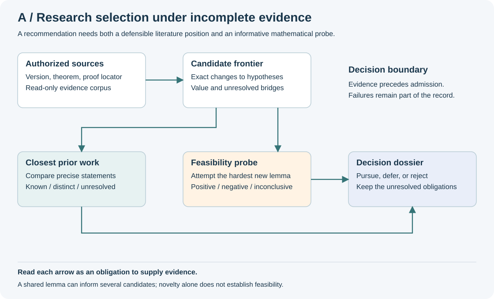

[English original](/posts/2026/08/agent-system/research-opportunity-system/) · [中文课程总览](/posts/2026/12/Agent-System-zh/)

*实验指令、文件结构与可执行代码保留英文原文，可直接复制；正文用中文解释其目的与验收标准。*

提交成果是一个您可以实际开始的研究提案：一个精确的候选定理、一个来源审核、一个合理的方法和一个经过测试的第一引理。流行的论文列表或精美的架构图不符合此标准。

这是一个设计和实验室，而不是系统已经发现新定理的报告。它需要访问真实来源并进行数学检查。如果没有校准数据，请勿指定数字成功概率。

**阅读路线：**从下面的工作坊开始进行高级设计；使用 [完整推导的机会审核：将紧致性替换为证明所需的 ](#a-worked-opportunity-audit-replace-compactness-by-what-the-proof-needs) 作为需要时的具体校准。在对照案例之后完成研究作业。

<a id="research-workshop-a-select-a-project-under-incomplete-evidence"></a>

## 研究工作坊 A：在证据不完整的情况下选择项目

**预备知识：**模块 3–5、9，以及同一领域内三篇可实际查阅的论文；应具备重建其中一个证明的背景。**研究成果：**比较精确候选定理的决策档案，包含新引理的实际尝试，并说明对各候选继续、暂缓或放弃的理由。后面的简单例子用于校准，不是最终作业。

难点在于：新颖性、可行性和价值是不同维度的不确定性。一个候选可能很新却难以着手，也可能容易证明却早已为人所知，还可能数学上正确却与研究目标无关。单一的“前景评分”会掩盖这些区别。

<a id="1-represent-an-opportunity-as-a-change-to-a-theorem"></a>

### 1. 将机会表示为定理的更改

对于每个候选，存储原始定理 $H\Rightarrow C$ 和建议定理 $H'\Rightarrow C'$。提供逻辑比较，而不仅仅是“概括”标签。对于具有相同结论的较弱假设，建立 $H\Rightarrow H'$。为了在相同假设下得到更有力的结论，建立$C'\Rightarrow C$。如果两种比较均不可用，请将命题描述为不同或无法比较。

更强的假设和更强的结论仍然可以定义一个有价值的项目，但它不会自动改进原始定理。同样，在不解决候选答案问题的情况下，证明特殊情况可能是有价值的可行性证据。

| 候选字段 | 研究人员必须能够检查的内容 |
|---|---|
| 定理差异 | 原始和提议的域、量词、假设和结论 |
| 数学价值 | 更改地址哪些现有障碍或下游应用程序 |
| 证明差异 | 精确来源停止工作的步骤并建议更换 |
| 已有工作状态 | 最接近的检查结果和蕴涵比较 |
|可行性证据 | 已完成的计算或引理尝试，包括失败 |
| 决策 | 下一步行动、剩余不确定性以及花费或停止工作的原因 |

检索系统搜索这种结构性差异。 “查找扩展论文”是一个语料库发现查询。 “找到一个消除正性假设 H 同时保留指定 section 扩展的结果”是一个定理级查询。他们需要不同的证据。

<a id="2-keep-a-frontier-of-candidates-rather-than-a-popularity-ranking"></a>

### 2. 保留候选集合，而不是按热度排名

首先排除已有有效反例的候选，以及在相同范围内已被查明的结果所涵盖的候选。来源暂时无法访问的，单独标记并说明原因。对其余候选，比较数学价值、所需背景、未证衔接步骤，以及下一项决定性测试的投入。

只有当一个候选在你当前关心的各项标准上都不差于另一个，且至少一项更好时，才能说它占优。更多时候，两者各有长处：一个目标更重要，另一个有更明确的初步实验。应让研究者看到这种权衡，而不是用带小数点的成功概率把它隐藏起来。

例如，将论证扩展到更广泛的类别与改进其在原始类别中的结论进行比较。前者可能需要更换紧致性；后者可能需要更准确的估计。如果两者都依赖于相同的缺失一致界，则该引理是共享瓶颈。对其进行探索可能会立即通知两位候选答案。优先考虑它的原因是这种具体的依赖关系，而不是模型知道成功概率的断言。

<a id="3-design-a-discriminating-probe"></a>

### 3. 设计能区分路线的 probe

一个好的 probe 应预先说明不同结果将如何改变决策。例如，原证明只给出依赖 j 的常数 C_j，而推广需要独立于 j 的 C。选取一族可精确计算参数依赖的例子。若在候选假设下，所需常数必然发散，这个衔接步骤就失败了；若只在受限的例子族上得到 uniform estimate，则应保留这个范围，再寻找推广所需的新步骤。

在尝试之前，记录这些分支：

```text
Probe P3 tests candidate C2-v1, bridge B7-v1.
Question: does the required bound hold uniformly in the chosen family?
Positive outcome: a proof with a constant independent of the index.
Negative outcome: examples satisfying the hypotheses that force divergence.
Inconclusive outcome: only separate bounds or a finite sample.
Decision affected: pursue B7, change the proposed hypothesis, or defer C2.
```

这是一个推理实验设计。它不需要编码，并且当排除了重要路线时，故障是有用的。有限的许多成功例子不能在无限的家族中消解 一致命题 。

<a id="4-separate-discovery-from-recommendation"></a>

### 4. 将发现与推荐分开

[](/images/agent-system-zh/advanced-opportunity.svg)

来源库保存只读证据，候选提案不能直接写入已接受的数学事实。决策档案必须同时包含 prior-art comparison 与 feasibility report；两者不能互相替代。如果一篇尚无法查阅的相关论文可能已包含目标结果，推荐就应保持暂定状态。

在 Codex 中，创建 `CORPUS.md`、每个候选一个 `candidates/C*.md`、`PROBES.md` 和 `DECISION.md`。对于第一次运行，使用小型授权语料库并需要精确的定理段落。仅当命名间隙需要时才扩展检索。通过修订保留相同的候选 ID，并具有不同的命题版本。

<a id="5-graduate-assignment-and-oral-defense"></a>

### 5. 研究级作业与答辩

从三篇真实论文出发，提出三个精确的定理变体。为最强候选重建其来源论证，并与至少一个假设不同但结论接近的已知结果比较。实际尝试一个关键衔接步骤，再与另一条路线比较。成果可以是受限范围的定理或决定性障碍，但必须有数学论证。

答辩应回答：哪条 implication 说明这是推广？原证明在哪里使用了被改变的假设？这次 probe 增加了什么此前没有的依据？什么证据会推翻你的推荐？论文清单、未经测试的架构，或没有依据的“很可能可行”，都不能通过。

<a id="what-the-system-should-return"></a>

## 系统应返回什么

对于每篇入围论文，需要其确切的版本和定理定位器、提出的改进、使用原始假设的证明步骤以及提出的替代方案可行的原因。将原始命题保留在候选答案旁边。较弱的结论或特殊情况必须相应地标记。

最终建议必须包括依赖性计划、最难的衔接论证、适用的已知结果、具体的第一个实验和停止条件。它可能会建议放弃每一位候选答案。这比发明一个可实现的项目更好。

<a id="architecture-expressed-as-evidence-contracts"></a>

## 作为证据表达的架构接口约定

| 阶段 | 输入 | 可检查输出 | 停止或返回的原因 |
|---|---|---|---|
| 语料库发现| 授权金库、数据库导出、论文 | 具有访问状态和确切版本的库存 | 全文不可用 |
| 数学提取 | 实际命题和证明| 带有证明位置的假设使用表 | 无法检查提取 |
| 机会提案 | 特定的证明瓶颈 | 原始定理和提出的定理并列| 只提出了一个模糊的主题 |
| 已有工作审核 | 候选和术语变体 | 搜索日志、近似匹配、经过验证的比较 | 已知或新颖性未解决|
| 方法设计 | 候选和适用引理 | 具有显式返回的依赖计划论证 | 基本衔接论证不支持|
| 可行性探测 | 最弱的衔接论证 | 证明尝试、反例或精确阻碍 | 证据与提案相矛盾|
| 建议 | 所有之前的研究记录 | 入围名单及其原因和限制 | 没有候选答案幸存 |

此序列中隐含的每个箭头传输研究记录，而不是置信度。查找相关的来源并不能证明适用性。不成功的搜索并不能证明新颖性。成功的特殊情况计算并不能建立一般定理。

<a id="build-it-from-zero-in-codex"></a>

##  在 Codex 中从零开始构建

打开一个新的项目文件夹。将来源笔记保留为只读并在此处写入生成的材料。对于该研究人员的设置，数学库是 `D:/Source/Enotes/Math`；其他读者应替换其自己的授权位置。不要仅仅为了搜索而将私人保管库上传到外部服务。

```text
Create a research-opportunity workspace using Markdown, without building an app.
Create BRIEF.md, CORPUS.md, HYPOTHESIS-AUDIT.md, CANDIDATES.md,
PRIOR-ART.md, METHODS.md, PROBES.md, and DECISION.md.

First inventory only the sources I authorize. Record actual access:
full text, abstract only, metadata only, or unavailable.
Ask for the research topic and constraints if they are not supplied.
Never edit my source notes or invent citations and execution results.
Separate established facts, proposed extensions, and unresolved obligations.
```

在 BRIEF.md 中填写主题、首选的一般性、可用时间、数学背景以及什么使结果值得追求。从你理解的三篇论文开始，而不是整个库。小型可审核运行比不透明的大型搜索更容易改进。

<a id="find-the-right-source-material"></a>

### 找到合适的来源材料

```text
Find notes and papers relevant to this brief in the authorized corpus.
Use exact terms and mathematical synonyms. Show the search terms used.
For each match, record the exact path or URL, version, theorem locator,
and why its statement or proof is relevant. Do not rank by title alone.
Identify missing full texts before proposing theorem-level improvements.
```

使用可用的连接搜索工具，或本地文件搜索和提供的导出。 arXiv 是一个附加的来源，而不是之前工作的完整说明。保留标识符、版本和搜索日期。如果没有可用的浏览或数据库连接，请报告该限制并仅继续使用可访问的材料；不要模拟搜索。

<a id="extract-opportunities-from-proofs"></a>

### 从证明中提取机会

```text
For these three papers, inspect selected theorem statements and proofs.
For each hypothesis, locate where it is used and what that step needs.
Suggest at most three precise improvements: a weakened hypothesis,
a broader setting, a sharper conclusion, or a simpler method.
For each, state the missing bridge and check immediate counterexamples.
Do not call a hypothesis unnecessary merely because its use is hard to find.
```

例如，证明可以调用紧致性来提取收敛子序列。提议的扩展必须提供替代的紧致性论证、另一种收敛机制或不同的证明。仅仅删除“紧致”这个词并不是一种研究方法。这个例子说明了审计程序；这不是一个新的研究提案。

<a id="check-whether-the-improvement-already-exists"></a>

### 检查改进是否已经存在

```text
Search for each exact candidate, including equivalent terminology and
stronger results that would imply it. Inspect relevant statements.
Record queries, dates, sources actually opened, and comparison of hypotheses.
Classify each candidate as already covered, contradicted, not found in the
searched sources, or unresolved. Never turn 'not found' into 'new'.
```

在投入大量研究时间和发表之前，应重复新颖性审查。最接近的论文中的参考文献通常比广泛的关键词列表更重要。

<a id="require-a-method-detailed-enough-to-attempt"></a>

### 需要足够详细的方法才能尝试

```text
For the surviving candidate, produce a proof blueprint.
List each intermediate lemma, its assumptions, and its role in the conclusion.
For every imported theorem, give an applicability check.
Identify the hardest new lemma and one alternative route.
Choose a first probe that could materially change our assessment today.
Do that probe, preserving the full argument or actual tool output.
```

有用的探索包括证明最难引理的受限版本、检查边界示例、找到所提出的衔接论证的反例或验证精确的来源应用。一个长的证明草图，其主要困难隐藏在“标准论证”中，失败了这个阶段。

<a id="a-worked-opportunity-audit-replace-compactness-by-what-the-proof-needs"></a>

## 完整推导的机会审核：将紧致性替换为证明所需的内容

这是对既定分析的校准练习，而不是新研究结果的断言。它显示了建议真正的纸张改进之前所需的详细程度。

从非空紧致空间上的连续实值函数达到最小值的定理开始。一个幼稚的提案删除了紧致性并使用域 $\mathbb R$。它失败了：$f(x)=e^x$ 的下确界为零，但从未采用该值。 $x=-n$ 上的正值接近零，因此失败是达到，而不是存在下确界。

证明审计确定了紧致性正在做什么：它阻止了一系列几乎最小化器的逃逸，并提供了一个收敛子序列。这表明了比简单删除假设更精确的候选者。

**候选：** 如果存在一个点 $x_0$ 使得子水平集，则连续函数 $f:\mathbb R\to\mathbb R$ 达到最小值

$$
K=\lbrace x\in\mathbb R:f(x)\leq f(x_0)\rbrace
$$

是紧致。该假设仅涉及该领域的相关部分；整个域不必是紧致。

<a id="complete-the-first-bridge"></a>

### 完成第一个衔接论证

集合 $K$ 是非空的，因为它包含 $x_0$。连续性和紧致性意味着 $f$ 到 $K$ 的限制具有最小值，在某个 $x_{\ast}$ 处达到。对于任何 $x\in K$，我们有 $f(x_{\ast})\leq f(x)$。对于任何 $x\notin K$，我们有

$$
f(x)>f(x_0)\geq f(x_{\ast}).
$$

因此 $x_{\ast}$ 是一个全局最小化器。从受限问题到原始域的返回论证已经被证明，而不是隐藏在“本地化问题”这句话中。

具体测试以$f(x)=x^2$和$x_0=1$为例。那么 $K=[-1,1]$，零处的最小值也是全局的。对于 $e^x$，设置为 $f(x_0)$ 值的每个子级别都是 $(-\infty,x_0]$，它是无界的，而不是紧致。失败的提案不满足修复的假设。

<a id="turn-the-calculation-into-a-decision-record"></a>

### 将计算转化为决策记录

| 候选 | 第一个探针 | 探针支持的决策 |
|---|---|---|
| 删除紧致性且不进行替换| $\mathbb R$ 上的 $e^x$ | 拒绝：目标为假 |
| 需要一个紧致子级别集 | 限制、最小化、比较| 在规定的假设下以数学方式建立 |
| 在新的函数空间中应用相同的想法 | 识别拓扑、紧致性和限制下的行为 | 在检查这些桥之前仍然是一个悬而未决的任务|

第二行不是可发表的发现：它是标准的基本结果。一个将其标记为新颖的系统即使其证明是正确的，也无法通过研究机会练习。第三行还不是项目推荐； “新函数空间”一词并未指定定理。

对于实际的论文，将玩具来源替换为经过检查的定理，并逐步识别相应的紧致性。写出新的空间、拓扑、函数和精确替换假设。然后尝试最弱的衔接论证：所提出的子级别集是否确实具有所需的紧致性，并且该限制是否保留了所需的不等式？这些是具体的数学任务，可以根据这些任务进行继续/推迟决策。

**实践：**向Codex提供原始定理和三个候选行，最初保留完整推导的证明。求反例，修复命题，完整返回论证，并新颖性分类。然后根据上面的推导检查其实际输出。在研究过程中，将参考答案替换为真实引理尝试和实际已有工作证据的审查。

<a id="feasibility-means-evidence-not-optimism"></a>

## 可行性意味着证据，而不是乐观

使用具有明确原因的定性决策：

- **准备集中尝试：**先决条件检查，第一个实质性衔接论证测试，剩余差距本地化。
- **需要基础工作：**合理的方向，但缺少定义、库支持或主要引理。
- **Defer：** 未解决的新颖性、无法访问的来源或困难localized.
- **拒绝此路由：** 反例或失败的必要条件会阻止它。

即使是第一类也不能保证成功。要求单独的审查对话使用完整的证据来攻击最薄弱的步骤。独特的对话并不能保证独立的判断。

<a id="run-a-pilot-before-searching-your-whole-corpus"></a>

## 在搜索整个语料库之前运行试点

从 [ 方法选择项目 ](/posts/2026/08/agent-system-zh/proof-sketch-system/) 中的提升问题开始。为系统指定 exact sequence 和建议的充足消失论证。询问指定 section是否需要消失。要求它区分较弱的充分标准和确切的阻碍标准。

使用带有trivial bundle和两个不同有理点的射影线作为对照案例。 限制映射将常数 c 发送到 (c,c)，因此 (1,1) 提升而 (1,0) 则不会。在提出概括之前要求系统进行计算。这是已建立的基础数学，而不是新的研究机会；认识到边界是练习的一部分。

接下来从您的授权语料库中选择三篇实际论文。对于一个候选者，完成假设使用表、已有工作搜索和第一次证明尝试。保存所有输出，包括被拒绝的候选答案。将此与使用相同材料和工作预算建议研究主题的普通请求进行比较。

通过其建议是否准确、来源比较是否正确以及其第一次尝试是否会实质性改变您的评估来判断系统。一份干净的负面报告比一份未经检验的想法的自信清单更有效。不要将拟议项目的冗长或数量视为研究进展。

<a id="final-output-to-the-researcher"></a>

## 最终输出给研究员

提交一个推荐项目，最多两个备选项目，以及拒绝的候选答案并说明理由。建议包括提出的定理、最接近的先前结果、证明计划、已完成的探索、突出的引理以及下一个具体的研究会议。如果没有任何结果，请提交诚实的负面报告。

[课程路线图](/posts/2026/12/Agent-System-zh/) · [在Codex中构建基础工作区](/posts/2026/08/agent-system-zh/codex-research-studio/)
