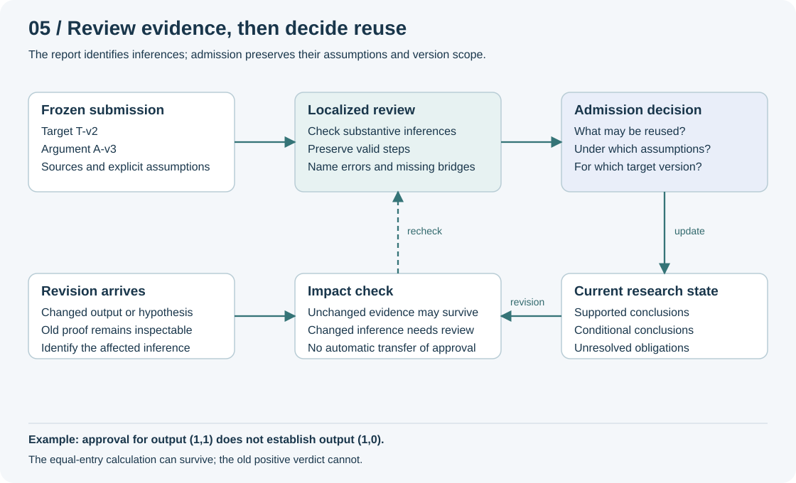

[English original](/posts/2026/08/agent-system/verification-gate/) · [中文课程总览](/posts/2026/12/Agent-System-zh/)

*实验指令、文件结构与可执行代码保留英文原文，可直接复制；正文用中文解释其目的与验收标准。*

review 判断论证能否支持结论；admission 判断流程能否复用这一结论、在什么假设下复用、适用于哪个版本。两者有关，却不等同。赞许语气或名为 `verified` 的字段，都不能充当数学证据。

**学习目标：** 定位有缺陷的推理；区分差距和反例；通过一条链保留假设；并将审查绑定到它检查的文本。实验室使用早期模块中的极限和规定输出示例。尚不需要形式化证明器。

<a id="1-a-reviewer-needs-a-claim-an-argument-and-a-context"></a>

## 1. 审查者需要断言、论证和上下文

考虑这个提交：

> 每个逼近函数都是连续的。该序列逐点收敛。传递到极限证明了连续性。

“需要更严格”不是有用的审查。有效审查应定位具体跳步：pointwise convergence 不能保证 continuity 传到极限。随后分别检查三个问题：前提是否成立？声称的 implication 是否有效？这个具体目标是否可能由别的理由成立？

对于 $[0,1]$ 上的 $f_n(x)=x^n$，前提有效，结论错误。模块 4 的计算提供了一个反例。对于连续函数的常数序列，相同的一般推理仍然是不合理的，但特定的极限是连续的。无效的论证和错误的结论不是同义词。

为了使审查可重现，请冻结目标、证明文本、假设和引用的来源版本。一旦多个修订并存，“审查我的最新证明”就会变得模糊。一个普通的文件名和一个版本标签就足以满足课程的需要；重要的一点是已审查文本仍然可用。

<a id="2-review-an-argument-one-inference-at-a-time"></a>

## 2. 审查和论证一次一个推理

这是更详细的缺陷证明。固定 $x_0$ 和 $\varepsilon>0$。选择$N$，以便$\vert f_N(x_0)-f(x_0)\vert<\varepsilon/3$。通过$f_N$的连续性，选择$\delta$控制其在$x_0$附近的变化。应用三角不等式并得出每当 $\vert x-x_0\vert<\delta$ 时 $\vert f(x)-f(x_0)\vert<\varepsilon$ 的结论。

开头与正确的 uniform-limit 证明十分相似。但缺少的是：对同一个 N，控制所有邻近 x 处的 $\vert f(x)-f_N(x)\vert$。

| 推理 | 审查 | 原因 |
|---|---|---|
| 选择$N$ 控制 $x_0$ 处的误差 | 已接受 | 逐点收敛提供此 |
| 选择 $\delta$ 以保证此 $f_N$ 的连续性| 已接受 | $N$ 现已固定 |
| 将差值拆分为三项 | 已接受 | 三角不等式|
| 界每个附近的误差 $x$ | 不支持 | 逐点收敛根据 $x$ 提供阈值|
| 推导出 $f$ 的连续性 | 不成立 | 取决于无支持的估计 |

该报告保留了有效的工作。它还建议进行具体修复：对 $x_0$ 的邻域建立估计一致。全局一致收敛就足够了，但可能比必要的更强。 审查者应该将其识别为新的待解决事项，而不是默默地将其添加到原始假设中。

<a id="3-admission-carries-assumptions-forward"></a>

## 3. 结果纳入向前推进假设

若草稿证明了 $P\Rightarrow Q$ 与 $Q\Rightarrow R$，而 P 仍是未证假设，那么 R 也仍然以 P 为条件。把 Q 单独命名为一个 lemma，并不会消解 P。

对于输出问题，让 $P$ 说请求的对具有相等的条目。然后，规则 $r(c)=(c,c)$ 通过选择该公共值给出解决方案。在平等成立之前，这是一个有条件的结果。它很有用，因为它可以识别剩余的支票；它不能证明任意请求对的解决方案是合理的。

存储三个不同的字段：

| 字段 | 答案是什么 | 示例 |
|---|---|---|
| 工作流程状态 | 已完成哪些操作？ | 已审查和已纳入有条件使用 |
| 证据 | 为什么支持蕴涵？ | 使用公共值作为输入检查论证 |
| 范围 | 可以得出什么结论？ | 假设两个请求的条目相等的解决方案 |

不要把这些字段压缩成置信度百分比。下游证明需要保留哪个假设，百分比无法回答。

[](/images/agent-system-zh/course-review-admission.svg)

该图将审查者与重用结果的决策分开。在狭小的工作空间中，一个人就可以执行这两种功能。这种分离是合乎逻辑的，而不是创建两个智能体的要求。

<a id="4-what-changes-when-a-proof-is-revised"></a>

## 4. 修改证明后会发生什么变化？

回想一下模块 1 的规则 $r(c)=(c,c)$。请求的输出 $(1,1)$ 由 $c=1$ 生成，而 $(1,0)$ 无法生成。此审查测试不需要几何解释。

输入 $c=1$ 的审查支持第一个请求的输出。如果修订版用 $(1,0)$ 替换该输出，则旧的审查不再支持该目标。然而，对可能输出的描述仍然可以重复使用。因此，一个好的改变审查既说明了哪些内容会过期，又哪些内容会继续存在。

比较三个修订版：

1. 印刷更正使命题和证明保持不变。确认它只是编辑性的。
2.  相同命题的新证明替换了引用的定理。 审查替代品论证及其假设；旧的审查保留有关旧证明的证据。
3. 更改了请求的输出、域、量词或允许的输入更改了数学目标。即使大多数散文都是相同的，也要重新检查适用性。

这就是为什么“审查每个从头开始更改的文件”会浪费精力，而“重用每个旧的批准”是不安全的。有用的单位是受影响的数学推理。系统仍然必须证明其判断编辑不相关的合理性。

<a id="5-design-a-review-request-with-a-bounded-job"></a>

## 5. 设计具有有界作业的审查请求

创建冻结提交和单独的报告。给审查者足够的来源材料来检查论证，而不仅仅是一个摘要说另一位助手批准了它。

```text
Review TARGET-v2 and ARGUMENT-v3 without editing them.
For each substantive inference, identify its premises and justification.
Classify findings as a false inference, missing evidence, or an accepted step.
For a claimed counterexample, check every hypothesis of the target.
State the strongest conclusion supported and all remaining assumptions.
Propose repairs separately; do not incorporate them into the reviewed claim.
```

维修后要求第二次通过。它应该将修复后的论证与原始发现进行比较：是否通过不同的途径证明、假设或避免了缺失的估计？更长的证据并不能证明差距消失了。

一次新的对话可以减少对早期有说服力的框架的接触，但它并不能保证独立的数学错误。两个审查者可以共享相同的误解或不完整的来源。更有力的证据来自于通过另一种方法检查脆弱步骤：明确的示例、来源应用程序审核或适当的形式化。

<a id="6-four-laboratory-tests"></a>

## 6. 四项实验室测试

对所有四种情况使用相同的报告格式。在进行更正之前保存回复。

| 输入 | 预期的审查行为 |
|---|---|
| 正确的一致限制证明| 在其规定的假设下接受实际的论证 |
| 省略附近误差项的逐点证明 | 本地化缺失的估计|
| 旧 $(1,1)$ 审查附加到新 $(1,0)$ 目标 | 拒绝批准转移；保留图像计算 |
| 从假定的 $P$ 到 $R$ 的有效链 | 在结论范围内保留 $P$ |

包括有效的对照案例。到处寻找想象中的缺陷的审查者并不成功。同样，在没有读取任何推理的情况下显示“未验证”的审查者也没有完成该作业。

对于形式化断言，询问实际检查的是什么。响应中的 Lean 代码是建议的研究记录。下一个模块介绍执行证据、公理依赖性以及编码的命题是否与预期匹配的单独问题。

<a id="7-exercises-and-worked-answers"></a>

## 7. 练习和完整推导的答案

<details markdown="1">
<summary>1。反例违反了一个假设</summary>

审查者在 $(0,1)$ 上使用 $f(x)=x$ 拒绝紧致域最大定理。这是一个有效的反驳吗？

**解答.** 否。该示例违反了紧致性，因此它不反驳该定理。它确实反驳了没有紧致性的提议版本。 审查必须识别其测试的命题。
</details>

<details markdown="1">
<summary>2。修复或目标改变？</summary>

$[0,1]$ 上失败的连续性证明被每个带有 $a<1$ 的 $[0,a]$ 上的正确证明所取代。

**解答.** 这是较小域上有用的较弱结果，而不是端点处连续性的完成。记录新分支并根据示例保留未解决或错误的原始结论。
</details>

<details markdown="1">
<summary>3。两次审批不同意直接计算</summary>

两个审查记录批准 $(1,0)$ 的输入，但每个可能的输出都被证明具有相同的条目。合并应该做什么？

**解答.** 检查论证和对象，而不是计票数。根据所述假设，等额分录计算不包括 $(1,0)$。找到批准中的错误步骤并撤回他们的支持。协议供应无替代数学蕴涵.
</details>

<details markdown="1">
<summary>4。有条件的审查纳入究竟应该是什么？</summary>

**解答.** 可能是纳入蕴涵并允许在其余假设明确的上下文中使用其结论。它可能不标志着假设成立。下游论证应该继承该假设，除非它们消解它或使用独立的路由。
</details>

<a id="8-assessment"></a>

## 8. 评估

提交冻结的输入、本地化报告、修复版本和最终范围决策。解释 1 个有效的推理被保留，1 个无效的推理被阻止。我们的目标是使数学更容易检查和修复的审查，而不是将生成的散文变成批准标签的仪式。

---

[课程路线图](/posts/2026/12/Agent-System-zh/)·[直接实验](/posts/2026/08/agent-system-zh/hands-on-lab/)·[下一模块](/posts/2026/08/agent-system-zh/lean-formalization/)
