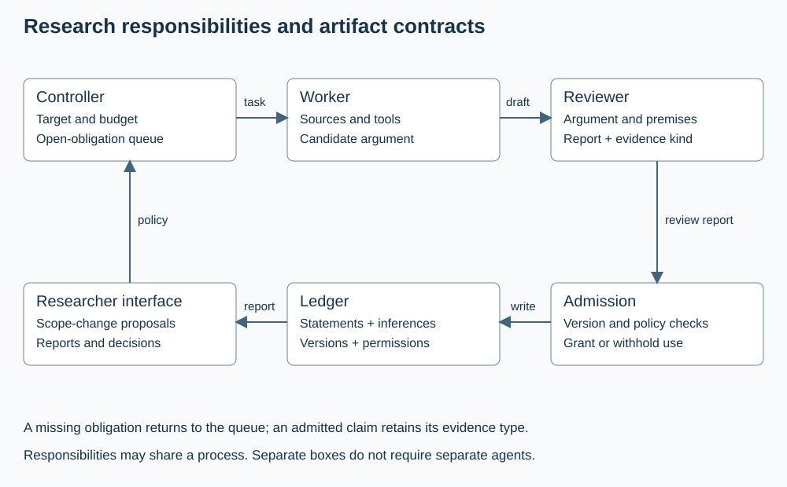

**Pattern reference.** This is a short design note, not a standalone lesson. For the worked argument, step-by-step practice, and assessment, read the [full course chapter](/posts/2026/08/agent-system/foundations/). Geometry references below refer to the optional extension of Case A.

Architecture diagrams should answer a named question. A box called “reasoning engine” is useful only if its input, output, and authority are specified.

*This is a proposed responsibility map, not a deployment diagram. Arrows carry artifacts; the admission component alone grants permission to use a claim as a premise.*

## Four views of the same system

| View | Question | Required content |
|---|---|---|
| Semantic | What does the system reason about? | Statements, object versions, assumptions, inference records |
| Logical | What justifies this conclusion? | Joint premises, alternative arguments, theorem applications, induction order |
| Execution | What action runs next? | Queues, retries, budgets, checkpoints, cancellation |
| Operational | What survives failure? | Durable writes, identities, service boundaries, replay and invalidation |

A dependency arrow must not also mean a network call. A search loop must not be read as a circular proof. Use the [two-graph example](/posts/2026/08/agent-system/design-principles/) to see the distinction.

## Responsibilities before agents

The controller schedules work; a worker proposes an artifact; a reviewer supplies evidence; admission checks policy; the ledger retains versions and dependencies. These may share a process. Separating responsibilities does not require one model, service, or person per box.

The formal checker, if present, checks an encoded proposition. The source adapter locates evidence. Neither can silently change the original target. The researcher interface presents proposed scope changes and the evidence needed to decide them.

## Hands-on practice

Draw the four views for the ledger lab. Mark which components are implemented and which are merely assumed. Then place a crash between saving a review and updating task status. In the operational view, show how replay recovers without applying the review twice or to the wrong statement version.

## Reference notation

[C4](https://c4model.com/introduction) supplies established context and container views for software architecture. The semantic and logical views here add the mathematical content that a deployment view cannot express. These are design proposals; the figure does not assert that any particular research system implements them.

## Worked design decision: draw one system from complementary views

A dependency view shows which claims rely on which premises. A workflow view shows how proposals move through review. A storage view shows where versions and sources persist. Combining all three into unlabeled arrows hides the difference between logical implication and a file transfer.

**Acceptance exercise.** For every arrow, state its meaning and a failure that can occur there. If an arrow cannot be given an operational or mathematical interpretation, remove it or mark it as a proposed relationship.

---

[Series guide](/posts/2026/12/Agent-System/) · [Running cases](/posts/2026/08/agent-system/research-cases/) · [Laboratory](/posts/2026/08/agent-system/hands-on-lab/)
