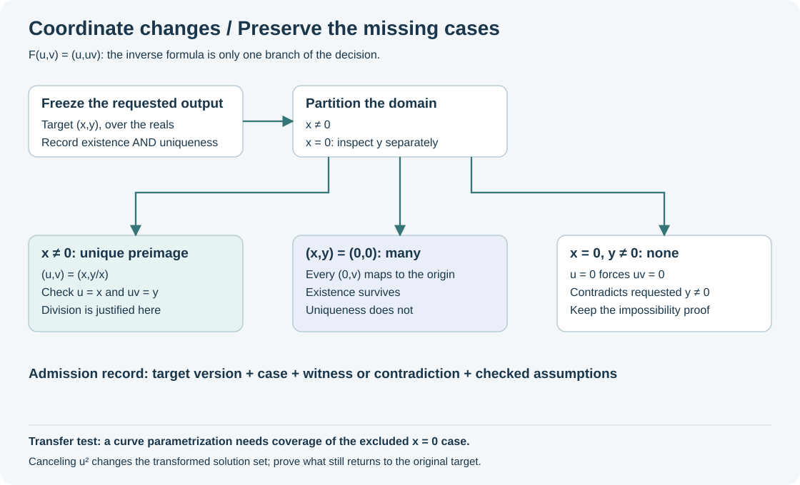

**Birational geometry proof project:** [Uniqueness of smooth minimal surfaces](/posts/2026/08/agent-system/birational-proof-workshop/) supplies a real target, exact sources, two complete proof routes, a relative variant, and a direct-request versus assisted-workflow comparison. Start here if the elementary calibration problems are already familiar.


The difficult part of a change of coordinates is often the part the new coordinates do not cover. This workshop develops that issue through explicit formulas, then connects it to a research system's obligation to preserve domains, recover solutions, and justify recursive reductions. You need polynomial algebra, functions, and induction—not algebraic geometry terminology.

**Research workshop C.** Produce a complete reduction record, including an inverse-domain check, an exceptional-case calculation, and an induction audit. The examples are reference mathematics. The Codex experiments are tasks to run and record, not reported successes of an autonomous system.

## 1. A transformation that is easy to invert—almost everywhere

Consider the map from the real plane to itself

$$
F(u,v)=(u,uv).
$$

If the requested output is $(x,y)$ with $x\ne0$, its unique preimage is

$$
u=x,\qquad v=y/x.
$$

Check this by substitution. The division is legitimate because the domain restriction has been stated. Now examine the excluded case rather than treating it as a footnote. If $x=0$, the first equation forces $u=0$, and the second output is then zero regardless of $v$.

| Requested output | Preimages | Reason |
|---|---|---|
| $x\ne0$ | Exactly $(x,y/x)$ | Substitute into both equations |
| $(0,0)$ | Every $(0,v)$ | The entire line is sent to the origin |
| $(0,y)$ with $y\ne0$ | None | The second coordinate would have to be zero |

Thus F is neither globally one-to-one nor globally onto. Nevertheless, on the regions $u\ne0$ and $x\ne0$, it has the displayed inverse. The inverse coordinates are ratios of polynomials. This is the elementary feature behind a *birational* change: rational formulas identify suitable dense open regions, without promising a global bijection. Here those regions are simply the planes with the vertical axis removed.

**First challenge.** Give Codex the request “invert F” without specifying a domain. Save its first answer. Does it return only the division formula, or does it discover all three rows? The full deliverable is the classification, including uniqueness and failure of existence. A few successful substitutions are not enough.

## 2. When failure of the transformed task says nothing about the original one

Suppose the original task is to exhibit a point satisfying $x=0$ and $y=1$. The answer $(0,1)$ exists. A planner decides to represent every point as F(u,v), then concludes that the original problem is impossible because the transformed equations have no solution.

The calculation is correct, but the reduction is invalid: F does not cover every allowed original point. Producing a preimage is a sufficient way to produce an original solution, not a necessary one. The missing implication is “every original solution has a representation of this form.”

Store the directions separately:

- A transformed solution maps to an original solution after checking substitution.
- An original solution maps back only where the inverse exists, unless exceptional cases are handled separately.

This is a small example of a serious research failure: a convenient construction becomes an unstated extra hypothesis. An unsuccessful transformed search is then misreported as a negative result about the original question.

**Adversarial test.** Ask for $(2,6)$, $(0,0)$, and $(0,1)$ in successive target versions. Deliver the first review after the last change. A reliable record retains the first calculation but does not transfer its approval or its uniqueness conclusion to the other cases.

## 3. A curve with two different routes through one point

Now consider all real solutions of

$$
y^2=x^2(1+x).
$$

The origin satisfies the equation. Away from $x=0$, set $t=y/x$. Dividing by $x^2$ gives $t^2=1+x$, so

$$
\begin{aligned}
x&=t^2-1,\\
y&=t(t^2-1).
\end{aligned}
$$

We have derived a candidate parametrization. To use it as a complete solution, prove two different statements.

**Forward direction.** For any real t, substitute these formulas. Both sides of the curve equation equal $t^2(t^2-1)^2$. Thus every parameter produces a point on the curve.

**Reverse direction away from the origin.** If $(x,y)$ satisfies the equation and $x\ne0$, set $t=y/x$. The equation gives $t^2=1+x$, and both reconstruction formulas follow. No such solution is lost.

**Excluded case.** If $x=0$, the original equation gives $y=0$. The origin is produced by both $t=1$ and $t=-1$. Thus the parametrization covers the entire real curve, but is not globally injective.

Here the exceptional-case calculation restores completeness; in the earlier plane example, a whole family of outputs was genuinely missing. The system must calculate which situation it is in. “We divided by x” is a reason to open an obligation, not a reason to assume that obligation is harmless.

Near t=1 and t=-1, the parametrization approaches the same point along different directions. At nonzero x, the slope y/x equals t; its two limiting values are therefore 1 and −1. This explains the two crossing branches using only the formulas. For geometric context, see the plane-curve examples in [Shifrin's differential-geometry notes](https://ghomi.math.gatech.edu/Classes/Math4441Fall2021/ShifrinDiffGeo.pdf). The algebra needed for this workshop is supplied above.

### A tempting cancellation that changes the solution set

Substituting x=u and y=uv into the curve equation yields

$$
u^2(v^2-1-u)=0.
$$

For $u\ne0$, this is equivalent to $v^2=1+u$. At $u=0$, however, the product equation allows every v, while the latter equation allows only v=±1. These are different sets of transformed points, even though both extra and retained points at u=0 map to the origin.

The two retained values capture the limiting slopes of nearby nonzero-u solutions. If u tends to zero along $v^2=1+u$, every finite limit of v must satisfy $v^2=1$; conversely each sign is realized by $v=\pm\sqrt{1+u}$ near zero. Cancelling the factor requires this explanation of what is retained and what is discarded.

**Second challenge.** Submit the false claim that the two transformed equations are equivalent everywhere. Require an explicit counterexample, an exact repaired domain, and a separate explanation of whether their images on the original curve differ. The input (u,v)=(0,0) disproves the equivalence; it does not produce an off-curve image.

## 4. The architecture records what each arrow proves

[](/images/agent-system/advanced-geometry.svg)

| Record | Required content |
|---|---|
| Original task | Equation, real domain, and whether existence, coverage, or uniqueness is requested |
| Forward map | Explicit formula and substitution proof |
| Inverse map | Formula and every nonzero-denominator condition |
| Exceptional branch | Direct calculation on the excluded set |
| Return argument | Which conclusions about transformed inputs establish the original target |
| Admission scope | Exact target version; whether coverage and uniqueness were separately established |

A plot is useful for noticing the crossing. It does not prove surjectivity of the parametrization or classify the missing points. A symbolic simplification can help check an identity, but must not erase its denominator assumptions.

## 5. A reduction is not automatically an induction step

Changing coordinates can simplify an equation without lowering any induction parameter. To call a repeated reduction an induction, give a quantity in a well-founded order and prove that each recursive call lowers it.

A concrete model is the Euclidean algorithm. For nonnegative integers a and positive b, write

$$
a=qb+r,\qquad 0\le r<b.
$$

The common divisors of a and b are exactly the common divisors of b and r: one direction uses $r=a-qb$, the other uses $a=qb+r$. Therefore the greatest common divisor is preserved. The next pair is (b,r), and its second coordinate is smaller. If r=0, stop; the greatest common divisor is b. The case with initial b=0 is handled separately, returning a when a>0.

There are two proofs here: preservation of the target and termination. Neither substitutes for the other. Trace (1071,462) → (462,147) → (147,21) → (21,0), obtaining 21. Then explain why this finite trace alone does not prove the algorithm for all inputs; the general divisor argument and decreasing nonnegative integer do.

For a mutually dependent theorem package, suppose $A_{d,q}$ uses $B_{d,q-1}$ and lower-dimensional results, while $B_{d,q}$ uses $A_{d,q}$. Lexicographic ranks (d,q,0) and (d,q,1) can organize those calls, provided all implications and boundary cases are proved. A same-rank cycle needs an independent argument; more rounds of agents cannot create one. This abstract extension does not require any theorem from algebraic geometry.

## 6. Build and stress-test it in Codex

```text
Create TARGET.md, MAPS.md, EXCEPTIONS.md, ARGUMENTS.md, and CHECKPOINT.md.
Start with F(u,v)=(u,uv) over the real numbers.
Classify every output by existence and uniqueness of a preimage.
Keep forward and inverse statements separate, with their domains.
Next parametrize y²=x²(1+x), proving both coverage and the exceptional case.
Do not cancel a factor without recording where it is nonzero.
For every rejected claim, retain a counterexample and a corrected statement.
Restart from the checkpoint and reconstruct exactly what was established.
```

Run three deliberate faults: omit x≠0 from the inverse; claim uniqueness at the origin; cancel u² without a case split. Diagnose the first invalid inference in each. Then replace the target by $y^2=x^3$ and repeat the argument from scratch. This time the formulas are x=t² and y=t³; direct substitution and the x=0 case give full coverage, with a unique parameter at the origin. Do not reuse the old two-parameter verdict.

For a formal track, ask Codex to encode one polynomial identity and one restricted inverse statement in an appropriate available Lean environment. Keep the domain assumption in the declaration. A proved identity alone does not certify the full coverage argument. Retain actual checker evidence and the admission policy from Module 6.

## 7. Submission and research-level extension

Submit the complete classification of F, both curve parametrizations, cancellation counterexample, decreasing-rank argument, and actual initial and repaired assistant outputs. A successful submission distinguishes existence, uniqueness, coverage, and termination throughout. A beautiful graph with unproved arrows does not pass.

For the accessible track, select an analysis or linear-algebra argument that changes variables, divides by a parameter, takes a limit, or recurses. Reconstruct the transformation and excluded cases. Change one hypothesis and attempt a replacement for the first failing step. The mathematical challenge is preserving the full target through a genuine revision—not adding unfamiliar terminology.

[Method-selection workshop](/posts/2026/08/agent-system/proof-sketch-system/) · [Course roadmap](/posts/2026/12/Agent-System/)

## 8. From calibration to birational geometry research

The coordinate examples teach how to audit a reduction; they are not substitutes for a research problem. For the research track, select an actual proof passage involving a birational model or a recursive theorem package. Keep the cited statements open beside the proof. Your task is to produce the following mathematical dossier, not a generic architecture proposal.

| Question | Required evidence |
|---|---|
| Does the model or operation exist under the stated assumptions? | The applicable theorem, with every relevant hypothesis matched to the current objects |
| Which properties survive the transformation? | The precise preservation statement and its proof or applicable citation |
| What changes on exceptional loci? | A localized calculation or theorem; do not infer global equivalence from agreement on an open set |
| How does the transformed result imply the original target? | An explicit return implication with its own assumptions |
| Why can the reduction not continue forever? | A proved termination theorem or a genuinely decreasing well-founded invariant |

Choose one assumption to weaken. Locate the first broken application, formulate a replacement lemma, and spend the main work on that lemma. A successful submission can establish a special case or identify a concrete obstruction; it must not rename a conditional reduction as the original theorem.

For a spiraling induction package, list each statement with all its parameters. Draw an arrow only when the proof actually invokes another statement. Check every arrow against the proposed rank, including boundary cases. If a same-rank cycle remains, identify the missing independent input. A visually convincing spiral has no evidential value without these checks.

Use the [proof-based hands-on track](/posts/2026/08/agent-system/hands-on-lab/#research-track-audit-and-improve-an-actual-proof) and mission 07 in the practice pack. No numerical experiment is required. The deliverable is a source-grounded proof attempt that another researcher can resume and scrutinize.


## 9. A source-based assignment: negativity and uniqueness

This is the research-background track. It assumes divisors, relative nefness, and birational morphisms; readers without that background can use Module 4's analysis track. Its purpose is to audit an actual theorem application rather than to build more orchestration files.

**Read first:** Caucher Birkar, [*Lectures on Birational Geometry*, arXiv:1210.2670v1, Lemma 4.15, printed p. 21](https://arxiv.org/pdf/1210.2670v1#page=21). Work in the notes' characteristic-zero algebraic setting. The lemma concerns a projective birational morphism $f:Y\to X$ of normal varieties and an $\mathbb R$-Cartier divisor D with $-D$ nef over X; it equates effectivity of D and of its pushforward. We use that result as an imported theorem. The full proof of the negativity lemma is not supplied or formally verified here.

### Worked application: an exceptional numerically trivial divisor vanishes

Assume D is exceptional over X and $D\equiv_f0$. Here exceptional means every prime component maps into codimension at least two, and numerical triviality means intersection zero with every contracted integral curve. Prove $D=0$ as a divisor, not merely as a numerical class.

Exceptional support gives $f_*D=0$. Numerical triviality makes both D and $-D$ relatively nef. Apply the negativity lemma first to D: its required negative is nef and its pushforward is effective, so $D\geq0$. Apply it again to $-D$: its negative is nef and its pushforward is zero, so $-D\geq0$. Every coefficient is both nonnegative and nonpositive; hence D is the zero divisor.

The two applications have opposite signs. A system that records only “nef, therefore effective” can silently reverse one of them. The source statement, the substitution, and the resulting inequality should be readable next to one another.

### Assignment: recover uniqueness, then test the boundary

Let $D_1,D_2$ be exceptional $\mathbb R$-Cartier divisors for the same morphism and assume $D_1\equiv_fD_2$. Prove equality. Then test the proposed strengthening that exceptional support can be removed. Do not respond only that a hypothesis is missing: produce an actual counterexample satisfying the remaining assumptions.

<details markdown="1">
<summary>Proof and counterexample checkpoints</summary>

Apply the worked argument to $D=D_1-D_2$. This difference is still exceptional and $\mathbb R$-Cartier, and is numerically trivial over X. Thus $D_1=D_2$.

To remove exceptional support, take the identity morphism on $\mathbb P^1$ and a nonzero point divisor P. No curves are contracted, so $P\equiv_f0$ is vacuous, yet P is not the zero divisor. Its pushforward is P, not zero. This counterexample pinpoints the lost input to the two-sign argument. It does not contradict the negativity lemma.
</details>

### The harder question is a proof obligation, not a promise

Suppose a manuscript replaces the algebraic projective morphism by a proper bimeromorphic map of compact complex spaces. This source alone does not authorize that replacement. Identify which analytic negativity result would be needed, its Cartier and positivity hypotheses, and whether the manuscript satisfies them. If the source is unavailable or a hypothesis remains open, keep the application conditional. Do not infer that the desired conclusion is false merely because this citation is insufficient.

For an induction package, use an actual cited proof to identify where this uniqueness statement is needed. Mark whether it compares models, identifies a divisor, or returns a result to the original space. That dependency must be a written implication. A diagram labeled “spiraling induction” without such implications is not a research result.

**Submit:** the two signed applications, the uniqueness proof, the counterexample, and one precisely scoped application or unresolved analytic replacement. These deliverables assess proof construction and source use. There is no requirement to claim a new theorem, run a numerical calculation, or create multiple agents.
