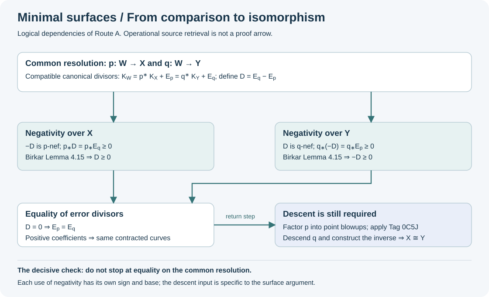

The practical question is whether a research workflow helps an agent complete mathematics that a direct request leaves unfinished—or reaches the same justified conclusion with substantially less work. This workshop uses a real theorem in birational geometry, with two proof routes and an exact place where an attractive shortcut fails.

**Target.** Let X and Y be smooth projective surfaces over an algebraically closed field of characteristic zero, with nef canonical divisors. Prove that a given birational map $\phi:X\dashrightarrow Y$ extends to an isomorphism.

This is a classical uniqueness statement, not a proposed new result. The theorem is a controlled starting problem because its proof can be inspected. Success on it does not demonstrate open-problem solving. The architecture and comparison protocol below are teaching proposals; no agent performance results are reported here.

**Prerequisites:** intersection numbers on smooth surfaces, divisors, nefness, and blowups. If you already know the proof, use an unfamiliar cited proof from your own project for the baseline; do not count recall as a gain from the course.

## 1. Establish what the agent can already do

Give one fresh session the target and the source packet below. Ask for a complete proof. Keep the answer unchanged, including mistakes and unresolved steps. Set a time or usage allowance that you can actually measure. This is the direct-request baseline, not a deliberately deprived competitor.

Assess four mathematical obligations: obtaining the common resolution; comparing canonical divisors with correct signs; proving that the same curves are contracted; and descending to an isomorphism. A response ending “the exceptional divisors agree, so we are done” still owes the last implication.

If the baseline already completes the proof, this problem does not demonstrate increased capability. It can still test efficiency, or you can move to the relative variant in Section 7. A workflow earns its place through observed results, not through its number of components.

## 2. A small source packet with exact responsibilities

| Imported result | Inspected source | Role in this proof |
|---|---|---|
| A birational map of proper regular surfaces has a common resolution by point blowups | [Stacks Project, Tag 0C5S](https://stacks.math.columbia.edu/tag/0C5S), Lemma 54.17.2 | Construct p and q for the given birational map |
| Proper birational morphisms of regular surfaces factor into point blowups | [Tag 0C5R](https://stacks.math.columbia.edu/tag/0C5R), Lemma 54.17.1 | Control the exceptional divisors and allow one-step descent |
| Negativity lemma | Birkar, [*Lectures on Birational Geometry*, arXiv:1210.2670v1, Lemma 4.15, p. 21](https://arxiv.org/pdf/1210.2670v1#page=21) | Turn relative nefness and an effective pushforward into a coefficient inequality |
| A morphism contracting the exceptional curve of a point blowup factors through its contraction | [Tag 0C5J](https://stacks.math.columbia.edu/tag/0C5J), Lemma 54.16.1 | Prove the final descent instead of assuming it |

These sources supply the listed inputs. The assembly of the argument, local calculation, exercises, and workflow below are course exposition. The source theorems themselves are not reproved here. None of these citations establishes that a particular agent workflow is effective.

## 3. Choose an intermediate statement that actually advances the proof

Take a smooth common resolution with projective birational morphisms $p:W\to X$ and $q:W\to Y$, inducing the given map. Use the same nonzero rational two-form in the common function field to choose compatible canonical divisors. This lets us compare actual divisors rather than silently switching between equality and linear equivalence.

For a point blowup b with exceptional curve E,

$$
K_{\widetilde S}=b^{\ast}K_S+E.
$$

Here is the local calculation behind the coefficient. In coordinates $x=u$, $y=uv$,

$$
b^{\ast}(dx\wedge dy)=u\,du\wedge dv.
$$

The Jacobian vanishes to order one along E; away from E the map is an isomorphism. The other blowup chart gives the same divisor. Applying the formula successively yields

$$
K_W=p^{\ast}K_X+E_p=q^{\ast}K_Y+E_q,
$$

where each error divisor is effective and has strictly positive coefficient along every exceptional curve of its morphism. At each blowup the old effective error pulls back effectively, while the new exceptional curve receives at least its new coefficient one. This also explains why the support is the entire exceptional locus.

The useful intermediate target is now

$$
D:=p^{\ast}K_X-q^{\ast}K_Y=E_q-E_p=0.
$$

This is a substantive reduction: it will identify the contracted curves. It does not by itself construct the final isomorphism.



## 4. Route A: two signed applications of negativity

Birkar's Lemma 4.15 says that, for a projective birational morphism of normal varieties, an $\mathbb R$-Cartier divisor B with $-B$ relatively nef is effective if and only if its pushforward is effective. The sign on B matters.

**Over X.** If C is p-contracted, then

$$
(-D)\cdot C=q^{\ast}K_Y\cdot C\geq0.
$$

If q also contracts C, the intersection is zero; otherwise the projection formula and nefness of $K_Y$ give nonnegativity. Thus $-D$ is p-nef. Moreover,

$$
p_{\ast}D=p_{\ast}E_q\geq0,
$$

because $p_{\ast}E_p=0$. Apply the lemma with B=D and morphism p to get $D\geq0$.

**Over Y.** Reverse the roles. The divisor D is q-nef, and

$$
q_{\ast}(-D)=q_{\ast}E_p\geq0.
$$

Apply the lemma with $B=-D$ and morphism q to get $-D\geq0$. Therefore D=0, and $E_p=E_q$.

| Application | Divisor submitted to the lemma | Required negative is nef | Effective pushforward | Conclusion |
|---|---|---|---|---|
| Over X | D | $-D$ is p-nef | $p_{\ast}E_q$ | $D\geq0$ |
| Over Y | $-D$ | D is q-nef | $q_{\ast}E_p$ | $D\leq0$ |

Do not demand that D be exceptional for either morphism before the calculation. That would assume a relationship between the exceptional loci that we are trying to prove. This version of the lemma requires effectivity of the pushforward; the calculation supplies exactly that.

## 5. The final bridge: equality of exceptional loci must give descent

Since the coefficients of $E_p$ and $E_q$ are positive along precisely their exceptional curves, equality implies that p and q contract exactly the same curves.

Factor p into point blowups. At its last blowup, write $p=p'\circ b$ with $b:W\to W'$ and exceptional curve C. Since q contracts C, Tag 0C5J gives a morphism $q':W'\to Y$ with $q=q'\circ b$.

The remaining contracted curves still match: for a curve on W', its strict transform on W is contracted by $p'$, respectively $q'$, exactly when the original curve is. Remove the blowups successively. This produces a morphism $a:X\to Y$ satisfying $q=a\circ p$.

Repeat symmetrically to obtain $b_0:Y\to X$ with $p=b_0\circ q$. These maps induce inverse maps on the common dense open set. Because X and Y are integral and separated, the equalizer with the identity is closed and contains that dense open set. Thus both compositions are identities. The original birational map extends to the isomorphism a.

The proof has now returned from W to the spaces in the target. That is the difference between establishing a useful divisor identity and completing the theorem.

## 6. Route B: avoid the negativity lemma in this surface problem

Choose a common resolution with the number of point blowups in p minimal. If p is not an isomorphism, let C be the exceptional curve of its last blowup. Then $C^2=-1$ and $K_W\cdot C=-1$, by the blowup formula and the fact that the pulled-back canonical divisor has intersection zero with C.

If q contracts C, Tag 0C5J lets q descend through this blowup, contradicting minimality of the number of blowups in p. Thus q does not contract C, so C is not a component of $E_q$.

Now intersect $K_W=q^{\ast}K_Y+E_q$ with C. The first term is nonnegative by nefness of $K_Y$. The second is nonnegative because $E_q$ is effective and C is a distinct curve from every component of its support on a smooth surface. This contradicts $K_W\cdot C=-1$.

Consequently p is an isomorphism. Then q is a birational morphism from X to Y. If it has any point blowup in its factorization, its last exceptional curve on X has canonical intersection -1, contradicting nefness of $K_X$. Hence q is also an isomorphism.

**Why compare these routes?** Route B uses a specifically two-dimensional exceptional-curve argument. Route A organizes the proof through divisor inequalities and a general negativity theorem. This may make A a more useful starting point for a different setting, but it does not prove any higher-dimensional analogue. A method-selection system should make that trade-off explicit before spending effort expanding both proofs.

## 7. Transfer problems with mathematical acceptance criteria

### A. Relative nefness: what changes over a base?

Let X and Y be smooth projective surfaces with morphisms to the same projective variety S. Let the given birational map be over S. Replace absolute nefness by nefness of $K_X$ and $K_Y$ over S. Determine whether the proof still works. Do not simply replace the word “nef” everywhere: identify why the curve whose intersection you use is contracted over S.

<details markdown="1">
<summary>Decisive checkpoint for the relative proof</summary>

Choose the common resolution over S, so both compositions to S agree. If C is p-contracted, its image in S is a point. If q does not contract C, the curve q(C) is still contracted by $Y\to S$. Relative nefness therefore gives the same intersection inequality. The symmetric argument is identical. Route A and the descent steps prove an isomorphism over S. The key additional evidence is commutativity over S, not stronger positivity.
</details>

### B. Delete one nefness assumption and find a genuine failure

Test the target when only $K_Y$ is nef. Use the blowup of a smooth projective surface with nef canonical divisor. Explain which half of Route A becomes unjustified and which half still gives a valid inequality.

<details markdown="1">
<summary>Counterexample and retained information</summary>

Let Y be a smooth projective abelian surface and X its blowup at a point, with exceptional curve E. Then $K_Y=0$ and $K_X=E$, so $K_X\cdot E=-1$. The blowdown $X\to Y$ is birational and not an isomorphism. Taking W=X and p the identity gives $D=E\geq0$; the reverse inequality fails because nefness of $K_X$ is missing. This example refutes the proposed one-nef theorem, not merely one method of proof.
</details>

### C. Explain the higher-dimensional obstruction without guessing a theorem

Inspect Route A under whatever hypotheses would make its discrepancy comparison valid in higher dimension. Even if the canonical pullbacks agree, which step above uses the fact that W is a surface? Explain why divisorial information alone does not rule out small exceptional loci. A satisfactory answer identifies the missing implication; it need not prove an unprovided theorem about flops.

The point-blowup factorization and exceptional-curve descent are surface inputs. The exercise prevents a correct surface proof from becoming an unsupported general uniqueness claim. Before proposing an extension, retrieve and inspect the appropriate higher-dimensional statement.

## 8. Build the agent intervention around an observed failure

After the baseline, introduce only the mechanism its proof needs. If it misuses negativity, give it the exact theorem and request the two signed substitutions. If it stops at equality of errors, give it the descent obligation and ask for the appropriate factorization result. If it repeatedly searches for the same source, retain the inspected statement with its locator for reuse.

```text
Work on the surface uniqueness target using the supplied source packet.
Keep the target and field assumptions fixed.
Before expanding a proof, compare the negativity route and the last-blowup route.
For each imported theorem, show the objects substituted into its hypotheses.
Do not declare completion at equality of canonical pullbacks:
prove descent to the given X and Y.
If a step fails, preserve the valid earlier deductions and repair that step.
Report the remaining gap instead of supplying an approval label.
```

This protocol is not an enforcement mechanism. Its value is an empirical question about actual runs. Do not provide the complete worked proof to the solving session and then describe its reproduction as independent solving. If you teach the proof first, assess learning on a different task and disclose that instructional exposure.

## 9. Assess capability and resource savings separately

Use the same model, available sources, tools, and a comparable total allowance for a direct request and an assisted workflow. Keep the first outputs, all retries, added mathematical hints, and actual checking evidence. A one-off comparison is a case study; model variability requires repeated runs before a general performance claim.

| Intended gain | Evidence needed | What does not establish it |
|---|---|---|
| Complete a previously unfinished proof | Baseline has a localized gap; assisted run closes every target obligation within the declared allowance | A longer answer or a reviewer saying “correct” |
| Obtain the same result more cheaply | Both proofs pass the same rubric; measured total tokens/time or fewer documented human repairs | Faster final response after hidden retries or uncounted preparation |
| Transfer to a new problem | An unseen variant with a source-supported proof, not copied checkpoints | Reproducing the worked proof after reading it |

Count source preparation and failed branches when reporting total cost. Separate one-time setup from per-problem cost; reuse may amortize setup, but do not hide it. If token measurements are unavailable, report time, source inspections, and correction counts without converting them into invented token savings.

**Submission:** the baseline, the intervention justified by its failure, the resulting proof or remaining gap, one transfer task, and the measured resource record. A negative result—no improvement or higher cost—is grounds to simplify the design. The course succeeds when it changes what a learner can reliably accomplish with an agent, not when it teaches a vocabulary for describing the attempt.
