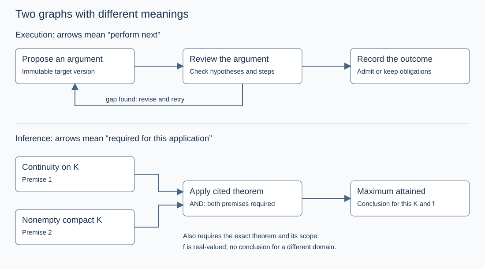

A mathematical reasoning system must preserve the meaning of a problem while changing its representation, searching for arguments, and accumulating knowledge. Better models expand the search we can afford. They do not remove the need to specify what was proved, from which premises, or how a conclusion answers the original question.

This series is about those enduring design problems. Agent frameworks and prompts are replaceable mechanisms. The architecture is the organization of mathematical work and evidence.

## Proof production with a small acceptance boundary

Treat the proof generator as replaceable. Its search may use language models, informal arguments, symbolic computation, or many cooperating workers. The acceptance path should depend on the returned evidence, not the generator's reputation or a majority of approving agents.

For a fixed formal target, successful mechanical validation can replace routine human checking of individual proof steps. A small checker has a different role from a second model asked whether a proof looks right. Lean separates elaborate proof construction from checking in its core theory; independently implemented kernels can provide additional assurance. See the official [external-kernel documentation](https://lean-lang.org/doc/reference/latest/External-Kernels/).

Three boundaries remain: does the target mean what was intended; does the evidence establish that target under the allowed assumptions; and was the validation performed in the declared environment? Making these responsibilities explicit does not reserve them permanently for humans. AI may help construct and audit specifications too. A fully formal task can avoid repeated natural-language translation altogether.

The durable lesson is to organize evidence so that increasingly powerful search can operate behind a stable acceptance boundary. This is a proposed system architecture, not a claim that arbitrary research mathematics is already fully automated.

## A small problem that exposes the architecture

Consider the deliberately false conjecture: every continuous real-valued function on the open interval $(0,1)$ attains a maximum. One worker invokes the extreme value theorem; another proposes $f(x)=x$ as a counterexample. A vote between workers would be meaningless. The theorem application requires compactness, which is missing. The counterexample requires two checks: continuity and failure to attain a maximum. For every $x\in(0,1)$, the point $(x+1)/2$ remains in the interval and has a larger value.

A good system records a refutation of the original universal statement. It may separately propose a repaired statement on $[0,1]$. It must not silently replace the original question with that repaired statement and report success.

This elementary example is a diagnostic fixture, not a benchmark for research ability. The same interfaces must survive when the missing hypothesis is a uniform bound or the missing implication is a return from transformed coordinates.

## Two graphs, two meanings

The upper graph describes actions over time. A failed review can trigger another attempt. The lower graph describes a mathematical inference. Continuity and compactness are jointly required by the indicated theorem application. Neither incoming arrow alone establishes the conclusion.

An implementation should therefore store an inference as a conclusion together with a list of required premises and its justification. A simple directed edge cannot express the difference between two alternative proofs and two premises required by one proof. Use inference records or a directed hypergraph. Ordinary finite proof dependencies should be acyclic; induction requires an explicit well-founded argument, not a cycle disguised as a recursive task.

## Six boundaries that survive model improvements

**Semantic boundary.** A target has quantifiers, a domain, and hypotheses. Rewording it creates a proposed equivalent statement whose equivalence may itself need proof. A structured schema preserves fields; it cannot by itself establish that those fields mean the same thing.

**Inference boundary.** A proposed step carries all its premises. A plausible method becomes a proof plan only when its missing implications are explicit. Conditional work is useful when its conditions remain visible.

**Evidence boundary.** Examples, calculations, retrieved results, informal reviews, and formal proof terms support different claims. Record the scope of each check. Even a formal proof needs an audit of its axioms and its correspondence to the intended statement; see the [Lean axiom reference](https://lean-lang.org/doc/reference/latest/Axioms/).

**Transformation boundary.** Passing to a new object incurs two obligations: establish the hypotheses there and transfer the resulting conclusion back. For example, a result about a restriction is not automatically a result about the ambient object.

**Persistence boundary.** A research result is versioned knowledge. If a premise changes, the system must identify affected arguments. It should suspend their use while checking alternatives, rather than conclude that all downstream statements are false.

**Decision boundary.** The controller selects which open obligation deserves work and decides when to stop. These are decisions under limited resources, not logical inferences. A promising route is not thereby a valid route.

## What belongs to humans?

These are responsibilities of the system, not permanent divisions between humans and machines. A researcher can delegate planning, critique, and even architectural proposals. The architecture should still expose the objective, evidence policy, and authority to change them. A human need not approve every lemma. Changes of scope and publication decisions require a declared policy, whatever performs the routine work.

Do not justify a component by saying AI will never perform its function. Justify it by the mathematical or operational constraint it enforces. A more capable model may combine several workers, but it must still preserve the distinction between a conditional result and a completed proof.

## Build before you scale

Start with the [hands-on lab](/posts/2026/08/agent-system/hands-on-lab/): construct a small obligation ledger, run failure cases, and add an agent only after the state transitions work. Then read [foundations](/posts/2026/08/agent-system/foundations/), [planning](/posts/2026/08/agent-system/plan-and-execute/), and [verification](/posts/2026/08/agent-system/verification-gate/). The [research workflow](/posts/2026/08/agent-system/research-workflow/) applies these ideas to literature-dependent research.

The pattern vocabulary draws on Gulli's *Agentic Design Patterns*. [Anthropic's workflow discussion](https://www.anthropic.com/research/building-effective-agents) provides an engineering account of fixed and dynamically selected execution paths. The mathematical contracts and exercises here are proposed designs, not claims that an existing implementation solves open problems.

---

[Series guide](/posts/2026/12/Agent-System/) · [Running cases](/posts/2026/08/agent-system/research-cases/) · [Laboratory](/posts/2026/08/agent-system/hands-on-lab/)
