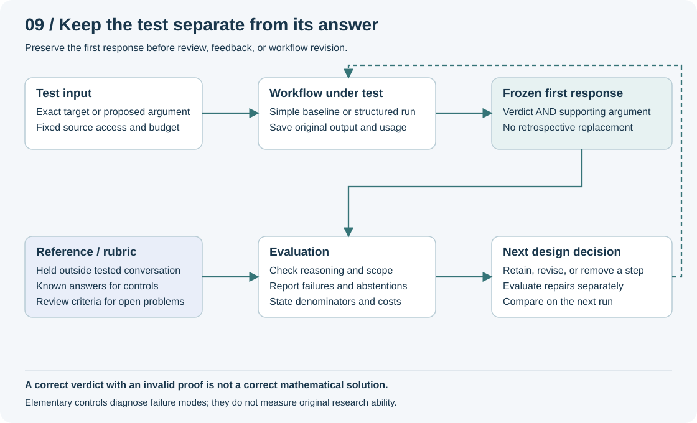

A research system should be judged by the mathematics it delivers and the errors it prevents at an acceptable cost. It should neither accept every plausible argument nor reject every proposal. This module builds a small controlled evaluation and then explains what must change when the target is an open research problem.

**Learning goals:** prepare valid and invalid controls, distinguish a decision from its supporting argument, report denominators and abstentions, compare workflows fairly, and assess partial progress without pretending to know the answer to an open problem.

## 1. Three questions that need separate answers

**Protocol fidelity:** did the system preserve the target, source versions, and assumptions? **Mathematical correctness:** are its inferences valid? **Research usefulness:** does the result advance a worthwhile objective? A perfectly organized record can contain a false proof; a correct elementary calculation can have little value for the chosen research problem.

Evaluate each dimension rather than averaging them into one unexplained score. A workflow change may improve recovery while adding no mathematical capability. That can still be valuable, but the evidence supports a narrower claim than “better at research.”

## 2. Prepare the reference set before the run

Use paired cases that change one important condition. The following set has known answers derived in earlier modules:

| Case | Reference result | Failure exposed |
|---|---|---|
| Continuous real-valued $f$ on $[0,1]$ | Maximum exists | Rejecting an applicable theorem |
| $f(x)=x$ on $(0,1)$ | No maximum | Missing attainment or compactness |
| Constant zero on $(0,1)$ | Maximum exists | Treating a failed hypothesis as a false target |
| Two-point section $(1,1)$ | Lifts as constant one | Rejecting a valid witness |
| Two-point section $(1,0)$ | Does not lift | Changing the specified section |
| Each natural number has a bound | True with $C=n$ | Misreading witness dependence |
| One natural number bounds all natural numbers | False using $n=C+1$ | Exchanging quantifiers |
| Uniform limit of continuous functions | Continuous | Rejecting a valid return bridge |
| $x^n$ on $[0,1]$, pointwise limit | Limit is discontinuous | Using the wrong convergence mode |

The two-point cases use the trivial bundle on the projective line over a field and two distinct rational points. Include these hypotheses in the inputs. A short label in the table does not replace a complete task statement.

Keep reference reasoning outside the tested conversation. Save the model's original response before giving feedback. Evaluate the first answer and any repaired answer separately. Otherwise an interactive lesson can be mistaken for first-attempt performance.

## 3. Decide what counts as a correct outcome

A correct yes/no answer with an invalid proof is not a correct mathematical solution. Ask for the exact conclusion, argument, assumptions, and sources actually used. Score the verdict and the reasoning separately when they differ.

For review tests, the input is a proposed argument. A correct decision accepts a valid argument, rejects a defective one with a localized reason, or explicitly abstains when evidence is unavailable. For theorem-solving tests, the input is a target; a valid counterexample can solve a false target. Do not mix these two tasks in a single acceptance rate.

Write a short rubric before testing:

| Dimension | Passing evidence |
|---|---|
| Target preservation | Same objects, domain, quantifiers, and conclusion |
| Mathematical argument | Every essential inference justified |
| Source use | Inspected material distinguished from recollection |
| Conditional scope | Unproved assumptions remain explicit |
| Revision handling | Changed evidence triggers the appropriate recheck |
| Usefulness | A named obligation is completed or sharply localized |

If the reviewer cannot determine whether an argument is correct, record that uncertainty. Do not manufacture a ground-truth label merely to finish a spreadsheet.

## 4. A worked scoring example with explicit denominators

The following numbers are **hypothetical**, chosen to explain reporting. They are not measured model results. Suppose a review set contains ten valid arguments and ten invalid arguments:

| Reference class | Accepted | Rejected | Abstained |
|---|---:|---:|---:|
| Valid: 10 | 7 | 1 | 2 |
| Invalid: 10 | 2 | 6 | 2 |

The invalid-acceptance rate is $2/10=20\%$. The valid-rejection rate is $1/10=10\%$. Overall abstention is $4/20=20\%$. Reporting only accepted outputs would instead give seven valid arguments among nine accepted, or $7/9$. That is a different denominator and answers a different question.

Likewise, there are thirteen correct decisions among sixteen non-abstaining decisions, but only thirteen correct decisions among all twenty cases. Neither number should be reported without naming its denominator. Abstention can be responsible when evidence is missing; it is still important to know how much of the task set the system completed.

These small counts are descriptive. They do not establish a stable error rate for future research mathematics. Report the underlying cases and repeat runs when feasible. If a rare failure is expensive, inspect the failure mechanism rather than trusting a favorable aggregate.

## 5. Evaluate changes, not just snapshots

Many dangerous errors appear after an initially correct answer. Add transition tests:

1. Change the section from $(1,1)$ to $(1,0)$ and deliver an old review.
2. Withdraw one of two alternative proof routes, then their shared premise.
3. Replace uniform convergence by pointwise convergence.
4. Resume from a checkpoint whose cited proof artifact is missing.

For each test, specify the expected state change before running it. Correct behavior often preserves some evidence while withdrawing a conclusion. A system that discards everything and a system that keeps everything both fail the more precise task.

The return arrow represents a design revision for the **next** run. It must not overwrite the original response. Otherwise the record no longer shows what the system did before assistance.

## 6. Compare a simple workflow with a structured one

Use the same tasks, source access, and total effort allowance for both workflows. Record the date, visible model settings, number of attempts, available tools, and actual outputs. If usage information is unavailable, say so and use an observable budget such as source inspections and review rounds; do not claim exact cost equivalence.

The baseline can be an ordinary request for a proof and review. The structured version adds target records, application tables, or version-aware checkpoints. Add one mechanism at a time when practical. If several change together, the result may support the combined workflow but cannot isolate which component caused the improvement.

Track elapsed time and total work separately. Count duplicate retrieval, human corrections, invalid arguments admitted, and useful obligations completed. Be alert to answer leakage: if the same conversation has already seen the reference proof, its subsequent solution does not measure an unaided attempt.

Familiar examples test specific behaviors; they are not a benchmark of original mathematical discovery. Use them to catch avoidable mistakes before moving to harder material, then test on less familiar cases with independently reviewable answers.

## 7. What changes for an open research problem?

You may not know whether the target is true. You can still inspect the validity and value of intermediate work. A useful deliverable might reconstruct a published lemma with its actual assumptions, prove a nontrivial special case, identify a counterexample to a proposed bridge, or reduce the target to a precise new obligation.

Distinguish an obstruction to a method from a counterexample to the theorem. A family on which an attempted uniform estimate fails can decisively rule out that route while leaving the main conjecture open. Likewise, failure to find prior work is not a proof of novelty. Record the searched corpus and unresolved literature questions.

For the final project, require at least two candidate improvements to a source result, a justified choice of one, two substantive proof routes, and an attempt at the hardest bridge. The project should include a reviewed intermediate result or decisive obstruction, recovery after evidence withdrawal, and comparison with a simpler workflow. A new theorem is welcome but not a sensible universal grading requirement.

The assessment should ask what a mathematician can now do that was not justified before the project. “We produced twenty agent reports” answers a different question.

## 8. Exercises and worked answers

1. A system rejects every argument

**Answer.** Its invalid-acceptance rate is zero, but it rejects all valid controls. Report both directions of error and completion. A single safety-looking number conceals that the system provides no useful admission decisions.

2. The correct verdict has a false proof

**Answer.** Record the verdict as correct and the mathematical solution as defective. For example, a constant function on an open interval has a maximum, but a proof asserting that the open interval is compact is invalid. Success must include the evidence required by the task.

3. A repaired answer is excellent

**Answer.** Preserve the first failure and report repair separately, including the feedback supplied. Repairability is a useful capability, but it is not first-pass correctness. Compare workflows under comparable feedback as well as comparable initial inputs.

4. No new theorem, but one route is decisively blocked

**Answer.** Assess whether the obstruction is correct, addresses a serious route, and changes the next research decision. A precise counterexample to the route's central lemma can be substantial progress. An unsupported statement that a route “seems difficult” is not comparable evidence.

## 9. Final submission: an inspectable research result

Submit task inputs, reference reasoning where available, original responses, review decisions, repairs, resource observations, and limitations. Conclude with one concrete design decision: retain, revise, or remove a mechanism, explaining which observed failure or benefit supports that decision.

This completes the core course. The advanced modules apply the same discipline to opportunity discovery, proof-sketch systems, birational geometry, and reported research implementations. Their architectures earn their complexity only when the resulting evidence improves a real mathematical decision.

---

[Course roadmap](/posts/2026/12/Agent-System/) · [Direct experiments](/posts/2026/08/agent-system/hands-on-lab/)
