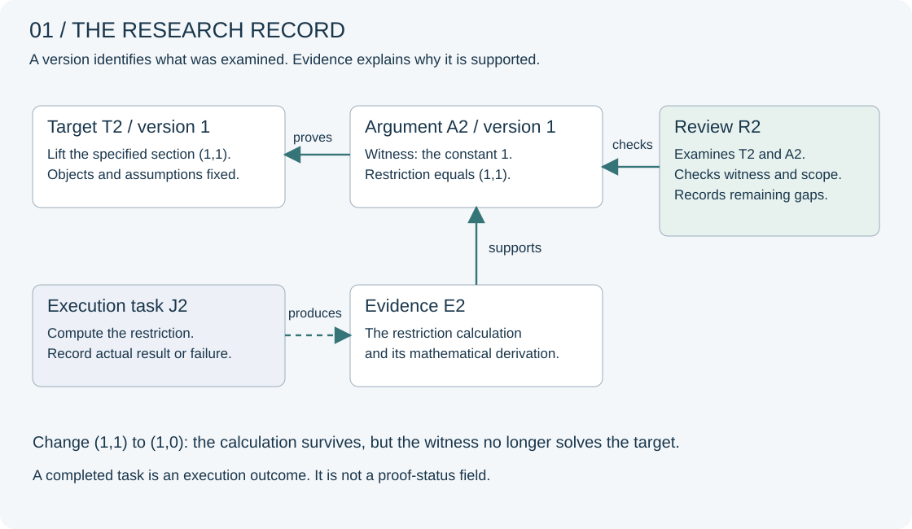

A mathematical research system must preserve the meaning of its task while its methods, evidence, and conclusions change. This module develops a representation that makes those changes inspectable. We begin with elementary logic, work through a constant-function example, and then construct a research record directly in Codex. The same records will later support linear systems and analysis examples.

**Lesson format:** plan for 60–90 minutes of explanation and discussion, followed by a separate laboratory. These are teaching allocations, not measured recording times. Sections 1–4 form the conceptual core; Sections 5–7 connect it to research; Sections 8–10 supply practice and assessment.

**By the end, you should be able to:** distinguish a statement from an argument; track assumptions through several steps; identify a changed target; explain which evidence survives a revision; and build a checkpoint another researcher can audit. No programming is required. The main example needs only real numbers and equality. No algebraic geometry is assumed.

## 1. Why conversation history is not a mathematical state

Imagine a conversation that begins with “Can a constant function take the values 1 and 0 at two different points?” After several attempts, the assistant reports “A nonzero constant exists, so the task is solved.” The conclusion answers a different question.

The problem is not primarily a lack of memory. The conversation may preserve every word while failing to distinguish a function with specified values from the existence of any function. More context does not repair an incorrectly represented target.

A research state should let a new reader answer four questions without reconstructing the entire conversation: What is the exact task? What supports each current conclusion? Which assumptions remain? What would need reconsideration if an input changed?

A transcript is still valuable as an audit trail. A state record is a structured interpretation of that trail, and can itself be wrong. Keep the source arguments available so that the interpretation can be checked.

## 2. Context, proposition, and justification

Write a mathematical judgment schematically as

$$\Gamma\vdash P.$$

Here $P$ is the proposition under consideration and $\Gamma$ contains the objects, definitions, and assumptions available to the argument. In this chapter the notation describes intended mathematical support; writing it in a Markdown file does not invoke a proof checker.

For example, Γ might specify a real-valued continuous function f on [0,1]. The proposition P says that f attains a maximum. If the domain changes to (0,1), the context changes, and the previous theorem application must be reconsidered. The function f(x)=x supplies a counterexample to the corresponding general claim on the open interval.

There are two ways to record a hypothesis. You may work in a context containing P and derive Q, or state the implication P implies Q. What you may not do is record Q as unconditional while silently dropping P.

### A chain of conditional conclusions

Suppose the available arguments establish P implies Q and Q implies R. If P is assumed, you obtain R conditional on P. If P is later proved, that assumption can be discharged using the proof. If P is withdrawn from the working context, the conditional implication may remain useful, but R no longer has the same unconditional support.

The official Lean text gives a formal treatment of propositions, proofs, implication, and assumptions. This module uses those distinctions informally; formal checking comes in Module 6. See [Propositions and Proofs](https://lean-lang.org/theorem_proving_in_lean4/Propositions-and-Proofs/).

### Quantifiers are part of the task

Compare these assertions over the natural numbers:

$$\forall n\;\exists C:\ n\le C,$$

$$\exists C\;\forall n:\ n\le C.$$

The first is true by choosing C=n. The second is false: after a proposed C is fixed, choose n=C+1. A record saying only “a bound exists” loses the dependence that distinguishes a theorem from a false statement.

**Discussion checkpoint:** when a paper writes “there exists a constant C,” what variables may C depend on? A research system should preserve that dependence explicitly wherever it matters to the next inference.

## 3. A complete worked example: can one constant give two prescribed values?

The idea we need is simple: **finding an object is not enough; it must satisfy the exact conditions requested.** We will first work with ordinary real numbers. Every step can be checked by substitution.

### Step 1. State the rules of the problem

We are allowed to choose a **constant function**. Once we choose its value $c$, the function has that value everywhere. In particular, at two different points called $p$ and $q$, its values are

$$
f(p)=c,\qquad f(q)=c.
$$

The restriction to constant functions is part of this example's rules. If we allowed arbitrary functions, assigning different values at the two points would be a different problem.

Our task is to find an allowed function with these **prescribed** values:

$$
f(p)=1,\qquad f(q)=0.
$$

“Prescribed” means that the values are already part of the question. We cannot replace the zero by a one to make the problem easier.

### Step 2. Test a proposed answer

Suppose the assistant proposes the constant function $f(x)=1$. This is an allowed function, and it is nonzero. But we must check both requirements:

| Point | Required value | Value of the proposed function | Matches? |
|---|---|---|---|
| $p$ | $1$ | $1$ | Yes |
| $q$ | $0$ | $1$ | No |

So this candidate fails. The error would be to report “a nonzero function exists, therefore the task is solved.” Existence answers only part of the question; matching the prescribed values is essential.

Could a different constant work? To match the value at $p$, we need $c=1$. To match the value at $q$, we need $c=0$. No real number satisfies both equations. This proves that **no allowed function solves this target**, rather than merely showing that our first attempt failed.

### Step 3. Compare three questions that sound similar

Now change the second prescribed value to one. The constant function $f(x)=1$ does meet both requirements. Keep this new task separate from the original:

| Task | Exact question | Answer |
|---|---|---|
| T1 | Can a constant function have values $1$ at $p$ and $0$ at $q$? | No: its values must be equal |
| T2 | Can a constant function have values $1$ at both points? | Yes: choose the constant $1$ |
| T3 | Does any nonzero constant function exist? | Yes: choose the constant $1$ |

T2 and T3 happen to have the same answer and the same example. They still ask different questions. Neither establishes T1. A research system must preserve this distinction even when the conversation moves quickly between the three tasks.

### Step 4. Give the calculation a reusable notation

Let $r$ mean “read off the values at the two points.” Its input is the chosen constant $c$; its output is the pair of observed values:

$$
r(c)=(c,c).
$$

For example, $r(0)=(0,0)$, $r(1)=(1,1)$, and $r(2)=(2,2)$. Every output has equal entries. Conversely, any pair with equal entries, say $(a,a)$, is produced by choosing $c=a$.

The **image** of $r$ means the collection of outputs it can produce. Here that collection consists exactly of pairs with equal entries. It is sometimes called the diagonal because those pairs lie on the line $y=x$ in the plane.

Given a desired pair $s$, a **lift** is an input $c$ that produces it. The equation to check is

$$
r(c)=s.
$$

This is all “lifting” means in the calculation: work backward from prescribed output to an allowed input. The pair $s=(1,1)$ has a lift; $s=(1,0)$ does not. Finding some input without checking its output is not enough.

### What the research system should save

Keep the target, candidate, test, and conclusion distinct:

```text
Target T1: find c such that r(c) = (1,0), where r(c) = (c,c).
Candidate: c = 1.
Test: r(1) = (1,1), which is not the required pair.
Candidate decision: this witness fails.
General argument: every output has equal entries; (1,0) does not.
Target decision: no lift exists under these rules.
Reusable result: (a,b) lifts exactly when a = b.
```

Notice the two different conclusions: the test rejects one candidate; the general argument rules out every candidate. A failed attempt alone would not justify the second conclusion.

**Quick check:** does $(3,3)$ lift? Does $(3,2)$? The first lifts by choosing $c=3$; the second cannot lift because its entries differ. If you can explain those answers and why T3 does not solve T1, you have the mathematical idea needed for the next section.

## 4. The five records and their responsibilities

A minimal design uses statements, arguments, evidence, reviews, and execution tasks. They can be sections of one file. Separate files become useful only when size or coordination makes them necessary.

| Record | Essential content | Error prevented by the distinction |
|---|---|---|
| Statement | Objects, assumptions, quantifiers, conclusion, version | Answering a nearby question |
| Argument | Conclusion, joint premises, inference, open steps | Treating a claim as its own justification |
| Evidence | Proof text, source passage, calculation, actual tool output | Replacing support with a confidence label |
| Review | Exact statement and argument examined, findings, scope | Reusing approval after relevant changes |
| Task | Requested action, input versions, execution outcome | Confusing a timeout with a refutation |

For T1, the statement asks for an input $c$ with $r(c)=(1,0)$ under the rule $r(c)=(c,c)$. The argument explains that every possible output has equal entries. Evidence is the calculation establishing that rule and its consequence. A review checks that the argument addresses the requested pair. A task might ask the assistant to describe all possible outputs; failure to finish that task does not show that the requested output is impossible.

A source quotation can be evidence about what a paper states without establishing that the theorem applies here. A tool log can establish that a process ran without establishing that its output means what we intended. Evidence must have an interpretation and a scope.

[](/images/agent-system/course-research-records.svg)

*Arrows name relationships between records, not steps that prove a theorem. The review is tied to the exact target and argument versions. A changed requested output requires checking that relationship again.*

### Why a single “verified” flag fails

A statement may have two arguments, only one of which has been reviewed. A review may approve a conditional argument. A formal check may concern a mistranslated proposition. A single flag collapses these situations.

Use separate fields for workflow status, evidence kind, and mathematical scope. For example: “reviewed; informal argument; conditional on P.” That record is informative without pretending that an informal review has formal assurance.

## 5. Dependencies belong to arguments

Suppose A1 proves T using P and Q together. Another argument A2 proves T using R. The support condition is: P and Q support A1, or R supports A2. It is not sufficient to establish only P, and it is not necessary to finish both routes.

| Available premises | A1 usable? | A2 usable? | Support for T |
|---|---|---|---|
| P only | No | No | None from these arguments |
| P and Q | Yes | No | Through A1 |
| R only | No | Yes | Through A2 |
| P, Q, and R | Yes | Yes | Two available routes |

This is the semantic content a dependency diagram must communicate. An unlabeled arrow from P to T would incorrectly suggest that P alone suffices. Argument nodes or explicit groups of joint premises avoid that ambiguity.

The table assumes the inferences themselves are valid. Bookkeeping cannot supply their proofs. If A1 is later found invalid, P and Q may remain true and reusable even though that route to T is lost.

Likewise, P implies Q and Q implies P do not establish either proposition without a starting point. Logical dependency and the sequence of executed tasks are different structures. A conversation may revisit a question many times without adding a premise.

## 6. Versions and identity: what changed mathematically?

Versioning is useful because reviews have a subject. Changing the requested output from $(1,1)$ to $(1,0)$ changes that subject. Changing a notation while preserving its definition may not change the proposition, but the system must justify the correspondence rather than infer it from similar wording.

Distinguish three changes:

- **Editorial:** punctuation or presentation changes without altering meaning. Check the claimed equivalence if later automation relies on it.
- **Mathematical:** the domain, requested output, hypotheses, or conclusion changes. Create a new statement version and reconsider affected applications.
- **Evidential:** a cited result is corrected or an argument is withdrawn. The statement can remain unchanged while its support changes.

An identifier is a reference, not a mathematical invariant. A content hash detects changes in text, not equivalence of propositions. Two equivalent statements can have different text; identical-looking text can use different definitions in different contexts. The record must preserve enough context to interpret its identifiers.

### A useful revision experiment

Review T2 using the input $c=1$: its output is $(1,1)$, as requested. Then change the requested output to $(1,0)$ and retain the old review. The calculation $r(1)=(1,1)$ is still correct, but it no longer matches the request. The rule describing all outputs also survives. Reuse those calculations while withdrawing the claim that this input solves the new target.

## 7. Extend the record to a linear system

An input may have several coordinates. Let $A(x,y)=(x+y,x-y,2x)$ and ask for the specified output $(a,b,c)$. The first two equations force

$$
x=(a+b)/2,\qquad y=(a-b)/2.
$$

Substitution into the third equation requires $c=a+b$. Conversely, if that equality holds, the displayed input satisfies all three equations. We have proved an exact criterion, not merely a necessary condition.

For $(3,1,4)$, the input $(2,1)$ works. For $(3,1,5)$, no input works. Store the common map once, but keep the two target records and their evidence separate. An accepted solution of the first target cannot be reused as a solution of the second.

This is a useful reduction: replace the search over all inputs by a compatibility calculation, then reconstruct an input when compatibility holds. The record needs both directions. A failed candidate does not prove impossibility; a nonzero compatibility error does, because we proved every output satisfies the relation.

**Try it before continuing.** Request $(0,2,2)$, compute the candidate, and check all three entries. Then change only the third entry to 3. Record the exact inference that changes. No new terminology or software framework is needed.

## 8. Laboratory: build and challenge the representation

Use a fresh conversation or a dedicated folder in Codex. Save initial outputs before giving corrective hints. These instructions define an experiment; they are not evidence that Codex has already passed it.

### Round A: construct the record

```text
Create RESEARCH.md for real numbers with the given map r(c) = (c,c).
Create three distinct targets: produce (1,0), produce (1,1),
and find any nonzero input c. Supply arguments, not just verdicts.
Test each proposed input by computing its output.
Distinguish rejecting one candidate from ruling out every candidate.
Separate the given rule from the conclusions you derive.
```

**Inspect:** all three targets appear; each proposed input is checked against the required output; impossibility is justified using the equal-entry rule.

### Round B: introduce a bad witness and a stale review

```text
For r(c) = (c,c), the requested output is (1,0). Test the input c = 1.
Compute its output and compare both entries with the requested pair.
Now take a review approving c = 1 for the old target (1,1).
Determine whether that review also approves it for the new target (1,0).
Identify exactly what survives and what requires a new justification.
Preserve the initial incorrect proposal and its diagnosis.
```

**Expected result:** $r(1)=(1,1)$, so the input fails to produce $(1,0)$. The earlier calculation remains valid, but the old approval does not solve the revised problem.

### Round C: test assumptions and alternatives

```text
For a separate logical exercise, stipulate valid implications
(P and Q) implies T, and R implies T.
Report support with P only, with P and Q, and with R only.
Then assume rather than establish R. Preserve that assumption in T's status.
Do not claim the stipulated implications were independently proved.
```

**Inspect:** the results match the dependency table and conditional scope remains explicit.

### Round D: recover from a checkpoint

Ask Codex to save the exact targets, arguments, assumptions, rejected witness, and next question. Start another conversation with only that record. Ask for the current status of T1–T3 before allowing further research. Compare the reconstruction with the saved evidence. A successful file write does not imply successful mathematical recovery.

## 9. Exercises with worked answers

<details markdown="1">
<summary>Exercise 1 — Diagnose a change of target</summary>

A task asks for an input producing a specified output $s$. The response supplies only a nonzero input $c$. What additional equation must be checked?

**Answer.** Check $r(c)=s$. Being nonzero does not establish this equality. For $r(c)=(c,c)$, the input $c=1$ produces $(1,1)$, not $(1,0)$.

</details>

<details markdown="1">
<summary>Exercise 2 — Preserve conditional scope</summary>

Assume P. You have arguments P implies Q and Q implies R. A saved summary says “R established.” Repair it. What changes if an independent proof of R is later added?

**Answer.** Record R conditional on P, with the two implication arguments as support. An independent proof of R gives a second, unconditional route. Withdrawing the assumption P removes the first route's availability but does not invalidate the independent proof.

</details>

<details markdown="1">
<summary>Exercise 3 — Classify a revision</summary>

A source correction adds hypothesis H to a theorem previously used to establish Q. Must Q now be false?

**Answer.** No. The application needs reconsideration. If H is established in the current setting, the corrected theorem may still apply. Otherwise that route has an open obligation. Another argument might independently establish Q. None of these bookkeeping changes alone supplies a counterexample to Q.

</details>

<details markdown="1">
<summary>Exercise 4 — Generalize the worked calculation</summary>

Extend the output rule to $m$ entries: an input $c$ produces $(c,\ldots,c)$. Which requested outputs are possible? Treat $m=1$ separately. What must be reconsidered if the output rule changes?

**Answer.** For $m\geq1$, precisely the outputs whose entries are all equal can be produced. For $m=1$, any requested value $a$ is produced by $c=a$. A different rule requires a new calculation of possible outputs.

</details>

<details markdown="1">
<summary>Exercise 5 — Design a record for your own mathematics</summary>

Choose a proof step involving a specified function, output, bound, or parameter. Write its exact target, one argument, and one tempting nearby statement. Identify a change that would invalidate the argument's current review.

**Answer guide.** There is no universal target here. A satisfactory submission names the mathematical objects and assumptions, supplies the actual inference, and gives a concrete distinction that affects the conclusion. “The model might hallucinate” is not a localized failure analysis. An example of a meaningful change is changing the requested vector, changing the permitted polynomial degree, or interchanging the order of dependent quantifiers.

</details>

## 10. Assessment and design limits

Submit the research record, initial and corrected assistant outputs, a checkpoint comparison, and your solution to Exercise 5. Assess mathematical fidelity first. A record that solves the wrong target fails even if its formatting is perfect.

A strong submission preserves exact objects, explains every claimed conclusion, tracks assumptions across steps, diagnoses the stale review selectively, and distinguishes actual execution from an expected answer. An adequate submission may remain incomplete if it identifies the exact gap honestly. Unsupported certainty is not an improvement over an explicit open obligation.

Do not create five databases for a ten-line proof. Begin with one Markdown document. Split it when the arguments become large, sources need independent versioning, or multiple tasks repeatedly interfere with each other's state. Representation has a maintenance cost: redundant records can drift apart. Keep one authoritative statement version and refer to it from reviews.

The schemas and laboratory protocol are course design proposals. Their mathematical examples have derivations above; their behavior in a particular assistant session must be observed. This distinction remains important as AI improves: stronger generation changes how efficiently records are produced, not what makes an inference valid.

## Reading and continuation

For the logical distinction between propositions, assumptions, and proofs, read the official [Lean chapter on propositions and proofs](https://lean-lang.org/theorem_proving_in_lean4/Propositions-and-Proofs/).

The next module uses the records developed here to choose research actions and represent joint premises and alternative routes. Bring RESEARCH.md forward rather than starting a new unrelated example.

[Course roadmap](/posts/2026/12/Agent-System/) · [Next: plan and search](/posts/2026/08/agent-system/plan-and-execute/)
