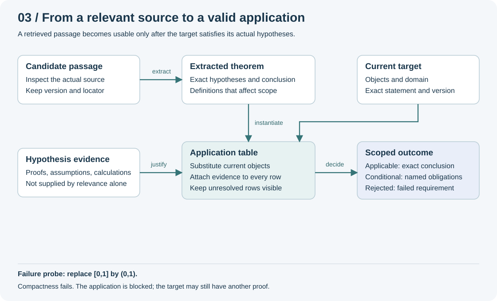

A relevant paper is a starting point. To use it in a proof, you must identify its exact theorem, match its objects to yours, and discharge its hypotheses. This module turns that familiar mathematical practice into a research workflow that can be delegated and audited.

**Learning goals:** distinguish retrieval from application; build a hypothesis table; diagnose a near-match; and decide when more searching is less useful than proving a missing condition. Modules 1–2 are prerequisites. The main example needs only elementary real analysis; the second example uses elementary linear algebra.

**Lesson route:** work through Sections 1–4, run the source-application laboratory, and finish with the exercises. The deliverable is one justified application and one rejected or conditional near-match, with enough evidence for someone else to reproduce the decision.

## 1. Why an accurate quotation is still insufficient

Suppose a source states: a continuous real-valued function on a nonempty compact space attains a maximum. Your target concerns a continuous function on an open interval. The quotation can be perfectly accurate while the application is invalid. The missing step is not another summary of the source; it is compactness of your domain.

Write the source theorem schematically as $H_1\land H_2\land H_3\Rightarrow C$. Applying it requires a substitution of your objects into the statement and proofs of the instantiated hypotheses. Names alone do not establish the substitution: the source's $X$ might be projective, smooth, or defined over a different field from your $X$.

There are therefore two separate records. A **source record** says what the inspected source asserts and where. An **application record** says why that assertion can be used here. One theorem may have many applications; a correct theorem may have several invalid applications. Keeping those records separate makes repairs local.

## 2. A complete application: attainment of a maximum

Let $f:[0,1]\to\mathbb R$ be continuous. We want a point $x_{\ast}\in[0,1]$ such that $f(y)\leq f(x_{\ast})$ for every $y\in[0,1]$.

| Source requirement | Substitution | Evidence |
|---|---|---|
| Nonempty space | $X=[0,1]$ | $0\in X$ |
| Compactness | Usual topology on $[0,1]$ | Closed bounded interval in $\mathbb R$ |
| Real-valued map | The specified $f$ | Its declared codomain |
| Continuity | Continuity of this $f$ | An explicit hypothesis of the target |

The conclusion follows from these rows jointly. It establishes existence, not uniqueness or a computational procedure. For example, a constant function has every point as a maximizer.

It is useful to understand the theorem's mechanism. The image $f([0,1])$ is a nonempty compact subset of $\mathbb R$, hence bounded and closed. Let $M$ be its supremum. For each positive integer $n$, the definition of supremum supplies an image point greater than $M-1/n$. These points converge to $M$, so closedness gives $M\in f([0,1])$. Choose a preimage $x_{\ast}$.

This explanation reveals why boundedness alone is insufficient: a bounded image may omit its supremum. It also explains why a source that only proves boundedness cannot silently supply attainment.

Now change the domain to $(0,1)$ and set $f(x)=x$. The function is continuous and bounded above, but has no maximum. Given any $x\in(0,1)$, the point $y=(x+1)/2$ still belongs to $(0,1)$ and satisfies $y>x$. We have both an inapplicable theorem and a counterexample to the proposed general conclusion. Those are distinct findings.

Change instead to the constant function $g(x)=0$ on $(0,1)$. Compactness still fails, but the maximum exists. Thus **failure of a theorem's hypotheses does not by itself refute the target**. It blocks that application. Another argument may succeed.

## 3. The source-to-application architecture

[](/images/agent-system/course-source-application.svg)

Read the diagram as an evidence pipeline. Search produces candidates, not premises. Extraction produces a statement with a locator. The application step also needs the target and independent evidence for its hypotheses. Its output is either a justified conclusion, a conditional application with named obligations, or a rejected match with a reason.

For a small project, use three ordinary documents:

```text
SOURCES.md
  S1: title, author, version/date, exact locator, inspected passage
  statement and definitions needed to interpret it

APPLICATIONS.md
  A1: target T3-v1; source S1-v1
  substitution; each hypothesis and its evidence
  exact conclusion; unresolved obligations

SEARCH-LOG.md
  question searched; sources actually opened
  promising and rejected candidates; next search or proof action
```

These files do not enforce correctness. They make the assistant's decisions visible. Start with one application; split records into more files only when their size or reuse makes that helpful. Copying the same theorem into many summaries creates another opportunity for versions to diverge.

The source locator should be recoverable: a theorem number, section, page in a specified edition, or stable identifier. Do not invent missing locators. A supplied excerpt can support an application within its stated scope, but should be labeled as supplied rather than independently checked against the entire paper.

## 4. Check the exact object, not just the theorem name

In Module 1, a claim about outputs of linear functions cannot automatically be applied to a problem allowing only constants. The words “function” and “two values” match, but the allowed inputs differ. Source applications need the same object-level precision.

### A correct theorem about the wrong matrix

Consider

$$
A_t=\begin{pmatrix}1&0\\0&t\end{pmatrix}.
$$

When $t\ne0$, the determinant is nonzero, so every requested vector $(a,b)$ has the solution $(a,b/t)$. At $t=0$, the same formula is undefined and the output is always $(x,0)$. A specified target is attainable exactly when $b=0$.

The source theorem about invertible matrices remains correct. Its old application does not survive the parameter change. Record the matrix, parameter, requested vector, determinant condition, and evidence for that condition. If $b=0$, a direct calculation can still solve the task even though the invertibility theorem cannot be used.

**Try it.** First request $(2,3)$ at $t=1$. Then set $t=0$ and deliver the old approval. Finally request $(2,0)$ at $t=0$. The correct sequence is: solvable, impossible, solvable by a different argument. A system that equates “the theorem does not apply” with “the target is false” fails the third case.

## 5. A laboratory in ChatGPT or Codex

Use a theorem passage you can legally access and understand. For the first run, the maximum theorem above is enough. For the second, choose a theorem from a paper in your authorized research corpus. Keep the task narrow: one application, not a literature survey of an entire field.

```text
Create a source record and an application record for the supplied passage.
Target: [write the exact statement and objects].
Extract the theorem's hypotheses, conclusion, and necessary definitions.
For each instantiated hypothesis, give evidence or mark it unresolved.
Distinguish text I supplied from sources you actually inspected.
Do not repair the target without recording a separate proposed target.
Return the exact conclusion this application would justify.
```

First inspect the target and source records yourself. Then change one assumption: replace the closed interval by the open interval. Ask for a revised application without deleting the original. A successful response withdraws the compactness evidence and distinguishes “this theorem is unavailable” from “this function has no maximum.” Test both $f(x)=x$ and $g(x)=0$.

For the research run, ask the assistant to identify the hardest unresolved hypothesis and propose one next action with a concrete output. “Search more papers” is too vague. “Inspect Theorem 2.3 of this accessible source to see whether its positivity condition applies to this twist” is reviewable. If the source cannot be accessed, that action remains incomplete.

Stop a search round after its stated scope is exhausted. Record the corpus, queries, inspected sources, and unresolved obligation. A bounded search with no match means no applicable theorem was found in that search; it is not a theorem of nonexistence or a proof of novelty.

## 6. Exercises and worked decisions

<details markdown="1">
<summary>1. A bounded image: what is missing?</summary>

A report proves that a continuous function has bounded image and concludes that its supremum is attained. Identify the missing bridge.

**Answer.** Boundedness gives a finite supremum for a nonempty image, but does not place that supremum in the image. Closedness of the image would supply the bridge. The map $f(x)=x$ on $(0,1)$ gives a bounded image whose supremum is absent. The boundedness result survives; attainment does not follow.
</details>

<details markdown="1">
<summary>2. A failed hypothesis with a true conclusion</summary>

Give a noncompact domain and continuous function with a maximum. What status should its compactness-based application receive?

**Answer.** On $(0,1)$, the constant function $0$ attains its maximum everywhere. The compactness-based application is inapplicable, while a direct argument proves the target. Record these separately; marking the target false would conflate an argument with its conclusion.
</details>

<details markdown="1">
<summary>3. Correct source, changed parameter</summary>

A source theorem applies to invertible matrices. The parameter changes from t=1 to t=0 in the matrix above. May the system reuse the source record?

**Answer.** Yes, as a record of the theorem. Its application must be reconsidered because the determinant is now zero. Solve the requested vector directly or find another applicable result. The source is not wrong merely because its hypotheses fail in the new task.
</details>

<details markdown="1">
<summary>4. When should retrieval stop?</summary>

After inspecting five relevant sources, all available statements need the same unproved uniform-bound condition. What is a useful next task?

**Answer.** Isolate that condition as a mathematical obligation and attempt it in a tractable example or under the current hypotheses. More retrieval is justified only by a specific alternative to test. A report should preserve what was searched so another session does not repeat the same five near-matches.
</details>

## 7. What to submit

Submit the source passage and locator, object substitution, hypothesis evidence, exact conclusion, and the failed variant. Add the actual conversation or file output so a reviewer can compare the generated records with their inputs. The mathematical derivations above are reference answers; they are not measurements of any assistant's reliability.

The durable skill is recognizing **which theorem is being applied to which objects, with which evidence**. Better retrieval and stronger models reduce the labor. They do not remove this mathematical obligation.

---

[Course roadmap](/posts/2026/12/Agent-System/) · [Direct experiments](/posts/2026/08/agent-system/hands-on-lab/) · [Next module](/posts/2026/08/agent-system/reasoning/)
