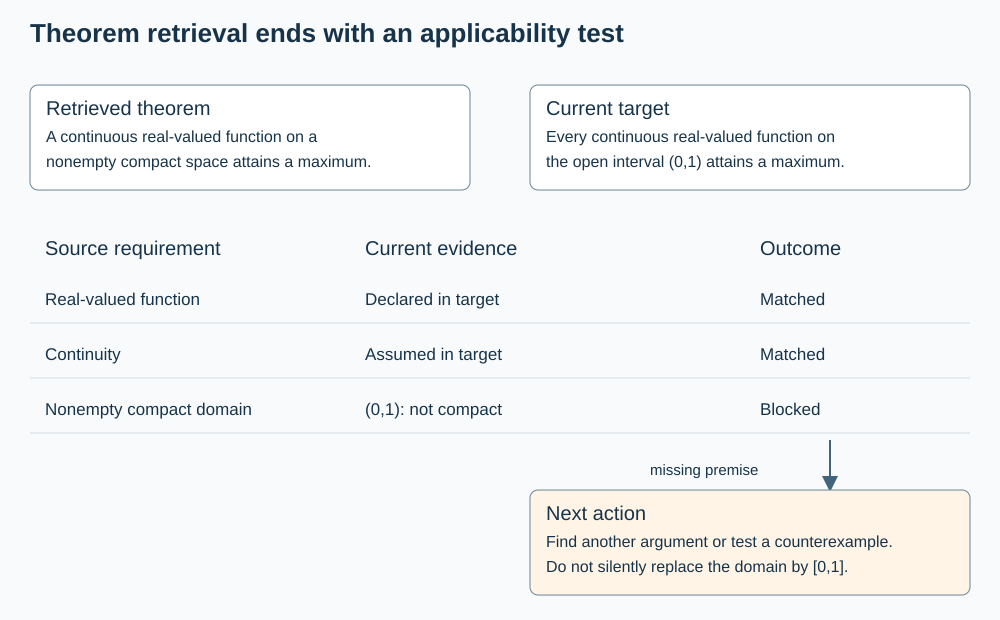

A relevant theorem is a candidate tool. In Case A, a vanishing theorem helps only if its hypotheses apply to the exact cohomology group needed by the lifting sequence. A result for a nearby twist can be relevant and still fail the task.

## From source to usable premise

Retrieve a stable source locator, theorem statement, definitions, and version. Instantiate the theorem's variables with the current objects. For each hypothesis record established evidence, a contradiction, or an open obligation. Keep the derived conclusion explicit so that a result about the wrong sheaf cannot masquerade as completion.

*The elementary compactness example is a diagnostic fixture. The same matrix is needed for positivity, singularity, and divisibility assumptions in research mathematics.*

Retrieval establishes that a source contains a statement. It does not by itself verify that statement or our application. The project's policy determines how external results are admitted; the application still needs its own justification.

## Preserve rejected matches

“Positivity unavailable for this twist” is useful memory. “Irrelevant paper” often is not. A later worker may repair the missing condition or use the same theorem on another branch.

Version the source and application separately. A corrected theorem can invalidate applications, while a new object version can make a previously valid application inapplicable without changing the source.

## Build and test

Prepare two Case A source records: one applicable after an explicit positivity argument and one for the wrong twist. Produce the hypothesis matrix and the exact resulting conclusion for each. Reject the mismatch even if both records contain the word “vanishing.”

Read with the [three running cases](/posts/2026/08/agent-system/research-cases/). Source provenance and the distinction between established patterns and our proposed specialization are explained in [sources and claims](/posts/2026/08/agent-system/sources-and-claims/).

---

[Series guide](/posts/2026/08/Agent-System/) · [Running cases](/posts/2026/08/agent-system/research-cases/) · [Laboratory](/posts/2026/08/agent-system/hands-on-lab/)
