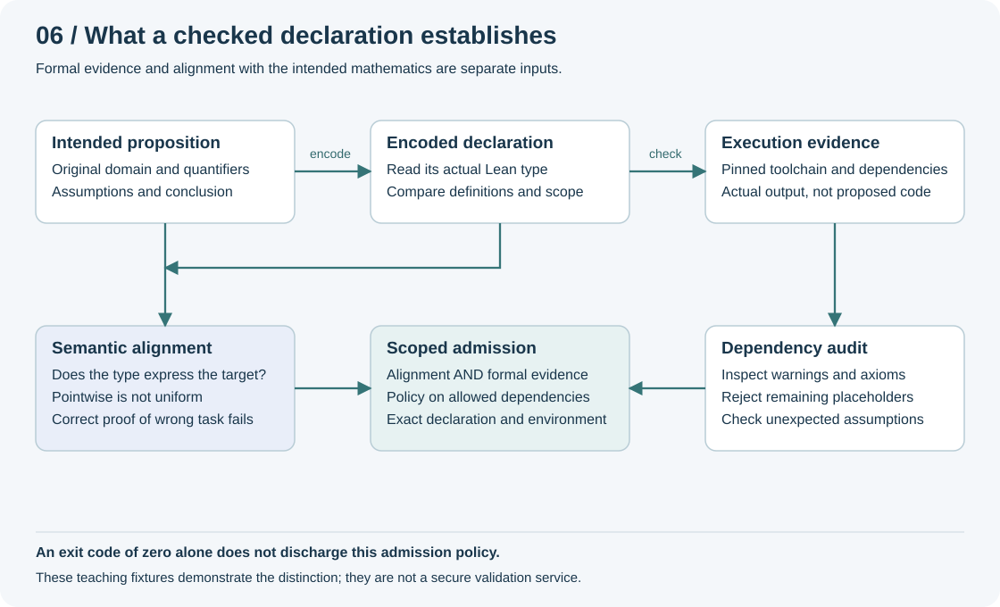
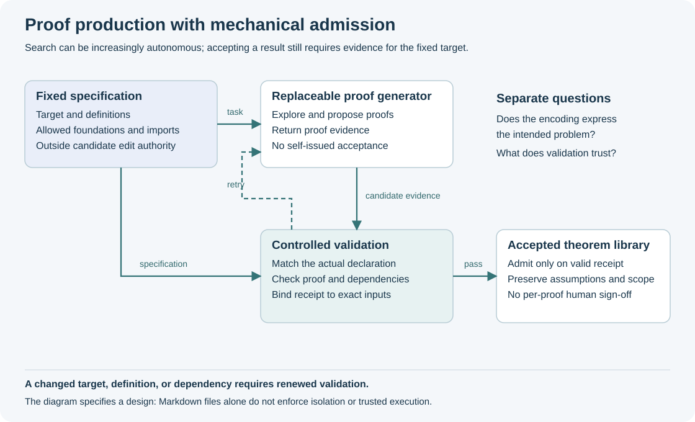

Use [the minimal-surface uniqueness workshop](/posts/2026/08/agent-system/birational-proof-workshop/) and its source packet. If the necessary geometric library is unavailable, encode only the abstract two-sign implication: coefficientwise nonnegativity of D and -D implies D = 0. State the finite index set and coefficient function explicitly. Keep the geometric negativity applications and descent as imported, unformalized obligations.

**Mathematical output:** Actual checker evidence for the encoded lemma, if run, and an explicit list of what it does not certify about the surface theorem.

**Value test:** preserve the direct-request baseline. Assess whether this intervention closes a previously unresolved obligation or reaches the same checked result with less measured work. Include retries and mathematical hints. This is a proposed exercise, not a reported improvement.


**The practical question:** when an agent returns Lean code, what evidence would justify using its result in another proof?

This module introduces formalization through one small mathematical mistake: exchanging two quantifiers. You will read a proof state, complete a proof, and compare a rejected argument with two files that compile but do not establish their claimed result under our policy.

**Prerequisites:** Modules 1–5 and elementary proof writing. No previous Lean knowledge is required. **Deliverable:** a completed proof file and a short report identifying the encoded statement, dependencies, and remaining trust assumptions.

[Download the complete exercise project](/files/lean-reasoning-lab.zip). It uses core Lean, without mathlib or a model API.

## 1. A statement worth getting exactly right

For every natural number $n$, there is a natural number $C$ with $n\leq C$. Choose $C=n$. But there is no single natural number bounding every natural number: given $C$, choose $n=C+1$.

$$
\forall n\in\mathbb N\;\exists C\in\mathbb N:\ n\leq C.
$$

This does not imply the uniform statement

$$
\exists C\in\mathbb N\;\forall n\in\mathbb N:\ n\leq C.
$$

The first witness may depend on $n$. The second must work for every $n$. This short formal exercise isolates dependence of a witness on its input. It teaches how the encoded proposition fixes the task; it is not a formalization of the geometric project.

```lean
theorem pointwiseBound : ∀ n : Nat, ∃ C : Nat, n ≤ C := by
  intro n
  exact ⟨n, Nat.le_refl n⟩
```

Read the theorem declaration as a contract. `Nat` fixes the domain. `∀` and `∃` fix the quantifier order. The text after `by` supplies a proof.

| Position | Available information | Remaining goal |
|---|---|---|
| Before `intro n` | No chosen natural number | `∀ n : Nat, ∃ C : Nat, n ≤ C` |
| After `intro n` | An arbitrary `n : Nat` | `∃ C : Nat, n ≤ C` |
| After `exact …` | Witness `n` and proof `n ≤ n` | No remaining goal |

`intro` introduces the universally quantified variable. The pair `⟨n, Nat.le_refl n⟩` supplies both the witness and its required property. Tactics help construct a proof term; checking concerns that term and its proposition, rather than the persuasiveness of the tactic text.

## 2. A proof that the uniform version fails

```lean
theorem noUniformBound : ¬ ∃ C : Nat, ∀ n : Nat, n ≤ C := by
  intro h
  cases h with
  | intro C hC =>
    exact Nat.not_succ_le_self C (hC (Nat.succ C))
```

Assume the proposed uniform bound exists. Extract its value `C` and the assertion `hC` that every natural number is at most `C`. Apply that assertion to `Nat.succ C`. It contradicts `Nat.not_succ_le_self C`.

**Pause before running:** point to the exact expression that chooses a counterexample *after* seeing the proposed bound. It is `hC (Nat.succ C)`. This dependence explains the mathematics.

Read the proof through its changing context:

| Step | New information | Task remaining |
|---|---|---|
| `intro h` | A hypothetical common bound exists | Derive `False` |
| `cases h` | A particular `C` and `hC : ∀ n, n ≤ C` | Derive `False` using these witnesses |
| `hC (Nat.succ C)` | A proof that `C + 1 ≤ C` | Contradict the order on natural numbers |
| `Nat.not_succ_le_self C` | A proof of `¬ (C + 1 ≤ C)` | Apply it to the contradictory inequality |

Negation is used here as an implication to `False`. The last line supplies the forbidden inequality to a proof that it cannot hold. Nothing numerical about `C` needs to be computed: the argument works for the arbitrary bound extracted from `h`.

This also explains a common failed repair. If the assistant changes the existential witness to a number depending on `n`, it is proving the pointwise statement again. The uniform statement chooses `C` before `n` is introduced. The official [quantifiers tutorial](https://lean-lang.org/theorem_proving_in_lean4/Quantifiers-and-Equality/) develops the introduction and use of universal and existential claims; the proof-state analysis here applies those rules to our example.

## 3. Run the laboratory

Use the [official Lean installation instructions](https://lean-lang.org/install/) and an editor with Lean support. Extract the project and open its directory. The `lean-toolchain` file pins **Lean 4.19.0** for reproducibility; this is a teaching version, not a claim about the latest release. The first run may download it.

```text
lake build
lake env lean Formalization.lean
lake env lean fixtures/Broken.lean
lake env lean fixtures/Incomplete.lean
lake env lean fixtures/ExtraAxiom.lean
```

`lake build` builds only the completed library. `Exercises.lean` and the deliberately damaged fixtures are separate. Run each fixture directly, or ask Codex to run the same commands and retain the actual output. The broken fixture is expected to fail. No Python wrapper is needed.

| File | Observed behavior on Lean 4.19.0 | What the class should conclude |
|---|---|---|
| `Formalization.lean` | Compiles; both declarations report no axioms | The two encoded statements have checked proofs in this environment |
| `Solutions.lean` | Compiles; both declarations report no axioms | Reference solutions for the exercises |
| `fixtures/Broken.lean` | Fails with a type mismatch | A proof of arbitrary `P` cannot fill a goal of arbitrary `Q` |
| `fixtures/Incomplete.lean` | Compiles with a warning; reports `sorryAx` | A placeholder remains |
| `fixtures/ExtraAxiom.lean` | Compiles; reports `inventedBound` | The result relies on the very bound that was assumed |

These outcomes were run locally with the pinned toolchain. A successful regression run means the fixtures behaved as expected. It does **not** mean every example contains an acceptable proof.

## 4. Compilation and admission answer different questions

Run these commands and compare their output:

```text
lake env lean fixtures/Broken.lean
lake env lean fixtures/Incomplete.lean
lake env lean fixtures/ExtraAxiom.lean
```

The first file supplies `hP : P` where `Q` is required. The second uses `sorry`. The third declares the desired bound as an axiom and then uses it. Merely checking the process exit code would miss both latter cases.

The elaborator turns the source and tactic instructions into an explicit proposition and proof term. The kernel then checks that the term has the proposition as its type. In Fred's example, from $g(f(x))=g(f(y))$, injectivity of $g$ supplies the equality $f(x)=f(y)$ that injectivity of $f$ requires. Applying injectivity of $f$ directly would supply a term of the wrong type. This is the same kind of check exposed by the broken fixture. [Stanford MATH 289, Lean kernel lecture, pp. 9 and 18–26](https://web.stanford.edu/class/math289/lean_fred.pdf#page=9).

Lean provides `#print axioms theoremName` to expose a declaration's axiom dependencies. Our completed elementary examples need none. This does not justify a universal “reject every axiom” policy: other developments deliberately use standard foundations such as choice. State the allowed foundations for the project and audit unexpected additions. See the official [axiom reference](https://lean-lang.org/doc/reference/latest/Axioms/).

An operational record should bind the original statement, formal declaration, exact source and dependency versions, validation output, and reviewer decision. If any of those inputs change, reconsider the admission decision. A label such as `formal-checked` without this evidence is just text.

## 5. The boundary formalization does not remove

[](/images/agent-system/course-formal-evidence.svg)

Two different inputs meet at admission. One is evidence that the formal declaration was checked under the chosen environment and dependency policy. The other is a semantic comparison showing that the declaration says what the research task intended. A successful checker run cannot supply the second comparison by itself.

Suppose an agent formalizes the pointwise statement when you asked for a uniform bound. A correct proof of the first statement still misses your target. Compare the intended and encoded statements before accepting the result: domains, quantifier order, assumptions, definitions, and conclusion all matter.

Otis's example from Erdős problem #480 shows how small the mismatch can be. An early formalization required $m\ne 0$, leaving $n=0$ available where the intended statement required $n\ne 0$. For $n=0$, the two sequence terms coincide and Lean's division by zero makes the right-hand side zero. The inequality holds for every positive $m$, so the encoded infinitude claim has an easy proof. As a specification test, ask which degenerate inputs the declaration admits and compute what the conclusion says on them. [Stanford MATH 289, Lean introduction, pp. 27–28](https://web.stanford.edu/class/math289/lean_otis.pdf#page=27).

Also distinguish these hand-inspected teaching files from arbitrary generated source. Executing generated Lean code and trusting its displayed messages is not a secure validation service. A production system needs isolated execution, controlled dependencies, and validation appropriate to its threat model. The official [proof-validation guide](https://lean-lang.org/doc/reference/latest/ValidatingProofs/) explains stronger checking procedures and their trust boundaries. Its current tooling may differ from this pinned teaching project.

These direct fixture runs are demonstrations, not an implementation of those stronger procedures.

## 6. A useful first formalization project

Complete `Exercises.lean` before opening `Solutions.lean`:

1. Prove `∀ n : Nat, ∃ C : Nat, n < C` by choosing a successor. The exercise file supplies `n` as an argument.
2. Rebuild the proof that no largest natural number exists.
3. Run the file and inspect both axiom reports. Explain why an exit code of zero is insufficient while a `sorry` remains.
4. Write a two-column comparison of the informal and formal statements. Explain how the witness depends on the input.
5. Submit a short admission report: exact declaration, toolchain, dependencies, checker output, semantic alignment, and decision.

**Success criterion:** both completed proofs compile without placeholders, their axiom reports match the stated policy, and the informal/formal comparison preserves the problem. A repaired proof of a weakened target does not satisfy the assignment.

### Work with Codex without giving away the mathematical task

Ask for a small, inspectable change and an actual execution record:

```text
Read the pinned Lean project and the existing exercise declarations.
Explain the mathematical statement before editing a proof.
Complete one exercise without changing its declaration or adding axioms.
Run it with the pinned toolchain and retain the real command output.
Inspect its axiom dependencies and compare the result with the original task.
If execution is unavailable, report proposed code, not a checked proof.
```

When an error occurs, ask the assistant to explain the goal and available hypotheses at that location before changing tactics. An arbitrary tactic search can eventually succeed, but reading the proof state teaches you whether the assistant is proving the right statement. Reject repairs that add the desired result as an assumption or change the quantifier order.

You do not need to learn general-purpose programming to conduct this exercise. You do need to read the proposition, inspect a few proof states, and understand what the execution evidence establishes. Delegating syntax does not remove responsibility for selecting the right mathematical statement.

### Questions to answer before opening the solutions

<details markdown="1">
<summary>Why does a strict pointwise bound use a successor?</summary>

For a fixed natural number $n$, choose $C=n+1$. The required property is $n<n+1$. Choosing $C=n$ worked for a non-strict bound but fails for this strict one. The witness and the proof of its property must both change. The supplied solution uses the corresponding basic fact about the successor order.
</details>

<details markdown="1">
<summary>Why can a file compile while its result is unacceptable?</summary>

The incomplete fixture contains a placeholder, represented in the dependencies by `sorryAx`. The extra-axiom fixture assumes a bound instead of proving it. A checker can accept a derivation relative to such assumptions while the course's admission policy rejects it as an unconditional solution. Inspect warnings and dependencies, not only the exit code.
</details>

<details markdown="1">
<summary>Does an empty axiom report prove semantic alignment?</summary>

No. A proof of the pointwise statement can have no axioms and still fail a request for a uniform bound. Inspect the declaration, including domains, assumptions, definitions, and quantifier order. Checking a different true proposition is not completion of the intended problem.
</details>

<details markdown="1">
<summary>What should be formalized first in a research argument?</summary>

Choose a consequential, sharply stated bridge whose prerequisites can be represented with available definitions. Estimate that translation work before committing. A small formalized lemma is useful when its interface with the informal proof is explicit; it should not be advertised as verification of the entire paper.
</details>

## 7. Moving toward research mathematics

For larger developments, [Mathematics in Lean](https://leanprover-community.github.io/mathematics_in_lean/) teaches mathematical use of Lean and mathlib. Begin with a small lemma whose definitions and prerequisites already exist in the library. Pin the project toolchain and dependency revision together. Library availability and translation effort are part of project selection.

A useful progression is: read existing formal statements, fill short proofs, reuse library theorems with the right hypotheses, and then formalize one fragile bridge in a research argument. An advanced geometry theorem may require substantial missing infrastructure. A formalized local lemma is valuable partial progress, but does not certify an entire informal manuscript.

For a paper-scale project, Otis's liquid-drop example starts with a Lean statement of the target and a blueprint of precise intermediate lemmas. Agents work on the blueprint, and a comparator checks that the resulting formal theorem matches the separately specified formal target. The link from the paper to that target still calls for a mathematical comparison. In our surface project, the analogous blueprint would keep the two geometric negativity applications, the coefficientwise comparison, and descent as separate obligations. A checked coefficient lemma then closes exactly one of them. [Stanford MATH 289, Lean introduction, pp. 33–39](https://web.stanford.edu/class/math289/lean_otis.pdf#page=33).

The enduring design principle is to keep **the intended proposition, encoded proposition, proof evidence, and admission decision** distinguishable. Future AI may automate more of their construction. The distinctions remain necessary for evaluating its output.

## 8. Build an admission path without routine human proof review

The earlier exercises ask learners to inspect proof states so they understand the evidence. That teaching method is not a permanent runtime requirement. For an established formal specification, the system can generate, check, and admit proofs without a human rereading each derivation.

[](/images/agent-system/course-proof-producing.svg)

Keep four artifacts separate:

| Artifact | Owner or authority | Admission requirement |
|---|---|---|
| Specification | Fixed task record, including definitions and hypotheses | The checked declaration matches this target in the intended environment |
| Candidate proof | Replaceable search process | Supplies proof evidence; cannot edit the acceptance rules |
| Validation receipt | Controlled checker execution | Binds target, proof, environment, dependency and axiom audit, and actual outcome |
| Accepted theorem | Admission process | Names the exact validated result and permitted scope of reuse |

For these elementary exercises, reject `sorryAx` and added assumptions; the completed proofs need no axioms. A larger development may deliberately allow standard axioms. The policy must state which foundations are allowed, rather than treating every axiom as a defect. The current [Lean proof-validation guide](https://lean-lang.org/doc/reference/latest/ValidatingProofs/) distinguishes routine checking from stronger validation of unreviewed generated code. Follow version-compatible procedures; an exit code or a generator-supplied log is not the entire acceptance path.

**Codex construction exercise.** Freeze the two exercise declarations and their imported definitions. Ask Codex to propose proofs without modifying that specification. Keep validation outside the candidate's writable workspace and retain its real output. The workflow may automatically admit the correctly checked theorem under the chosen policy; a Markdown instruction alone does not enforce this separation. If the stronger validator is unavailable, record the weaker check actually performed.

Run the following tests before claiming this architecture works:

1. A valid proof of the exact target should be admitted without a human approving its steps.
2. A proof of a nearby true statement must not solve the target.
3. A hidden placeholder or added axiom in a dependency must fail the declared policy.
4. A changed definition or import must trigger a new specification and applicability check, even if the displayed theorem text is unchanged.
5. A report for an older target must remain historical evidence, not current authorization.

Report each expected and actual outcome, whether any human corrected the mathematics, and what remained trusted. These are proposed experiments, not new measured results in this article. Automated proof checking can remove routine human verification; it does not remove the need for a well-specified question or guarantee that the search finds a proof.

[Return to the course](/posts/2026/12/Agent-System/)

[Next: recover research state](/posts/2026/08/agent-system/memory-management/)
