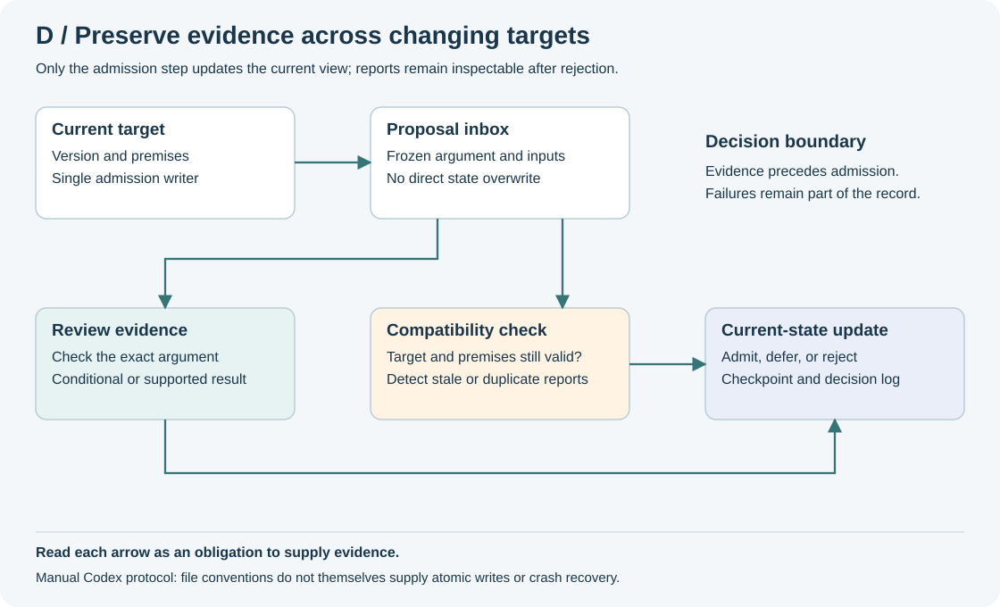

Use existing research systems as sources of questions, not templates whose complexity must be copied. This chapter builds and evaluates a small Codex workflow. It does not claim to reproduce a current Danus or Rethlas implementation, and it does not treat historical local API names as a usable specification.

**Reading route:** start with the workshop below for the advanced design; use [A reference episode with expected state changes](#a-reference-episode-with-expected-state-changes) as a concrete calibration when needed. Complete the research assignment after the control example.

## Research workshop D: design a persistent research system and test its failure behavior

**Entry requirements:** the core course and one source-dependent mathematical project. **Deliverable:** a versioned research workspace, reproducible failure experiments, and a comparison that identifies which architectural mechanism changes which observed behavior. The elementary episode later in this chapter is a diagnostic control, not the research benchmark.

### 1. Learn from reported systems without conflating their evidence

[Danus v2](https://arxiv.org/abs/2607.06447v2) reports planning and parallel proof search organized around shared fact-graph memory, with proposed claims checked before admission. [Rethlas–Archon v2](https://arxiv.org/abs/2604.03789v2) reports a division between informal reasoning and Lean formalization. These descriptions motivate two distinct design questions: how to maintain an evolving proof state, and how to relate informal discoveries to formally checked declarations.

The workshop combines these questions into a proposed architecture. It does not claim that every component below is absent from those systems, nor that a prompt-based workspace already outperforms them. Such comparisons require an inspected implementation revision and matched runs.

### 2. Separate proposals, reviews, and current state

Use a single authoritative current-state document with preserved supporting artifacts. A proposal writes to an inbox, a review refers to exact target and argument versions, and an admission step updates the current view only after checking that those versions still apply. A worker's report should not directly overwrite the current target.

```text
TARGET.md                 current target and version
inbox/                    proposals with target and premise versions
arguments/                complete argument texts; old revisions retained
reviews/                  scope, findings, and exact reviewed inputs
DECISIONS.md              admitted, conditional, rejected, or stale reports
STATE.md                  supported conclusions and open obligations
CHECKPOINT.md             recovery entry point with artifact locations
```

These directories can be created and operated in Codex without an orchestration program. Their rules remain a protocol that can fail; tests must check compliance. If concurrent writers can overwrite one another, a plain Markdown convention does not provide a transactional guarantee. Use one admission writer for the course experiment and treat stronger concurrency guarantees as a separately implemented extension.

### 3. Admission is a state transition with preconditions

Before applying a review, compare its target version, argument version, premise versions, and evidence policy with the current records. If any relevant item changed, the report may remain historically correct but must be reassessed for current use.

| Incoming result | Current condition | Permitted transition |
|---|---|---|
| Reviewed argument | Exact inputs still match; assumptions discharged | Admit its supported conclusion |
| Valid implication using an unproved lemma | The lemma remains assumed | Admit only conditional use |
| Review for old target | Target changed materially | Retain report; request applicability review |
| Duplicate report | Same decision already recorded | Do not create another independent support route |
| Withdrawn premise | Other routes may survive | Recompute affected support before downgrading the target |

This procedure is analogous to checking a precondition before committing an update. In a Codex-only laboratory it is a behavior to observe, not an automatic atomic operation.

### 4. A concrete stale-result experiment

At time one, a task investigates polynomial interpolation with degree bound one. It proves every value pair at two distinct points can be obtained. At time two, the target changes to degree zero. At time three, the old approval arrives.

The old theorem remains true but cannot establish universal solvability under the new bound. The system should retain the linear interpolation proof, reopen the application, and calculate the constants-only compatibility condition. It must not delete useful mathematics, silently change the bound, or count the stale approval as a current proof.

Now deliver the same old report twice. Its two deliveries are one piece of evidence, not independent corroboration. Then remove the applicability record while retaining the theorem. Recovery should identify exactly what is missing: the source theorem is preserved, but its use for the current target is unsupported.

[](/images/agent-system/advanced-research-state.svg)

### 5. Evaluate through controlled removal of components

Compare three configurations on the same mathematical material: ordinary conversation, versioned records without an explicit admission procedure, and versioned records with the procedure above. Keep source access and the effort allowance comparable. Run both valid controls and changes designed to produce stale evidence.

Record invalid reuse, false rejection of still-valid mathematics, recovery fidelity, useful completed obligations, human corrections, and total effort. Preserve first responses. If a repair needs the evaluator to supply the missing lemma, report that assistance rather than attributing its mathematics to the architecture.

Then remove one component at a time. Does removing version comparison allow stale approvals? Does removing alternative-route tracking discard a supported result after one premise is withdrawn? A failure with and without the component does not demonstrate a benefit. A single successful run supports only that observed episode.

### 6. Upgrade the benchmark beyond classroom controls

Select a published argument whose proof spans multiple source results. Freeze one reconstruction task and two hypothesis variants. Include one variant with a known failure and one whose status the reviewer must investigate. Keep the reference material separate from the solving conversation, while giving both compared systems equal authorized source access.

For an open target, assess intermediate results individually rather than labeling the whole run successful from its final prose. Require one source application audit, one attempted new lemma, one withdrawal experiment, and one fresh-session recovery. Include an actual Lean artifact only when the encoded bridge is relevant and executable. The final report must say which conclusions are informal, formal, conditional, or unresolved.

The advanced skill is designing a system that can change its mind for the right mathematical reason while retaining valid work. Future models may simplify the implementation, but the distinctions tested by these experiments remain necessary.

## Advanced extension: an autonomous formal admission lane

Extend the persistent workspace with a fixed specification store, a candidate area, a controlled validation environment, and an accepted theorem library. The generator may revise its candidates but cannot rewrite the specification or acceptance policy to make a failed attempt pass. Validation receipts refer to exact artifacts and environments; the admission process consumes those receipts, not the candidate's self-reported success.

Reuse Module 6's five failure tests, then add interruption and replay: a proof saved before validation remains pending after restart; an already admitted receipt does not create a second independent proof; a definition change forces a fresh check. Demonstrate the behavior before claiming the files enforce it.

The capstone can therefore have an autonomous formal lane alongside open informal research. Once the specification is established, no routine human proof review is required for that lane. This describes a design objective and an experiment, not a reproduced feature or measured superiority over Danus or Rethlas.

## The task and baseline

Choose one short mathematical argument you can check, plus two damaged versions: one missing a hypothesis and one missing a return implication. Use the lifting or blow-up experiments from the preceding projects if you need a controlled starting point.

First ask an ordinary chat to solve or review each task. Preserve its full output, source access, date, and effort budget. This is your baseline. Do not give your redesigned workflow extra source material and attribute the difference entirely to architecture.

## Build the smallest useful system

```text
Create a research workspace using Markdown only.
Use TARGET.md for exact versioned targets, ARGUMENTS.md for alternative routes,
REVIEWS.md for reviews of identified argument versions, and CHECKPOINT.md
for the state needed to resume without this conversation.
Investigate one task. Record the actual argument and remaining obligations.
Do not promote a proposal merely because it has been repeated or approved.
```

These files provide explicit interfaces: a target enters investigation, an argument enters review, and a reviewed result may support another step only within its recorded scope. You can operate all of them in one conversation before considering divided work.

## Separate proposal and review

Give a fresh review conversation the exact statement, argument, and sources. Ask it to identify failed inferences and missing premises. Preserve the report even when it disagrees with the proposal. Separate conversations are not guaranteed independent and may share the same error.

An informal review is fallible mathematical evidence. A label such as 'correct' is not a Lean certificate. If you use Lean, retain the encoded statement, environment, actual checking output, and axiom audit; also compare the encoded statement with the intended mathematics.

## Challenge the workflow

| Intervention | Behavior to inspect |
|---|---|
| Change a hypothesis after review | Old review is reconsidered against the new statement |
| Withdraw one of two independent routes | Remaining valid route still supports the target |
| Withdraw all available support | Target becomes unresolved, not automatically false |
| Deliver a delayed report | Its target version is checked before reuse |
| Restart with only a checkpoint | Target, assumptions, and open obligations survive |
| Ask for formal status without running a tool | Missing execution is reported honestly |

Run these interventions and retain the actual responses. A prompt requesting the right behavior is not evidence that the behavior occurred.

## A reference episode with expected state changes

Use the real-number rule $r(c)=(c,c)$ from Module 1. The following is a hand-derived test specification, not an observed transcript of Danus, Rethlas, or Codex.

| Event | Evidence actually available | Expected state |
|---|---|---|
| Set target V1 to producing $(1,1)$ | Rule and candidate $c=1$ | Check $r(1)=(1,1)$, then admit this solution |
| Change target to V2, producing $(1,0)$ | Old calculation still available | Old witness does not solve V2 |
| Deliver an old approving review | Review concerns V1 | Keep it with V1; do not transfer its verdict |
| Calculate every possible output | Both entries always equal | V2 impossible, with a general argument |
| Save a checkpoint and restart | Rule, targets, arguments, reviews | Recover V1 solved and V2 refuted for different reasons |

An important distinction appears in the second and fourth rows. A failed witness establishes only that this candidate does not work. The fourth row supplies a universal reason no candidate can work. A system that declares impossibility immediately after testing $c=1$ happens to reach the right answer here but has not justified it.

Test that weakness with a second rule $q(c)=(c,1-c)$. The same candidate $c=1$ now produces $(1,0)$. Changing the rule changes the problem, so the old equal-entry argument is inapplicable. A memorized negative verdict should not survive this intervention.

### Attribute an improvement to a mechanism

Compare the baseline with a version that adds only explicit target versions. If the new run catches the stale review but still mistakes candidate failure for impossibility, report exactly that. The version record addressed identity; it did not supply the missing universal argument.

Then add a review question: “Does this evidence reject one candidate, or all possible candidates?” Test both rules again, preserving first responses. If several mechanisms are added at once, you can assess the combined workflow but cannot isolate their individual effects from that experiment.

Avoid converting this five-event episode into an impressive-looking success percentage. Report the events, expected transitions, actual transitions, and mathematical reasons. More cases and repeated runs can later support a broader empirical claim.

### What to inspect in a named implementation

For a version of Danus or Rethlas you can actually inspect, trace one result through proposal, evidence, review, reuse, and revision. Ask which artifact identifies the target and argument, how conditional assumptions survive, and what happens when a previously accepted premise is withdrawn. Record code or document locations and actual run evidence separately.

If a feature cannot be found, mark it unlocated in the inspected material; do not conclude that no version has it. This project teaches an audit procedure. It does not make undocumented feature claims about either named system.

## Decide whether more coordination helps

If source checking and an alternative proof can proceed separately, try distinct Codex tasks or conversations. Fix comparable total effort and source access. Count duplicated work, elapsed time, accepted errors, missed valid arguments, and useful partial conclusions. A single-worker system is a valid outcome when coordination adds no value.

## How to make a responsible comparison with a named system

To compare directly with Danus or Rethlas, obtain an accessible, identified version and document its configuration. Run the same cases with comparable tools and resources. Separate claims supported by a paper from observations of your own run. If you cannot execute the named system, compare only architectural choices and do not claim measured superiority.

A useful final report says which failure the redesigned workflow caught, which it missed, and what the added mechanism cost. It may conclude that an ordinary chat is sufficient for a task. The objective is improved mathematical work, not a larger collection of agent roles.

[From-zero Codex setup](/posts/2026/08/agent-system/codex-research-studio/) · [Research-opportunity project](/posts/2026/08/agent-system/research-opportunity-system/) · [Course roadmap](/posts/2026/12/Agent-System/)

