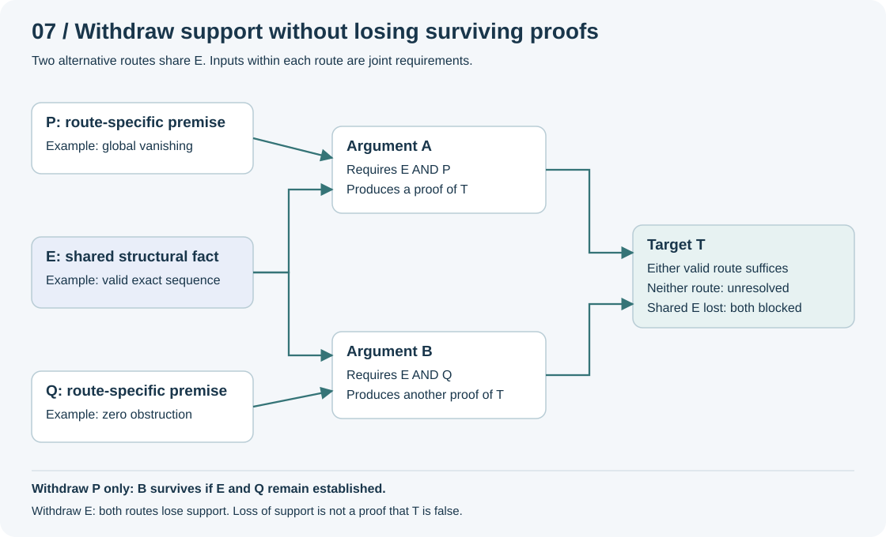

A research checkpoint should let a new session reconstruct what is known, why it is supported, and what remains conditional. Saving every message is not enough: the next reader can still confuse an abandoned route with a current theorem or lose the assumptions of a useful lemma.

**Learning goals:** maintain alternative arguments, propagate a withdrawal without overreacting, compress context without dropping mathematical scope, and test recovery in a fresh conversation. The practical deliverable is a checkpoint that survives a deliberate change of evidence.

## 1. Memory is a claim about the research state

Suppose a conversation concludes that the requested output cannot be produced. A later summary says “there are no allowed inputs.” The files persisted, but the mathematics changed. For the elementary rule $r(c)=(c,c)$, plenty of inputs exist; the failure concerns producing the prescribed output $(1,0)$. In the geometric version those inputs are global sections.

Every summary is an interpretation of evidence. It can introduce a new error. Keep the full argument available and write summaries with explicit objects and quantifiers. A compact statement such as “every output has equal entries, so $(1,0)$ is excluded” is both shorter and more faithful than a vague conclusion about nonexistence.

Useful memory has three layers. The **current view** states the target, supported results, and next action. The **support records** explain each result through arguments and sources. The **history** preserves revisions, failed attempts, and withdrawals. A new session usually begins with the current view and opens support records as needed; history is essential when a disputed assumption reappears.

## 2. Work through a withdrawal with two routes

Let $T$ be a target and suppose two valid implications have been established:

$$
\begin{aligned}
(E\land P)&\Rightarrow T,\\
(E\land Q)&\Rightarrow T.
\end{aligned}
$$

Here $E$ is a shared structural fact, while $P$ and $Q$ support alternative routes. For this protocol exercise the implications are stipulated inputs, not newly proved mathematical theorems. Read $E$ as a shared rule whose applicability has been checked; $P$ and $Q$ are different additional facts used by the two arguments. For example, two calculations can use the same model of the allowed inputs. If that model is wrong, both calculations need reconsideration. The optional geometric interpretation takes $E$ to encode the restriction sequence, $P$ global vanishing, and $Q$ zero obstruction for the chosen section.

| Event | Route A: $E,P$ | Route B: $E,Q$ | Status of $T$ |
|---|---|---|---|
| All three premises established | Available | Available | Supported by either route |
| Evidence for $P$ withdrawn | Unavailable | Available | Still supported by B |
| $Q$ now only assumed | Unavailable | Conditional | Conditional on $Q$, with $E$ established |
| Support for $Q$ also withdrawn | Unavailable | Unavailable | Unresolved |
| Restore $P$, but withdraw $E$ | Unavailable | Unavailable | Unresolved |

The last row is crucial. Two routes do not provide protection against failure of a shared premise. Counting them as independent proofs would conceal the common dependency.

Withdrawal means that the current record no longer supplies the claimed evidence. It does not necessarily prove the premise false. A source may have been misquoted, a file may be missing, or a calculation may need repair. Record the reason so the next session knows whether to recover evidence, fix an argument, or seek a different theorem.

[](/images/agent-system/course-memory-withdrawal.svg)

Read the diagram from premises through arguments to the target. Inputs to one argument are joint requirements; the two arguments are alternatives. This difference determines what a withdrawal does.

## 3. How to update the state without inventing a conclusion

When a premise changes, first identify which arguments cite that exact version. Reassess those arguments, then the conclusions that relied on them. Before marking a conclusion unsupported, inspect its other routes. Continue downstream only where support actually changed.

This is a mathematical procedure, not a demand to implement a graph database. For a small project, a table with argument IDs and premise IDs is sufficient. Codex can help maintain it, but the resulting table must be checked against the actual proofs.

There are two common errors. **Under-withdrawal** leaves a result available after its only support vanished. **Over-withdrawal** discards a result that still has a valid alternative argument. Both damage research: the first introduces false certainty; the second wastes work and can hide a robust route.

Conditional arguments require the same care. If $P$ is established only assuming $H$, then a route through $P$ inherits $H$. A summary that says “$P$ proved” without the assumption is not an acceptable compression. Conversely, if a second route proves the target without $H$, that target can be retained unconditionally even while the first route remains conditional.

## 4. Write a checkpoint another researcher can resume

Use this small structure:

```text
CHECKPOINT.md
  Target: exact statement, objects, version, intended scope
  Current conclusions: each with argument ID and remaining assumptions
  Alternatives: available routes and the first unresolved obligation in each
  Withdrawals: affected evidence, reason, consequences, surviving support
  Evidence locations: source passages, proof files, actual tool outputs
  Next action: one concrete question and the artifact that answers it
```

The checkpoint should link to complete proofs rather than squeeze them into an arbitrary word limit. Put details into supporting files when they are too large, but keep the conditional assumptions beside every conclusion in the current view. Those are needed before the reader decides which proof to open.

An effective next action is “check whether the cited positivity theorem applies to $L(-D)$ using source S2.” “Continue the proof” does not identify the unresolved mathematical task. If a previous attempt failed, include the decisive reason and the evidence, so the next session does not repeat it under a new name.

## 5. A fresh-session recovery experiment

In the first conversation, give the assistant the two-route table and ask it to create the records. Introduce the events one at a time. After each event, save the new current state while preserving the old evidence. Do not merely ask for a final summary of all five rows; test whether the updates happen correctly.

Then open a fresh conversation and provide only the checkpoint and its linked artifacts. In Codex these can be workspace files; in a chat interface you can supply the same text. No custom memory service is needed for this experiment.

```text
Reconstruct the research state from these files before proposing new work.
State the exact target, each supported conclusion, and remaining assumptions.
Explain which arguments survive the latest withdrawal and why.
Identify missing or conflicting evidence instead of filling it from memory.
Then propose one next action tied to an unresolved obligation.
```

Compare the reconstruction with the expected state. Check the target, quantifiers, versions, shared premises, surviving alternatives, and conditional assumptions. A convincing research plan does not compensate for an incorrect reconstruction.

For a harder test, omit a linked proof file. The proper response identifies the missing evidence and limits its conclusions. It may report that the checkpoint *claims* a result was reviewed, but should not pretend to have inspected the absent argument. Restore the file and see whether the status changes for the right reason.

## 6. Exercises and worked answers

<details markdown="1">
<summary>1. One route fails: must the target be withdrawn?</summary>

**Answer.** Only if no usable support remains. In the table, withdrawing $P$ disables A, while established $E$ and $Q$ keep B available. Preserve the failed route for diagnosis without downgrading the independently supported target.
</details>

<details markdown="1">
<summary>2. Two routes fail: is the target false?</summary>

**Answer.** No. The current evidence no longer establishes it. A proof of its negation or a valid counterexample would be needed for refutation. “Unresolved” and “false” must remain distinct states.
</details>

<details markdown="1">
<summary>3. Compress the two-point calculation faithfully</summary>

**Answer.** Write: “With real inputs and the rule $r(c)=(c,c)$, exactly the equal-entry pairs can be produced. Thus $(1,0)$ cannot be produced, while every pair $(a,a)$ is produced by $c=a$.” This preserves both the obstruction and the positive cases.
</details>

<details markdown="1">
<summary>4. What survives a missing source file?</summary>

**Answer.** The historical fact that a prior record cited it survives. Whether the mathematical result remains usable depends on other available evidence and the project's stated admission policy. Do not fabricate the missing passage. Distinguish inability to reproduce a source audit from a demonstrated error in the theorem.
</details>

## 7. Apply this to a live research project

Choose one lemma with at least two attempted proofs, or one proof with a disputed citation. Build the smallest dependency table that exposes the dispute. Withdraw the disputed support and identify what still follows. This often produces a better research plan than rereading the whole conversation: it reveals the precise lemma whose repair would restore the most useful conclusions.

Submit the update trace, checkpoint, fresh-session reconstruction, and comparison. The measure of success is mathematical continuity across sessions. A more powerful model may reconstruct more from less text, but it still needs to distinguish assumptions, evidence, and conclusions.

---

[Course roadmap](/posts/2026/12/Agent-System/) · [Direct experiments](/posts/2026/08/agent-system/hands-on-lab/) · [Next module](/posts/2026/08/agent-system/multiple-agent-cooperation/)
