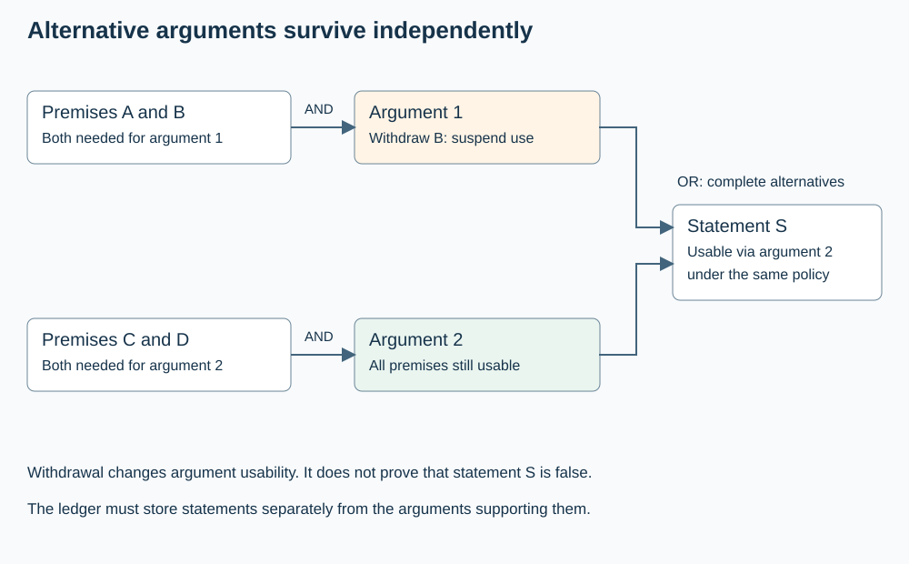

A statement can have several arguments. Case A's vanishing route may fail while its direct-obstruction route survives. A single Boolean beside the conclusion cannot represent this situation.

## Store support, not just conclusions

Persist statements, arguments, reviews, and dependency links separately. Keep withdrawn arguments for audit but exclude them from new support. Recompute usability from surviving arguments rather than declaring all downstream statements false.

*An argument loses permission to support a conclusion; the conclusion may retain another justification.*

A remembered lemma includes its hypotheses and source versions. A remembered failure identifies the exact attempted implication. The non-liftability of (1,0) on the two-point divisor must not be remembered as “no sections upstairs.” Likewise, failure to find a uniform estimate is not evidence that none exists.

## Conditional knowledge is worth retaining

If a result follows from an open assumption P, retain it as conditional on P. The assumption must propagate through downstream arguments. It cannot disappear because the conditional result has been retrieved many times.

The advanced workbench demonstrates this with assumption-labelled closure. It selects one supporting argument for explanation rather than enumerating all minimal support sets. That is an explicit limitation, not a mathematical equivalence between different assumptions.

## Build and test

Run the conditional-result and alternative-route tests. Withdraw one argument, save, and reload. Confirm that the surviving route and the withdrawal history remain visible. Then change saved statement text: its existing review digest must fail validation.

Read with the [three running cases](/posts/2026/08/agent-system/research-cases/). Source provenance and the distinction between established patterns and our proposed specialization are explained in [sources and claims](/posts/2026/08/agent-system/sources-and-claims/).

---

[Series guide](/posts/2026/08/Agent-System/) · [Running cases](/posts/2026/08/agent-system/research-cases/) · [Laboratory](/posts/2026/08/agent-system/hands-on-lab/)
