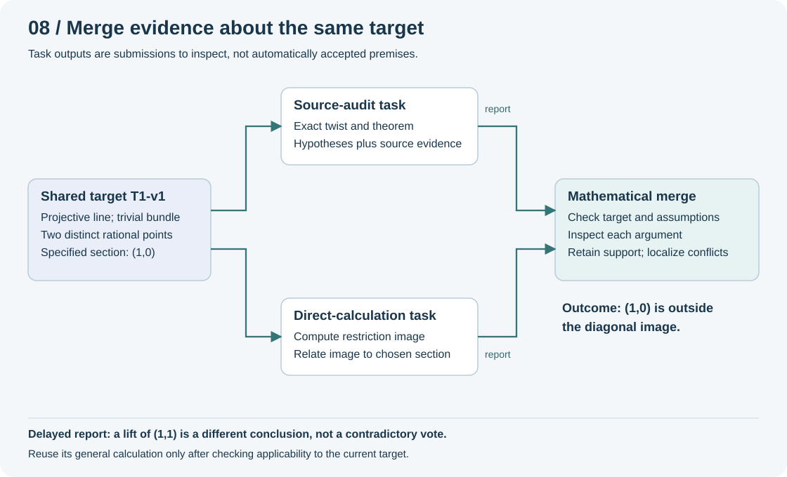

Dividing research work is useful when the parts produce evidence that can be combined correctly. More workers do not automatically mean more mathematical progress. This module begins with a sequential workflow, then asks when separate tasks or conversations improve its evidence or elapsed time.

**Learning goals:** choose a useful division of work, specify a handoff, merge reports about the same target, and compare divided work with a simpler baseline. You can complete the laboratory with ordinary conversations or a Codex workspace; a custom multi-agent implementation is not required.

## 1. Divide by mathematical obligation

For the section-lifting problem, two useful tasks are a theorem-application audit and a direct calculation of the restriction map. They answer different questions. The first determines whether a general vanishing theorem is available; the second can settle an explicit section even when the general route is unavailable.

Contrast this with asking three workers to “think harder about lifting.” Their reports may repeat the same unsupported claim, use different targets, and produce little that can be merged. Job titles such as researcher, critic, and expert do not specify mathematical outputs.

A task should identify its input, allowed scope, expected artifact, and stopping condition. For a source audit, the artifact is a hypothesis table with inspected source locations. For a calculation, it is an explicit map or witness together with a proof that it addresses the target. For a review, it is a localized inference report.

## 2. A complete merge example

Fix a field $k$, the projective line $X=\mathbb P^1_k$, the trivial line bundle, and two distinct $k$-rational points $p,q$. The target T1 asks whether the specified section $(1,0)$ on those points lifts globally.

The source-audit task reports: “The proposed vanishing route has not been justified for the required twist. No conclusion about this target follows from that route.” The calculation task proves that global sections are constants and hence restriction is

$$
k\longrightarrow k^2,\qquad c\longmapsto(c,c).
$$

The pair $(1,0)$ is outside the image, so it does not lift. The merged result is a negative answer supported by the calculation. The unresolved vanishing route does not make the target unresolved once another valid argument settles it.

Now introduce a third report: “The constant-one section lifts.” This is correct for $(1,1)$, but does not contradict the negative answer about $(1,0)$. A useful merge checks the objects before comparing verdicts. It can retain the third report as a positive control while rejecting it as support for T1.

Finally, suppose a report claims that restriction is surjective. This really conflicts with the diagonal-image calculation. The merge must inspect both arguments and locate the error; it cannot resolve the conflict by counting approvals or averaging confidence.

[](/images/agent-system/course-evidence-merge.svg)

The arrows into the merge mean “reports to inspect,” not “premises already accepted.” Only the reviewed mathematical content can support the target.

## 3. The handoff contract

Use the following table before launching any work:

| Task | Input | Required output | Stop when |
|---|---|---|---|
| Source audit | Target version, exact twist, candidate passage | Substitution and hypothesis evidence | Application justified, blocked, or source unavailable |
| Direct calculation | Same target and explicit objects | Restriction image and consequence for the chosen section | Calculation is complete or a precise gap remains |
| Review | Frozen argument and supporting material | Accepted inferences and localized defects | Every substantive step has a stated disposition |
| Merge | Reports plus current target | Reusable support, conflicts, open obligations | Each report's scope and effect are accounted for |

Give each task the same target snapshot. A source-audit worker need not receive a persuasive draft of the desired proof; it does need the exact objects and hypotheses. A reviewer needs the complete argument rather than just the author's conclusion. Limiting irrelevant context can help, but omitting necessary mathematical data creates artificial failures.

Here is a minimal source-audit assignment:

```text
Task S, target T1-v1, supplied source S2-v1.
Determine whether this theorem applies to the exact objects in TARGET.md.
Return a hypothesis table, exact conclusion, and source locations inspected.
Do not solve other branches or update the shared target.
If a hypothesis is unresolved, identify one concrete test of that hypothesis.
```

For a calculation task, replace the theorem application with the explicit map to compute. Require the same target version in its output. This is enough to demonstrate the architecture without implementing a scheduler.

## 4. Merge mathematics before merging prose

Inspect reports in this order. First compare the targets: domain, objects, specified section, and quantifiers. Next compare assumptions and source versions. Then inspect the actual argument and its remaining gaps. Finally decide its contribution: completion, conditional result, obstruction, reusable lemma, or no new support.

This order prevents a common mistake: producing a polished synthesis before discovering that its ingredients refer to different problems. A report about the wrong target may still contain useful mathematics, but transferring it requires a new applicability check.

Keep the original reports. If a merge rewrites their conclusions, the reason should be visible. In particular, a missing hypothesis in one report must not be silently supplied by another report that also merely assumes it. Combining two assumptions does not establish either one.

Use a simple conflict record when necessary:

```text
Conflict C1
  Report A: restriction has diagonal image, with explicit calculation
  Report B: restriction is surjective, using a claimed vanishing theorem
  Same objects and target? Check before treating as contradiction
  Disputed step: applicability of the vanishing theorem to the required twist
  Next action: inspect that exact hypothesis; preserve both original reports
```

## 5. Revision while work is in flight

Change T1 from $(1,0)$ to $(1,1)$ while a task is still working on the old snapshot. When its report arrives, do not overwrite its version label. The negative verdict for the old section does not answer the new question, but the diagonal-image calculation does: $(1,1)$ lies in the image.

This is a small but realistic test of asynchronous work. A delayed report is not necessarily worthless; its reusable content must be separated from its expired conclusion. The same issue occurs when a research project changes a divisor, removes a hypothesis, or switches between a variety and a birational model.

For course practice, perform the same event sequence manually in separate conversations. Parallel execution is optional. The point is to learn what a correct handoff and merge require before adding concurrency.

## 6. Compare with sequential work

First run the source audit, calculation, and merge in one sequential session. Then repeat with separate tasks under a comparable total effort budget and identical source access. Specify the budget before either run: for example, a fixed number of source inspections and review rounds. Record actual usage where available; mark unavailable token or cost data as unavailable.

Measure elapsed time separately from total effort. Parallel work can finish sooner while duplicating searches and increasing cost. Count useful completed obligations, invalid conclusions admitted, repeated work, and unresolved conflicts. A larger volume of text is not an improvement.

Separate conversations are not guaranteed independent. Workers may use the same theorem incorrectly or share a misleading input. Diversify the **evidence** when useful: compare a general theorem application with a direct example, or an informal proof with a suitable formal lemma. Adding an identical vote is a weaker intervention.

## 7. Exercises and worked answers

<details markdown="1">
<summary>1. One worker is blocked; another solves the target</summary>

**Answer.** Admit the supported conclusion after reviewing the successful argument. Preserve the blocked route as such. Completion does not require every proposed route to succeed, and the blocked route must not be described as proved merely because the target is settled.
</details>

<details markdown="1">
<summary>2. Both workers assume the same missing lemma</summary>

**Answer.** Their merged result remains conditional on that lemma. The shared premise is a single unresolved dependency, not corroboration. Assign a task to the lemma itself or find a route that avoids it.
</details>

<details markdown="1">
<summary>3. An old report has a useful general calculation</summary>

**Answer.** Retain the calculation under its original hypotheses. Apply it explicitly to the current target and create a new conclusion record. Do not transfer the old verdict solely because the same variety appears in both tasks.
</details>

<details markdown="1">
<summary>4. When is one worker the better architecture?</summary>

**Answer.** When tasks are tightly dependent, context handoff dominates the work, or divided runs add no useful evidence under comparable resources. Choosing the simpler workflow is a successful design outcome, not a failure to build a sophisticated system.
</details>

## 8. Submission

Submit task contracts, unedited reports, the merge decision, the delayed-report test, and the sequential comparison. Explain one specific benefit or cost of division. The enduring design question is where genuinely different mathematical work can proceed independently and how its evidence returns to a shared target.

---

[Course roadmap](/posts/2026/12/Agent-System/) · [Direct experiments](/posts/2026/08/agent-system/hands-on-lab/) · [Next module](/posts/2026/08/agent-system/evaluation-monitoring/)
