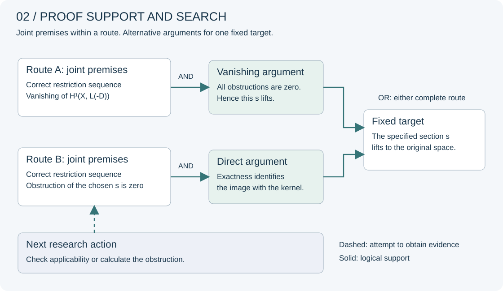

Planning means deciding which missing mathematical justification to pursue next. A task list alone does not express which results actually imply the target. This lesson develops the distinction through a complete interpolation problem, then transfers it to geometric research. Bring the statement and argument records from Module 1.

**Learning outcome:** you should be able to justify a decomposition, compare routes without confusing sufficient and necessary conditions, choose an informative next action, and preserve useful results when a route fails. Use the worked calculations for the lecture and the four-round laboratory for a separate practice session.

## A complete example before the architecture

Let $k$ be a field and let $a,b\in k$ be distinct. Given $u,v\in k$, seek a polynomial $f$ of degree at most $d$ satisfying

$$f(a)=u,\qquad f(b)=v.$$

The values, evaluation points, and degree constraint all belong to the target. A formula that matches the values but exceeds the allowed degree does not solve the problem.

### First route: construct and check a witness

For $d\ge1$, consider

$$f(t)=u\frac{t-b}{a-b}+v\frac{t-a}{b-a}.$$

The denominators are nonzero because $a\ne b$. At $t=a$, the first fraction is one and the second term is zero, so $f(a)=u$. At $t=b$, the first term is zero and the second fraction is one, so $f(b)=v$. Each summand has degree at most one. Thus the witness meets the degree constraint.

This gives three explicit obligations: the expression is defined, it has the required values, and it has the permitted degree. “Construct an interpolating polynomial” becomes a proof plan only when these checks are included.

### Second route: solve a linear system

Write $f(t)=c_0+c_1t$. The evaluation equations become

$$\begin{pmatrix}1&a\\1&b\end{pmatrix}
\begin{pmatrix}c_0\\c_1\end{pmatrix}
=\begin{pmatrix}u\\v\end{pmatrix}.$$

The determinant is $b-a\ne0$. The matrix is invertible, so every pair of values has a preimage. For larger degree bounds, this degree-at-most-one solution remains available.

This argument proves more than existence for one pair: the evaluation map is surjective. Its extra generality can be useful when later tasks require many pairs. If only one pair matters, the explicit witness may be the shorter route.

### A boundary case changes the decision

For $d=0$, every allowed polynomial is constant. A solution exists precisely when $u=v$. The pair $(1,1)$ lifts and $(1,0)$ does not. Surjectivity onto all of $k^2$ is false, but some specified pairs still have preimages.

This boundary case is the planning lesson: failure of a stronger route does not imply failure of the chosen target. Module 1's restriction map for the trivial bundle on the projective line is exactly this constant-polynomial pattern.

## Work backward, then verify forward

Backward reasoning asks what would suffice for the target. Forward checking asks whether that proposed sufficient condition is actually established. A complete decomposition needs both.

For example, to show a continuous real-valued function on $[0,1]$ attains a maximum, a planner may propose the extreme value theorem. The resulting obligations include continuity, real-valuedness, and a nonempty compact domain. The source theorem supplies the conclusion only after its hypotheses are checked.

If the domain becomes $(0,1)$, the compactness route no longer applies. That alone does not say whether a particular function attains a maximum: the constant zero function does, while $f(x)=x$ does not.

Before scheduling subtasks, ask: **if every listed subtask succeeded, would the original target follow?** If an additional theorem or transfer argument is needed, it belongs in the plan.

Lean's official [tactic tutorial](https://lean-lang.org/theorem_proving_in_lean4/Tactics/) illustrates how theorem application creates remaining goals. Our informal plans use analogous distinctions, but still need mathematical review; Markdown goal lists are not kernel-checked proofs.

## Two routes to one lifting target

For a line bundle $L$ and effective Cartier divisor $D$, the restriction sequence gives a connecting map $\delta$. Exactness says that a specified section $s$ lifts precisely when $\delta(s)=0$.

| Route | Premises needed together | Conclusion |
|---|---|---|
| Vanishing | Correct restriction sequence; $H^1(X,L(-D))=0$ | Every section on $D$ lifts |
| Direct obstruction | Correct restriction sequence; $\delta(s)=0$ | This section $s$ lifts |

Within each row the premises are joint requirements. Between rows there are alternatives for proving that $s$ lifts. Failure of the vanishing route leaves the direct route available; it does not refute liftability.

For the two-point example on the projective line, direct calculation distinguishes (1,1) from (1,0). A plan that merely says “apply vanishing” has not done that work.

[](/images/agent-system/course-proof-routes.svg)

*Solid arrows denote justified inference once all inputs are available. The dashed arrow is a request for research work: it produces a candidate result, not automatic support for the conclusion. Both routes must concern the same target version.*

## The dependency rule

A conclusion becomes supported when at least one justified argument has all its premises supported or explicitly assumed. If $P\Rightarrow Q$ and $Q\Rightarrow P$, neither $P$ nor $Q$ follows without a starting point. Repeated execution does not add a logical premise.

For an indexed argument, a finite dependency trace is not a proof of induction. Suppose $B_0$ is established and, for every $n\ge1$, the following implications are proved:

$$B_{n-1}\Rightarrow A_n,\qquad A_n\Rightarrow B_n.$$

Then the dependencies admit the order

$$B_0,\ A_1,\ B_1,\ A_2,\ B_2,\ldots.$$

The general implications and base case justify induction. Checking a finite list of instances does not replace either obligation.

## Choose an action that can change the assessment

Suppose the interpolation task omitted the degree bound. A search for more sophisticated theorems is premature: determining the permitted degree separates a universally solvable problem from one with a compatibility condition.

| Action | Evidence it could produce | Decision it affects |
|---|---|---|
| Clarify the degree bound | Exact target specification | Whether linear interpolation is allowed |
| Substitute into a proposed polynomial | Verification or failure of its values | Whether this witness works |
| Check its degree | Compatibility with the target | Whether the witness solves the actual task |
| Compute the determinant | Surjectivity of evaluation | Whether every pair can be solved |
| Test the degree-zero case | A necessary compatibility condition | Whether a general claim is overstated |

The purpose is not to assign invented probabilities to each action. State the uncertainty, the action, a reasonable budget, and how its possible outcomes would alter the plan. A short decisive calculation may be more useful than another broad search.

For a research problem, an informative action might inspect the exact positivity hypothesis of a vanishing theorem, prove a restricted version of the hardest lemma, or test a family that could break a uniform estimate. Positive evidence from a special case does not prove the general theorem, but can expose the mechanism that a general proof would need.

## Distinguish rejection, uncertainty, and exhaustion

A counterexample can refute a proposed bridge. An unverified source hypothesis leaves an applicability question open. A timeout records an operational failure. These outcomes require different next steps.

In the interpolation problem, degree zero with unequal values gives a complete negative answer. In the lifting problem, inability to verify a vanishing theorem leaves that route unresolved. An interrupted calculation supplies no mathematical verdict at all.

Keep useful results when replanning. If a candidate polynomial has the right values but excessive degree, preserve the interpolation identity as a result for a different degree bound. Do not present it as a solution of the original task. If a source check fails, retain any valid definitions and exact-sequence calculations that did not depend on the failed application.

Stop a branch when its decisive necessary condition fails. Stop a bounded experiment when its agreed budget is spent and export the remaining gap. Declare the original task complete only with an argument for its exact conclusion or a valid refutation. A well-scoped partial result is valuable without being renamed a full solution.

## Laboratory: four rounds in Codex

Save the initial response before giving corrective hints. These prompts specify experiments; they are not transcripts of successful runs.

### Round 1: compare real routes

```text
For distinct a,b in a field k, find a polynomial of degree at most d
with prescribed values u,v at a,b. Compare an explicit witness with
a linear-system argument. State each prerequisite and check every step.
Treat degree zero separately. Keep the same target across both routes.
```

**Inspect:** the two derivations above provide reference answers. The assistant must check the denominators, evaluations, and degree; a correct formula without those checks is an incomplete submission.

### Round 2: expose a false inference

```text
A proposed argument says: the space of constants and k² are both nonzero,
therefore evaluation from constants to k² is surjective.
Locate the failed inference and compute the actual image.
Test the pairs (1,1) and (1,0), without changing the allowed degree.
```

**Inspect:** the image is the diagonal. A correction that suddenly permits degree-one polynomials has changed the task. Preserve the original failure and the repair separately.

### Round 3: test grounding

```text
We have valid implications A implies B and B implies A, but neither
antecedent is established. Report what follows.
Add an independent proof of A as stipulated evidence, then withdraw it.
Explain each change without claiming the stipulated proof was checked.
```

**Inspect:** initially only the implications are available. The independent support permits both conclusions; its withdrawal leaves the cycle without a starting point. Multiple approving reports do not supply that point.

### Round 4: attempt a bounded research plan

Choose one theorem application in your field and supply its actual source. Allow three substantive actions, such as a hypothesis audit, a boundary calculation, and a lemma attempt. After each action, record what changed mathematically and what remains open. Do not count rephrasing a plan as another established result.

Submit the actual argument or calculation, not merely a summary that an action was completed. This round has no promised positive outcome: a precisely diagnosed obstruction can be its most useful result.

## Exercises and worked answers

<details markdown="1">
<summary>1. Does counting completed subtasks measure progress?</summary>

A route requires P and Q. P is proved, and the assistant reports 50% completion. What is missing from that assessment?

**Answer.** Q may contain essentially the entire research difficulty. The plan also needs a justified implication from P and Q to the target. The count can be recorded as operational information, but it does not measure mathematical distance to a proof. Report the exact remaining obstacle.

</details>

<details markdown="1">
<summary>2. What changes when the evaluation points coincide?</summary>

Set $a=b$ in the interpolation task. Analyze equal and unequal prescribed values.

**Answer.** If $u\ne v$, the same input cannot have both values, so no function meets the requirements. If $u=v$, the constant $u$ works whenever constants are allowed. The earlier formula is undefined because its denominators vanish; a true conclusion in the equal-value case does not repair that formula.

</details>

<details markdown="1">
<summary>3. Can failure of surjectivity settle a specified lifting task?</summary>

**Answer.** No. A proper image may still contain the specified element. The diagonal image contains $(1,1)$ and excludes $(1,0)$. The correct next question is membership of the chosen pair, unless some other argument already decides it.

</details>

<details markdown="1">
<summary>4. Which induction pattern has a starting point?</summary>

Compare $A_n$ from $B_{n-1}$ and $B_n$ from $A_n$, with $A_n$ from $B_n$ and $B_n$ from $A_n$. Assume $B_0$ is established.

**Answer.** The first pattern supports the order $B_0,A_1,B_1,A_2,B_2,\ldots$, provided the general implications are proved. In the second pattern, $B_0$ supplies no starting point for the mutual dependence of $A_1$ and $B_1$. Calling it induction does not establish well-foundedness.

</details>

<details markdown="1">
<summary>5. Design a probe for a uniform estimate</summary>

You have separate bounds for each object and need one bound for the whole family. What could a useful next action establish?

**Answer guide.** Inspect the dependence of the constants, seek a family forcing them to grow, or prove a uniform estimate on a precisely restricted subfamily. A counterexample can reject the proposed general bridge. Finitely many bounded examples do not prove uniformity over the entire family. State exactly which assessment the probe changes.

</details>

## Assessment and design limits

Submit the two interpolation arguments, the invalid-inference diagnosis, the cycle experiment, and a bounded research action log. The strongest submission explains why an action was chosen, what its actual evidence establishes, and why the next plan changed.

Do not turn every arithmetic operation into an administrative task. Split an obligation when it has a separately checkable statement, a reusable result, a different evidence source, or a meaningful independent attempt. Excessive decomposition increases maintenance costs and can hide a stalled hard lemma behind many completed easy tasks.

The mathematical examples have derivations in this chapter. The conversational protocol is a design proposal whose behavior must be tested. Correct mathematics in the reference answer is not evidence that an assistant reliably follows the protocol.

## Continue with the research record

Use both (1,1) and (1,0). Then remove the evidence for one route and ask which alternatives remain. Separately test the circular P/Q example. Submit the actual plan, actions, and revised status; compare with the mathematical reference rather than accepting a confident completion label.

---

[Course roadmap](/posts/2026/12/Agent-System/) · [Direct experiments](/posts/2026/08/agent-system/hands-on-lab/) · [Next module](/posts/2026/08/agent-system/knowledge-retrieval/)
