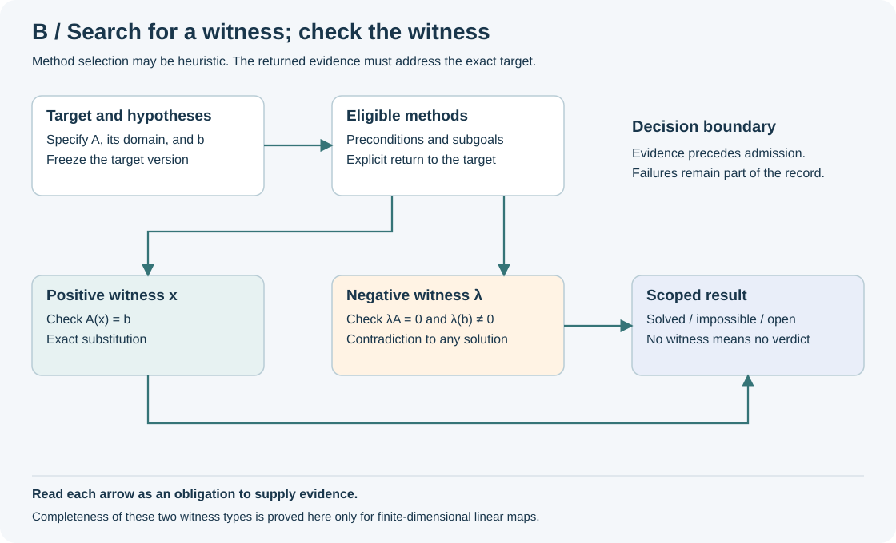

## Research task: choose a geometric method by its prerequisites

Use [the minimal-surface uniqueness workshop](/posts/2026/08/agent-system/birational-proof-workshop/) and its source packet. Compare Route A using negativity with Route B using the last exceptional curve. Explain which is usable for the exact target and which step would need replacement in higher dimension.

**Mathematical output:** One completed applicable route and a concrete account of the unused route’s cost or limitation.

**Value test:** preserve the direct-request baseline. Assess whether this intervention closes a previously unresolved obligation or reaches the same checked result with less measured work. Include retries and mathematical hints. This is a proposed exercise, not a reported improvement.

**Reading order:** start with this geometric task. The elementary examples below are optional calibration material; they are not evidence that the workflow solves research problems.


A method recommendation earns its place by producing evidence. This workshop starts with a small system of equations, develops a complete distinction between success and impossibility, and then asks a harder question: can a method be exactly correct but dangerously unstable?

**Deliverable:** two method cards, an attempted decisive calculation, a record of rejected claims, and a transfer experiment. You need elementary linear algebra and polynomials. The reference calculations below are mathematical examples, not reported autonomous research results.

## 1. Start with a problem whose answer can be checked

Suppose the requested output is $(a,b,c)$ and the available operation is

$$
A(x,y)=(x+y,x-y,2x).
$$

Can you produce the requested output? The first two equations force

$$
x=\frac{a+b}{2},\qquad y=\frac{a-b}{2}.
$$

The third equation then holds exactly when $c=a+b$. This proves both necessity and sufficiency. For $(3,1,4)$, the input $(2,1)$ works. For $(3,1,5)$, no input works.

Now compare two routes. **Elimination** constructs the only possible input, then checks it. **An obstruction calculation** applies the rule $\lambda(a,b,c)=c-a-b$ to the output. Every obtainable output has value zero under this rule, whereas $(3,1,5)$ has value one. That single exact calculation rules out every possible input.

The distinction is useful in much harder mathematics: a failed attempt to find a solution is not evidence that a solution cannot exist. A contradiction satisfied by every possible solution is.

**Try before continuing.** Classify $(0,2,2)$ and $(0,2,3)$ using both routes. Write down the input or the obstruction value, not merely “possible” or “impossible.” Then ask whether the obstruction would still characterize solvability if A had a fourth output coordinate. You would have to check the new equation; the old test need not be complete.

## 2. Positive and negative evidence

For a linear map $A:V\to W$ between finite-dimensional real vector spaces, a positive witness for $Ax=b$ is an actual x together with the equality check. A negative witness is a linear rule $\lambda:W\to\mathbb R$ such that

$$
\lambda(Ax)=0\text{ for every }x,
\qquad \lambda(b)\ne0.
$$

Why does the second witness prove impossibility? If $Ax=b$, applying the same rule to both sides would give both zero and a nonzero number.

In this setting these two kinds of evidence cover all cases. If b lies outside the image of A, choose a basis of the image, append b, and extend to a basis of W. Define a linear rule to be zero on the image basis, one on b, and zero on the remaining basis vectors. It supplies the negative witness.

There is a subtle limitation. Finding one rule that vanishes on the image supplies a necessary condition. It need not supply every condition. In our example, the explicit formula for x and y proved that our single condition was sufficient too. Keep that sufficiency proof attached to the criterion.

Do not silently extend this argument to continuous linear rules on infinite-dimensional spaces. The basis construction alone does not prove continuity. Recording the theorem's scope is part of designing a usable method library.

## 3. A second problem: fit prescribed data with a polynomial

Ask for a polynomial p of degree at most one with

$$
p(0)=a,\qquad p(1)=b,\qquad p(2)=c.
$$

Writing $p(t)=u+vt$ forces $u=a$ and $v=b-a$. Substitution at 2 gives the complete criterion

$$
c-2b+a=0.
$$

Thus $(0,1,2)$ is fitted by $p(t)=t$, but $(0,1,3)$ has no linear fit. If the degree allowance becomes two, the latter data are fitted by $p(t)=(t^2+t)/2$. The negative verdict was about a degree bound, not the data alone.

For distinct real nodes $t_1,\ldots,t_m$, define

$$
\ell_i(t)=\prod_{j\ne i}\frac{t-t_j}{t_i-t_j}.
$$

At its own node this polynomial equals one; at every other node it equals zero. Therefore

$$
p(t)=\sum_{i=1}^m b_i\ell_i(t)
$$

fits all prescribed values and has degree at most $m-1$. This is the Lagrange construction; [NIST DLMF, Section 3.3](https://dlmf.nist.gov/3.3) gives the standard interpolation formulas. Here the denominators also show exactly why distinctness is required.

For a degree allowance $d<m-1$, evaluation is injective: a polynomial of degree at most d that vanishes at m distinct nodes must be zero. Its image consequently has dimension $d+1$, inside the m-dimensional space of data. There are $m-d-1$ independent compatibility conditions. For $d\ge m-1$, the construction above proves surjectivity. Altogether, for nonnegative integer d,

$$
\operatorname{codim}(\operatorname{im}E_d)=\max(m-d-1,0),
$$

where $E_d$ sends a polynomial to its values at the nodes. This dimension count says some data fail when the image is proper. It does **not** say that the particular data in your task fail. You still need a witness or the relevant compatibility tests.

## 4. Turn the mathematics into method cards

A useful card records an executable mathematical action, its prerequisites, and its evidence.

| Field | Constructive interpolation | Compatibility calculation |
|---|---|---|
| Task | Produce a polynomial meeting the data | Decide whether data lie in the allowed image |
| Preconditions | Distinct nodes; sufficient degree allowance for this construction | Exact evaluation matrix and specified degree bound |
| Action | Form the Lagrange sum and evaluate it | Eliminate coefficients or compute all independent linear constraints |
| Positive evidence | Polynomial, degree check, values at every node | Recovered coefficients and substitution checks |
| Negative evidence | Not supplied merely by failure of this construction | A linear relation violated by the specified data |
| Scope warning | More degree than allowed invalidates the answer | One necessary relation may not be sufficient |

The selection policy is now concrete. When the degree allowance is sufficient, construct and check. When it is restrictive, compute compatibility. When the nodes collide, rebuild the task before choosing either route.



## 5. Build and break the workflow in Codex

Create a folder with `TARGET.md`, `METHODS.md`, `ATTEMPTS.md`, and `DECISION.md`. Begin with this assignment:

```text
Target v1: real polynomials of degree at most one, with values
0, 1, 3 at nodes 0, 1, 2 respectively.
Compare a coefficient-solving route and a compatibility route.
For each, state prerequisites, perform the decisive calculation,
and attach either an exact witness or an impossibility certificate.
Do not replace the degree constraint by an easier one.
Save the original attempts and a separate review.
```

Inspect the actual evidence. Next change only the degree allowance to two and label it v2. Ask which calculations survive and which verdict must be withdrawn. A robust system retains the old impossibility proof as a statement about degree one while admitting the quadratic solution for v2.

Run these additional cases yourself:

| Case | What must be distinguished |
|---|---|
| Degree zero; values (2,2,2) | A restrictive degree bound can still fit the chosen data |
| Degree zero; values (2,2,3) | A concrete inconsistency, not a dimension slogan |
| Repeated node 0 with values 1 and 2 | No function can satisfy contradictory values at one input |
| Repeated node 0 with values 1 and 1 | Repetition alone is not inconsistency; combine duplicate constraints |
| Proposed answer has correct values but excessive degree | The target includes the degree requirement |
| Old approval submitted after changing one node | Recheck evaluations and the distinctness assumptions |

For each case retain the first answer, your localized criticism, the repair, and a fresh test. Do not rewrite the first answer to make the workflow look successful. Use the [downloadable practice pack](/files/reasoning-practice-lab.zip) for a starter record and additional fault injections.

## 6. The harder bridge: exact solvability versus stability

Let the nodes be 0 and h, with $h>0$, and the data be 0 and $\varepsilon$. The unique linear interpolant is

$$
p(t)=\frac{\varepsilon}{h}t.
$$

The data perturbation has size $\vert\varepsilon\vert$, but the value at 1 is $\varepsilon/h$. As h becomes small, this extrapolated value can be arbitrarily larger than the perturbation. Exact interpolation therefore supplies no bound independent of h on this output.

But a broad claim that the interpolant is unstable everywhere would also be wrong. On the interval $[0,h]$, we have $\vert p(t)\vert\le\vert\varepsilon\vert$. The output domain changes the conclusion.

**Challenge.** For arbitrary data a,b at 0,h, derive

$$
p(t)=\left(1-\frac{t}{h}\right)a+\frac{t}{h}b.
$$

Perturb each datum by at most $\eta$. Prove that the output error is at most $\eta$ on $[0,h]$. Then compute the worst-case error at a fixed $t>h$ and show it equals $(2t/h-1)\eta$ by choosing opposite signs for the two perturbations. This is a sharp bound, not just a few numerical tests.

Now design a method card that separates existence, uniqueness, and stability. A solver that returns a correct polynomial but labels it “robust” without an output domain and an error bound has exceeded its evidence.

## 7. Extend the workshop toward research

Choose an interpolation or approximation result from an accessible source. Record its exact node assumptions, approximation domain, norm, and conclusion. Propose one change: clustered nodes, a changed domain, noisy data, or a restricted polynomial family. First recover a known special case. Then attempt the step on which the proposed improvement depends.

A serious submission may end with a counterexample or a conditional bound. It must include the actual inequality or construction attempted, the source comparison, and the remaining obstruction. Finding a classical bound is a successful learning result, not a claim of research novelty. Novelty requires a separate literature check.

**Completion criterion:** another learner can reconstruct the decision from your artifacts, distinguish every target version, and check the decisive mathematics. The system's architecture earns its complexity only when these tasks become more reliable.
