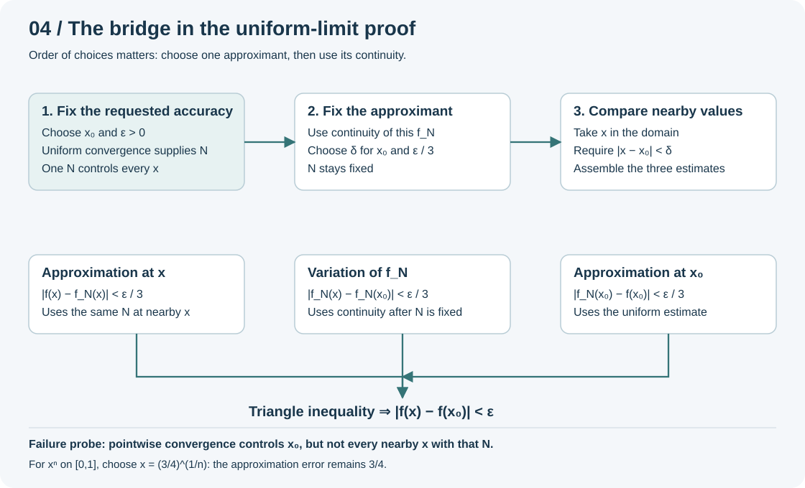

A reduction is useful only if solving the new problem helps solve the original one. In mathematical research, the difficult step is often the bridge back: a limiting argument, descent from a model, removal of an auxiliary hypothesis, or recovery of uniformity. This module teaches you to expose and test that bridge before investing in the easier subproblem.

**Learning goals:** classify a transformation as an equivalence or one-way implication; track the dependence of choices; prove a return implication; and preserve useful partial progress when the bridge fails. The main worked example uses real analysis. The coordinate-change workshop gives an additional example using two-variable polynomials.

## 1. Write the return argument before delegating the new task

Let $T$ be the target and $R$ a proposed replacement. If you prove $R\Rightarrow T$, solving $R$ is sufficient. If you only know $T\Rightarrow R$, then $R$ is a necessary condition: failure of $R$ can obstruct $T$, but success need not establish it. If both implications hold, the transformation is an equivalence.

For Module 1's rule $r(c)=(c,c)$, asking whether $(a,b)$ can be produced is equivalent to asking whether $a=b$. If an input exists, both output entries equal that input, so $a=b$. Conversely, if $a=b$, choose $c=a$. These two short arguments justify both directions of the reduction.

Requiring that **every** pair can be produced would be stronger and false. That failure does not stop the particular pair $(1,1)$ from being produced. The transformed task may demand more than the original needs.

A good system stores both the new obligation and its relation to the original. “Try a stronger general theorem” is a research action. “That theorem implies this target under these hypotheses” is a mathematical dependency. Keeping them separate lets the system change its plan without changing what has been proved.

## 2. Full example: approximating a continuous function

Suppose $f_n:[0,1]\to\mathbb R$ are continuous and converge to a function $f$. We want to prove that $f$ is continuous. This is a realistic pattern: construct easier approximants, establish properties there, and pass to a limit.

The word “converge” hides the decisive hypothesis. Pointwise convergence means that for every $x$ and every $\varepsilon>0$, a threshold may be chosen depending on $x$ and $\varepsilon$:

$$
\begin{gathered}
\forall x\;\forall\varepsilon>0\;\exists N\;\forall n\geq N:\\
|f_n(x)-f(x)|<\varepsilon.
\end{gathered}
$$

Uniform convergence puts the same threshold before the choice of $x$:

$$
\begin{gathered}
\forall\varepsilon>0\;\exists N\;\forall x\;\forall n\geq N:\\
|f_n(x)-f(x)|<\varepsilon.
\end{gathered}
$$

In both displays $x\in[0,1]$ and $n,N$ are natural numbers. The difference is a dependency: may $N$ depend on $x$? Writing that question explicitly is more useful than calling the second convergence “stronger” without explanation.

## 3. The return bridge under uniform convergence

Fix $x_0\in[0,1]$ and $\varepsilon>0$. Uniform convergence lets us choose one index $N$ such that, for every $x\in[0,1]$,

$$
|f_N(x)-f(x)|<\varepsilon/3.
$$

Continuity of this fixed function $f_N$ at $x_0$ supplies $\delta>0$ such that, for $x$ in the domain with $\vert x-x_0\vert<\delta$,

$$
|f_N(x)-f_N(x_0)|<\varepsilon/3.
$$

The triangle inequality now gives

$$
\begin{aligned}
|f(x)-f(x_0)|
&\leq |f(x)-f_N(x)|\\
&\quad+|f_N(x)-f_N(x_0)|\\
&\quad+|f_N(x_0)-f(x_0)|\\
&<\varepsilon.
\end{aligned}
$$

This proves continuity at $x_0$, including the appropriate relative-topology interpretation at an endpoint. Since $x_0$ was arbitrary, $f$ is continuous.

Notice what the proof did **not** need: one common continuity modulus for all the $f_n$. We chose $N$ first, then used continuity of that one function. Asking a worker to establish equicontinuity would introduce a stronger obligation than this proof requires. The dependency order tells us which work is necessary.

[](/images/agent-system/course-return-bridge.svg)

The diagram's arrows record choices and estimates used by the proof. The bottom warning identifies the exact place where a weaker convergence hypothesis stops supplying the needed evidence.

## 4. A failed bridge with useful surviving results

Take $f_n(x)=x^n$ for positive integers $n$. Each function is continuous on $[0,1]$. For $0\leq x<1$, the values tend to zero; at $x=1$, they are always one. The pointwise limit is therefore

$$
f(x)=\begin{cases}0,&0\leq x<1,\\1,&x=1.\end{cases}
$$

It is discontinuous at $1$. For instance, $x_j=1-1/j$ approaches $1$ through points with $f(x_j)=0$ while $f(1)=1$.

The convergence is not uniform. For every $n\geq1$, choose $x_n=(3/4)^{1/n}<1$. At that point,

$$
|f_n(x_n)-f(x_n)|=3/4.
$$

Thus no single threshold makes all errors less than $1/2$ across the domain. This is a direct witness against the required uniform estimate, not merely an appeal to the discontinuity of the limit.

What remains useful? The approximants are continuous, the pointwise limit has been identified, and convergence is uniform on every $[0,a]$ with $a<1$, since $0\leq x^n\leq a^n$. These are valid partial results. They do not solve the original continuity problem on the full interval. A revised target must retain its new domain explicitly.

## 5. A transformation record you can actually use

| Field | Entry for the limit example |
|---|---|
| Target | Continuity of $f$ on the specified domain |
| Proposed replacement | Continuous approximants and uniform convergence |
| Return argument | The three-term estimate above |
| Choice dependencies | $N$ depends on $\varepsilon$; $\delta$ on the fixed $N,x_0,\varepsilon$ |
| Evidence still needed | Actual uniform error control |
| Failure test | $x^n$ near $1$ |
| Surviving branch | Uniform convergence on $[0,a]$, for each fixed $a<1$ |

The record is short because the proof itself lives elsewhere. Its purpose is to prevent the system from reporting that the approximating problem solved the original merely because both use the same nouns.

For a coordinate transformation, record its formula, domain, inverse where defined, and the excluded inputs. The substitution (u,v) → (u,uv) has inverse (x,y) → (x,y/x) only when x is nonzero. The coordinate-change workshop derives this example completely. A useful substitution still needs an argument returning to the original problem.

## 6. Build and stress-test the workflow in Codex

Create `TARGET.md`, `TRANSFORMATIONS.md`, and `ARGUMENTS.md`. Give the assistant the continuity target with a specified convergence hypothesis. Use this instruction:

```text
Propose at most two reductions of the exact target.
For each, write the transformed obligation and the implication back.
Track which choices may depend on which variables.
Prove the return implication or identify its first missing inference.
Before extending the construction, test that inference on a simple example.
Keep partial results separate from completion of the original target.
```

Run three rounds. First provide uniform convergence and require the full proof. Next replace it by pointwise convergence without changing the desired conclusion. Finally provide $x^n$ and ask for the strongest conclusions actually established by the calculation. Save each response before correction.

Review whether the assistant identifies the same failed dependency as the reference proof. A response that merely says “uniform is needed” is incomplete: it should explain how the estimate must hold at a nearby point chosen after $N$, and supply a counterexample to the weaker claim.

For a research problem, use the same workflow on **one** bridge. Ask what evidence would settle it in a small case. If the reduction assumes an open conjecture as strong as the target, the diagram has not reduced the work; it has relocated it. Mark that dependency and reassess the route.

## 7. Exercises with worked answers

<details markdown="1">
<summary>1. Is uniform convergence necessary for a continuous limit?</summary>

**Answer.** It is sufficient, not necessary. On $[0,1]$, define $g_n(x)=\max(0,1-n^2\vert x-1/n\vert)$ for $n\geq2$. Each is continuous. At $0$ it is zero, and at every fixed $x>0$ its support eventually lies to the left of $x$, so the pointwise limit is zero. Yet $g_n(1/n)=1$, preventing uniform convergence. This does not contradict the return theorem: a sufficient condition need not hold in every successful instance.
</details>

<details markdown="1">
<summary>2. Does local uniformity solve the endpoint problem?</summary>

**Answer.** Uniform convergence of $x^n$ on every $[0,a]$ with $a<1$ proves continuity of the limit at points below $1$. It supplies no neighborhood estimate at $1$. The missing endpoint is exactly where the discontinuity occurs. “For every smaller interval” must not be compressed into “on the whole interval.”
</details>

<details markdown="1">
<summary>3. Which direction is enough to solve the target?</summary>

Suppose the target implies a numerical inequality. The assistant establishes that inequality and declares success.

**Answer.** Only a necessary condition has been checked. The system needs the converse implication for this argument to solve the target. A violated necessary condition would obstruct the target; a satisfied one can help prioritize work but does not complete it.
</details>

<details markdown="1">
<summary>4. Where should the next research budget go?</summary>

An approximation construction is complete, but all attempts to obtain uniform bounds depend on the same unknown estimate.

**Answer.** Name that estimate as the decisive bridge. Test it on an explicit family, inspect whether constants depend on the approximation index, and seek either a proof or a failure example. Producing more approximants without addressing the estimate does not remove the obstruction.
</details>

## 8. Submission and design judgment

Submit one complete return proof, one counterexample to a weakened bridge, and a record of the partial results that survive. Include the actual experiment trace. A well-designed system makes the hardest unresolved implication visible early enough to change the research plan. That remains valuable even if future models automate every routine construction around it.

---

[Course roadmap](/posts/2026/12/Agent-System/) · [Direct experiments](/posts/2026/08/agent-system/hands-on-lab/) · [Next module](/posts/2026/08/agent-system/verification-gate/)
