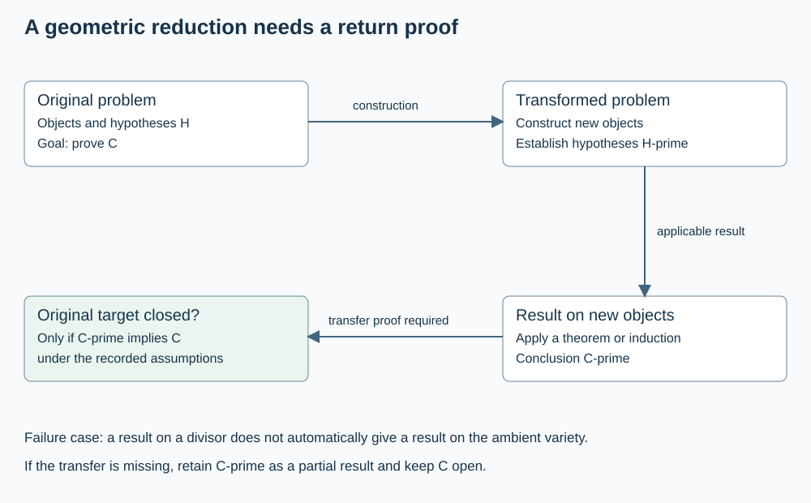

Case A changes a geometric question into an obstruction calculation. Exactness supplies the bridge: the chosen section lifts precisely when its connecting class vanishes. The new representation is useful because its relationship to the target is proved.

A transformation without such a bridge may solve only a related problem. Passing to a larger domain, special fiber, birational model, or numerical class can lose the information needed by the original conclusion.

## The transformation contract

Record the original objects, transformed objects, construction, preserved hypotheses, new assumptions, transformed result, and return implication. These are mathematical obligations, not just fields to fill with confident prose.

*If the return implication is open, keep the transformed result as partial progress and the original target unresolved.*

In Case B, passing to a limit requires a specified topology, suitable compactness or convergence evidence, and an argument that the desired property survives. A bound for each approximant does not automatically supply a uniform bound. In Case C, changing a model without lowering the induction rank is preparation, not induction.

## Search structure is a separate choice

Chains, branching search, and shared dependency graphs organize attempts. None supplies the missing implication. A heuristic may rank transformations, but its score is evidence about search preference, not mathematical validity.

Sometimes the best next step is to change the target explicitly and pursue a useful partial theorem. That is a new branch with a named scope, not a silent repair of the original claim.

## Build and test

Write the complete Case A transformation contract. Remove exactness from the evidence and identify the missing bridge. Then write the Case B limit contract and leave uniformity unresolved. Both records should remain useful without being reported as completed proofs.

Read with the [three running cases](/posts/2026/08/agent-system/research-cases/). Source provenance and the distinction between established patterns and our proposed specialization are explained in [sources and claims](/posts/2026/08/agent-system/sources-and-claims/).

---

[Series guide](/posts/2026/08/Agent-System/) · [Running cases](/posts/2026/08/agent-system/research-cases/) · [Laboratory](/posts/2026/08/agent-system/hands-on-lab/)
