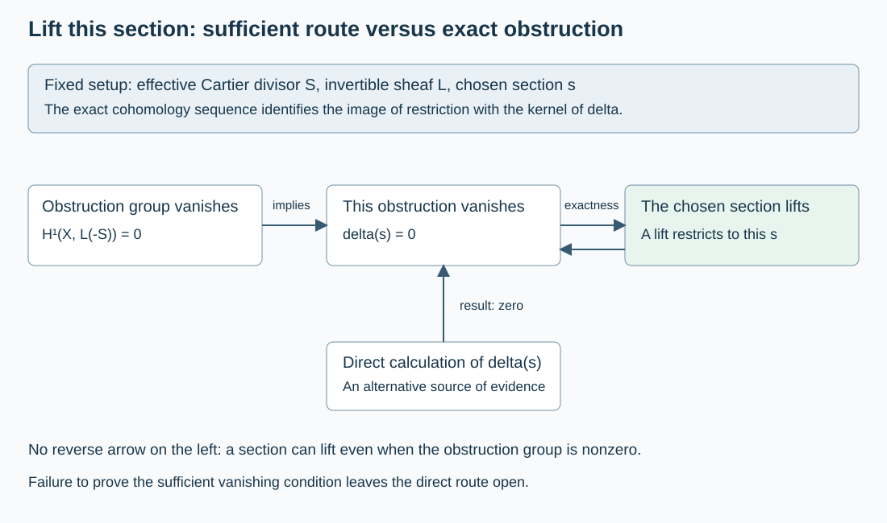

The examples in this series have different jobs. The elementary maximum example is a smoke test for a missing hypothesis. The following three cases expose deeper architectural requirements: transferring a result between objects, preserving quantifiers through approximation, and organizing induction. None is offered as a new research theorem.

## Case A. A section downstairs is not yet a section upstairs

Let $X$ be a scheme, let $S\subset X$ be an effective Cartier divisor, and let $L$ be an invertible sheaf on $X$. Fix a nonzero section $s\in H^0(S,L\vert _S)$. The research task is to lift this particular section to $X$.

The ideal sequence of $S$, tensored with $L$, gives

$$
0\longrightarrow L(-S)\longrightarrow L\longrightarrow i_*(L|_S)\longrightarrow0.
$$

Here $i:S\hookrightarrow X$ is the inclusion. The associated cohomology sequence contains

$$
H^0(X,L)\longrightarrow H^0(S,L|_S)
\xrightarrow{\delta} H^1(X,L(-S)).
$$

Exactness says that $s$ lifts precisely when $\delta(s)=0$. The stronger condition $H^1(X,L(-S))=0$ is sufficient, but is not necessary for this particular section to lift. Any lift of a nonzero section is nonzero.

This distinction matters for search. A planner may first try a vanishing theorem. If that route fails, it should retain the weaker obstruction problem $\delta(s)=0$ as an alternative. It must not mark the lifting problem impossible merely because the sufficient vanishing condition is unavailable.

*Every arrow here is a mathematical implication under the fixed setup. The left implication has no converse in general; the two right arrows express exactness.*

### A concrete failure fixture

Take $X=\mathbb P^1$, $S=\lbrace p,q\rbrace $ for two distinct points, and $L=\mathcal O_X$. Sections on $X$ are constants; sections on $S$ are pairs of scalars. Restriction sends $c$ to $(c,c)$. Thus $(1,0)$ does not lift, while $(1,1)$ does. A nonzero downstairs section alone does not justify lifting that chosen section.

This example does not refute the different conclusion $H^0(X,L)\ne0$: constants already prove that. The system must distinguish “lift this section” from “produce some nonzero section.” Otherwise a valid counterexample to a method may be misreported as a counterexample to the original target.

### Required artifacts

Store the exact objects, the restriction map, the chosen section, the obstruction, and either an argument that the obstruction vanishes or a sufficient vanishing theorem with matched hypotheses. A changed multiple of a divisor changes the sheaf and the lifting task. An agent cannot reuse an old review solely because both tasks are called “extension.”

The [Stacks Project's Cartier-divisor treatment](https://stacks.math.columbia.edu/tag/0C4S) supplies the ideal-sheaf conventions. The exact-sequence argument above is written out here so the inference, including its weaker sufficient alternatives, is inspectable.

## Case B. Approximation does not manufacture a uniform bound

Suppose a method constructs quantities $u_j$ and proves $\\vert u_j\\vert \le C_j$ for every $j$. The target requires a single finite $C$ with $\\vert u_j\\vert \le C$ for all $j$. These are different quantifier structures:

$$
\forall j\;\exists C_j\quad\text{versus}\quad\exists C\;\forall j.
$$

The first gives no uniform estimate. The sequence $u_j=j$ in $\mathbb R$ is already a counterexample to that implication. If a limiting argument requires compactness, the planner must identify the topology and an actual compactness theorem; boundedness alone is not sufficient in every space and topology.

In geometric analysis, an approximation route often has exactly this shape: construct regularized objects, prove estimates, extract a limit, and identify the limit as a solution of the original problem. The architecture must record which constants depend on the approximation parameter, what converges, and which properties pass to the limit. This paragraph describes a proof obligation, not a claim that any specific analytic conjecture follows.

### Required artifacts

An estimate record names the quantity, norm or topology, domain, allowed parameter dependence, and range of parameters. A limit record names the convergence theorem and the implication that transfers the property. Sampling many values can expose bad estimates; it cannot establish an infinite uniform bound.

A useful failure report is “the estimate depends on j, and no uniform replacement is supplied.” “The approximation approach is wrong” is too broad: the route may be repairable with a different estimate.

## Case C. Mutually supporting statements need a well-founded order

Consider a schematic theorem package with statements $A_n$ and $B_n$. Assume explicit base cases $A_0,B_0$, and suppose that for every $n>0$ there are justified implications

$$
B_{n-1}\Longrightarrow A_n,\qquad
(A_n\land B_{n-1})\Longrightarrow B_n.
$$

The package is well-founded under the lexicographic order $(n,\mathrm{stage})$, with $A$ before $B$. This is an abstract dependency example, not a claimed theorem of birational geometry. The supplied implication proofs and base cases do the mathematical work; the ordering explains why their composition is legitimate.

Now replace the first implication by $B_n\Longrightarrow A_n$. The two claims can no longer justify each other from the listed base cases. More worker rounds do not repair the cycle. One needs an additional independent argument, a stronger inductive package, or a genuinely decreasing rank.

### Required artifacts

Store the statement family, quantified parameter, base cases, step implications, and a well-founded rank. A model change that preserves dimension is not automatically an induction step. Nor does checking a finite collection of indexed nodes prove the entire induction scheme.

## How the cases connect

| Design question | Case A | Case B | Case C |
|---|---|---|---|
| Meaning to preserve | Chosen section and exact sheaf | Quantifier order and constant dependence | Indexed statements and full premises |
| Search choice | Vanishing or direct obstruction | Improve estimate or change topology | Reorder package or prove a new bridge |
| False completion | Downstairs result reported upstairs | Pointwise bounds reported uniform | Circular support reported induction |
| Useful partial result | A section plus an open obstruction | Valid parameter-dependent estimate | A verified step with missing base case |

Use these cases throughout the [chapter route](/posts/2026/08/Agent-System/) and [project laboratory](/posts/2026/08/agent-system/hands-on-lab/). The same artifact contracts should handle all three. If an implementation only catches one example by matching its vocabulary, it has learned a fixture rather than enforced a design rule.

---

[Series guide](/posts/2026/08/Agent-System/) · [Running cases](/posts/2026/08/agent-system/research-cases/) · [Laboratory](/posts/2026/08/agent-system/hands-on-lab/)
