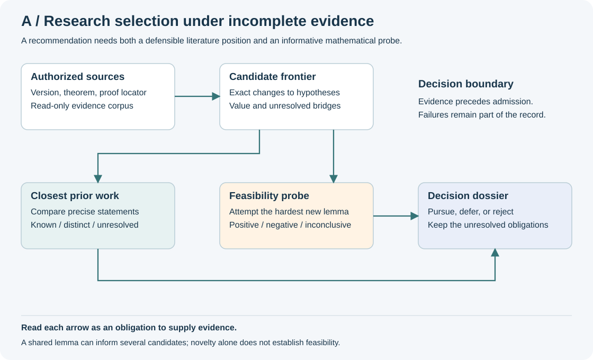

Use [the minimal-surface uniqueness workshop](/posts/2026/08/agent-system/birational-proof-workshop/) and its source packet. Start with the relative-nef variant of the surface theorem and inspect why the absolute proof transfers. Then select a real paper and a precisely changed hypothesis; compare prior results before recommending work.

**Mathematical output:** An actual attempted bridge and prior-art comparison, not a confidence score or a list of topics.

**Value test:** preserve the direct-request baseline. Assess whether this intervention closes a previously unresolved obligation or reaches the same checked result with less measured work. Include retries and mathematical hints. This is a proposed exercise, not a reported improvement.


The deliverable is a research proposal you can actually begin: an exact candidate theorem, a source audit, a plausible method, and a tested first lemma. A list of fashionable papers or a polished architecture diagram does not meet this standard.

This is a design and laboratory, not a report that a system has already discovered a new theorem. It requires access to real sources and mathematical checking. Do not assign numerical success probabilities without calibration data.

**Reading route:** start with the workshop below for the advanced design; use [A worked opportunity audit: replace compactness by what the proof needs](#a-worked-opportunity-audit-replace-compactness-by-what-the-proof-needs) as a concrete calibration when needed. Complete the research assignment after the control example.

## Research workshop A: select a project under incomplete evidence

**Entry requirements:** Modules 3–5 and 9; three accessible papers in one area; enough background to reconstruct one proof. **Research deliverable:** a decision dossier comparing precise candidate theorems, including an attempted new lemma and a reasoned decision to pursue, defer, or reject each candidate. The elementary example later in this chapter is a calibration exercise, not the final assignment.

The difficult design problem is that novelty, feasibility, and value are different uncertainties. A candidate can be new but inaccessible, easy but already known, or mathematically correct but irrelevant to the research objective. A single numerical “promising” score hides these distinctions.

### 1. Represent an opportunity as a change to a theorem

For each candidate, store the original theorem $H\Rightarrow C$ and the proposed theorem $H'\Rightarrow C'$. Supply the logical comparison, not just the label “generalization.” For weaker hypotheses with the same conclusion, establish $H\Rightarrow H'$. For a stronger conclusion under the same hypotheses, establish $C'\Rightarrow C$. If neither comparison is available, describe the statements as different or incomparable.

A stronger hypothesis and stronger conclusion can still define a worthwhile project, but it is not automatically an improvement of the original theorem. Similarly, proving a special case may be valuable feasibility evidence without settling the candidate.

| Candidate field | What the researcher must be able to inspect |
|---|---|
| Theorem difference | Original and proposed domains, quantifiers, hypotheses, and conclusions |
| Mathematical value | Which existing obstruction or downstream application the change addresses |
| Proof difference | Exact source step that stops working and proposed replacement |
| Prior-art status | Closest inspected results and implication comparisons |
| Feasibility evidence | Completed calculation or lemma attempt, including failure |
| Decision | Next action, remaining uncertainty, and reason to spend or stop work |

The retrieval system searches for this structured difference. “Find papers on extension” is a corpus-discovery query. “Find a result that removes positivity hypothesis H while retaining extension of the specified section” is a theorem-level query. They need different evidence.

### 2. Keep a frontier of candidates rather than a popularity ranking

First reject candidates contradicted by a valid example or already implied by an inspected result in the same scope. Put inaccessible-source cases aside with the reason recorded. Among survivors, compare mathematical value, prerequisites, unproved bridges, and cost of the next decisive test.

One candidate dominates another for your current project only when it is no worse on the criteria you actually care about and better on at least one. Often neither dominates: one targets a more important theorem, another has a much sharper first experiment. Preserve that trade-off for the researcher instead of hiding it in decimal probabilities.

For example, compare extending an argument to a broader category with improving its conclusion in the original category. The former may need a replacement for compactness; the latter may need a sharper estimate. If both depend on the same missing uniform bound, that lemma is a shared bottleneck. Probing it may inform both candidates at once. The reason to prioritize it is this concrete dependency, not a claim that the model knows the probability of success.

### 3. Design a discriminating probe

A good probe has specified consequences for different outcomes. Suppose an argument supplies constants $C_j$ but the extension needs one $C$ independent of $j$. Write a small family where the dependence can be calculated exactly. If $C_j$ must diverge for that family under the candidate's hypotheses, the proposed bridge fails. If a uniform estimate is proved only on a restricted family, record that scope and ask what additional step would generalize it.

Before the attempt, record these branches:

```text
Probe P3 tests candidate C2-v1, bridge B7-v1.
Question: does the required bound hold uniformly in the chosen family?
Positive outcome: a proof with a constant independent of the index.
Negative outcome: examples satisfying the hypotheses that force divergence.
Inconclusive outcome: only separate bounds or a finite sample.
Decision affected: pursue B7, change the proposed hypothesis, or defer C2.
```

This is an experimental design for reasoning. It does not require coding, and a failure is useful when it rules out an important route. Finitely many successful examples cannot discharge a uniform statement over an infinite family.

### 4. Separate discovery from recommendation

[](/images/agent-system/advanced-opportunity.svg)

The source store is read-only evidence. Candidate proposals do not write accepted mathematical facts. The decision dossier receives both the prior-art comparison and the feasibility report. Neither report substitutes for the other. A recommendation can remain provisional when the closest inaccessible paper might already contain the result.

In Codex, create `CORPUS.md`, one `candidates/C*.md` per candidate, `PROBES.md`, and `DECISION.md`. For the first run, use a small authorized corpus and require the exact theorem passages. Expand retrieval only when a named gap calls for it. Keep the same candidate ID through revisions, with distinct statement versions.

### 5. Graduate assignment and oral defense

Start from three real papers and produce three candidate changes. Reconstruct the source argument for the strongest candidate. Complete a prior-art comparison with at least one near-match whose hypotheses differ. Attempt one substantive bridge and compare it with an alternative route. The mathematical result may be a restricted theorem or a decisive obstruction, but it must include the argument.

At the defense, answer: Which implication makes this an extension? Where does the original proof use the changed hypothesis? What did the probe establish that was not justified before? What evidence would reverse your recommendation? A list of papers, an untested blueprint, or an unsupported claim that the project is “very likely doable” does not pass.

## What the system should return

For each shortlisted paper, require its exact version and theorem locator, the proposed improvement, the proof step where the original hypothesis is used, and a reason the proposed replacement could work. Preserve the original statement alongside the candidate. A weaker conclusion or a special case must be labeled accordingly.

The final recommendation must include a dependency plan, the hardest bridge, applicable known results, a concrete first experiment, and a stopping condition. It may recommend abandoning every candidate. That is preferable to inventing an achievable project.

## Architecture expressed as evidence contracts

| Stage | Input | Inspectable output | Reason to stop or return |
|---|---|---|---|
| Corpus discovery | Authorized vault, database exports, papers | Inventory with access status and exact versions | Full text unavailable |
| Mathematical extraction | Actual statement and proof | Hypothesis-use table with proof locations | Extraction cannot be checked |
| Opportunity proposal | A specific proof bottleneck | Original and proposed theorem side by side | Only a vague topic is proposed |
| Prior-art audit | Candidate and terminology variants | Search log, near-matches, verified comparisons | Already known or novelty unresolved |
| Method design | Candidate and applicable lemmas | Dependency plan with explicit return argument | Essential bridge unsupported |
| Feasibility probe | The weakest bridge | Proof attempt, counterexample, or precise obstruction | Evidence contradicts the proposal |
| Recommendation | All preceding artifacts | Ranked shortlist with reasons and limitations | No candidate survives |

Each arrow implicit in this sequence transfers an artifact, not confidence. Finding a relevant source does not establish applicability. An unsuccessful search does not establish novelty. A successful special-case calculation does not establish the general theorem.

## Build it from zero in Codex

Open a new project folder. Keep source notes read-only and write generated material here. For this researcher's setup the math vault is `D:/Source/Enotes/Math`; other readers should substitute their own authorized location. Do not upload a private vault to external services merely to search it.

```text
Create a research-opportunity workspace using Markdown, without building an app.
Create BRIEF.md, CORPUS.md, HYPOTHESIS-AUDIT.md, CANDIDATES.md,
PRIOR-ART.md, METHODS.md, PROBES.md, and DECISION.md.

First inventory only the sources I authorize. Record actual access:
full text, abstract only, metadata only, or unavailable.
Ask for the research topic and constraints if they are not supplied.
Never edit my source notes or invent citations and execution results.
Separate established facts, proposed extensions, and unresolved obligations.
```

Fill BRIEF.md with the topic, preferred generality, available time, mathematical background, and what would make a result worth pursuing. Start with three papers you understand, not an entire vault. A small auditable run is easier to improve than an opaque large search.

### Find the right source material

```text
Find notes and papers relevant to this brief in the authorized corpus.
Use exact terms and mathematical synonyms. Show the search terms used.
For each match, record the exact path or URL, version, theorem locator,
and why its statement or proof is relevant. Do not rank by title alone.
Identify missing full texts before proposing theorem-level improvements.
```

Use connected search tools when available, or local file search and supplied exports. arXiv is an additional source, not a complete account of prior work. Preserve identifiers, versions, and search dates. If no browsing or database connection is available, report that limitation and continue only with accessible material; do not simulate a search.

### Extract opportunities from proofs

```text
For these three papers, inspect selected theorem statements and proofs.
For each hypothesis, locate where it is used and what that step needs.
Suggest at most three precise improvements: a weakened hypothesis,
a broader setting, a sharper conclusion, or a simpler method.
For each, state the missing bridge and check immediate counterexamples.
Do not call a hypothesis unnecessary merely because its use is hard to find.
```

For example, a proof may invoke compactness to extract a convergent subsequence. A proposed extension must supply a replacement compactness argument, another convergence mechanism, or a different proof. Merely deleting the word “compact” is not a research method. This example illustrates the audit procedure; it is not a new research proposal.

### Check whether the improvement already exists

```text
Search for each exact candidate, including equivalent terminology and
stronger results that would imply it. Inspect relevant statements.
Record queries, dates, sources actually opened, and comparison of hypotheses.
Classify each candidate as already covered, contradicted, not found in the
searched sources, or unresolved. Never turn 'not found' into 'new'.
```

A novelty review should be repeated before committing substantial research time and before publication. References inside the closest papers often matter more than a broad keyword list.

### Require a method detailed enough to attempt

```text
For the surviving candidate, produce a proof blueprint.
List each intermediate lemma, its assumptions, and its role in the conclusion.
For every imported theorem, give an applicability check.
Identify the hardest new lemma and one alternative route.
Choose a first probe that could materially change our assessment today.
Do that probe, preserving the full argument or actual tool output.
```

Useful probes include proving a restricted version of the hardest lemma, checking boundary examples, finding a counterexample to the proposed bridge, or verifying a precise source application. A long proof sketch whose main difficulty is hidden in “standard arguments” fails this stage.

## A worked opportunity audit: replace compactness by what the proof needs

This is a calibration exercise in established analysis, not a claim of a new research result. It shows the level of detail required before recommending a genuine paper improvement.

Start with the theorem that a continuous real-valued function on a nonempty compact space attains a minimum. A naive proposal removes compactness and uses the domain $\mathbb R$. It fails: $f(x)=e^x$ has infimum zero, but never takes that value. The positive values along $x=-n$ approach zero, so the failure is attainment, not the existence of an infimum.

The proof audit identifies what compactness was doing: it kept a sequence of almost-minimizers from escaping and supplied a convergent subsequence. This suggests a more precise candidate than simply deleting a hypothesis.

**Candidate:** a continuous function $f:\mathbb R\to\mathbb R$ attains a minimum if there is a point $x_0$ such that the sublevel set

$$
K=\lbrace x\in\mathbb R:f(x)\leq f(x_0)\rbrace
$$

is compact. This hypothesis concerns only a relevant part of the domain; the whole domain need not be compact.

### Complete the first bridge

The set $K$ is nonempty because it contains $x_0$. Continuity and compactness imply that the restriction of $f$ to $K$ has a minimum, attained at some $x_{\ast}$. For any $x\in K$, we have $f(x_{\ast})\leq f(x)$. For any $x\notin K$, we have

$$
f(x)>f(x_0)\geq f(x_{\ast}).
$$

Thus $x_{\ast}$ is a global minimizer. The return argument from the restricted problem to the original domain has been proved, rather than hidden in the phrase “localize the problem.”

For a concrete test, take $f(x)=x^2$ and $x_0=1$. Then $K=[-1,1]$, and the minimum at zero is also global. For $e^x$, every sublevel set at a value $f(x_0)$ is $(-\infty,x_0]$, which is unbounded and not compact. The failed proposal does not satisfy the repaired hypothesis.

### Turn the calculation into a decision record

| Candidate | First probe | Decision supported by the probe |
|---|---|---|
| Remove compactness with no replacement | $e^x$ on $\mathbb R$ | Reject: target is false |
| Require one compact sublevel set | Restrict, minimize, compare outside | Mathematically established under the stated assumptions |
| Apply the same idea in a new function space | Identify topology, compactness, and behavior under limits | Still an open task until those bridges are checked |

The second row is not a publishable discovery: it is a standard elementary consequence. A system that labels it novel fails the research-opportunity exercise even if its proof is correct. The third row is not a project recommendation yet; the words “new function space” do not specify a theorem.

For an actual paper, replace the toy source with an inspected theorem and identify the corresponding compactness step by location. Write the new space, topology, functional, and precise replacement hypothesis. Then attempt the weakest bridge: does the proposed sublevel set really have the compactness needed, and does the limit preserve the required inequality? These are concrete mathematical tasks on which a proceed/defer decision can be based.

**Practice:** supply Codex with the original theorem and the three candidate rows, withholding the worked proof initially. Ask for the counterexample, repaired statement, complete return argument, and novelty classification. Then inspect its actual output against the derivation above. In the research run, replace the reference answer with a review of the real lemma attempt and the actual prior-art evidence.

## Feasibility means evidence, not optimism

Use qualitative decisions with explicit reasons:

- **Ready for a focused attempt:** prerequisites checked, first substantive bridge tested, remaining gaps localized.
- **Needs groundwork:** plausible direction, but missing definitions, library support, or a major lemma.
- **Defer:** novelty unresolved, inaccessible sources, or difficulty not localized.
- **Reject this route:** a counterexample or failed necessary condition blocks it.

Even the first category is not a promise of success. Ask a separate review conversation to attack the weakest step using the full evidence. Distinct conversations do not guarantee independent judgments.

## Pilot on a source-based geometric proof

Use the minimal-surface workshop to establish a baseline before searching an entire corpus. Its relative-nef variant demonstrates how to audit a changed hypothesis, but is not a novel research proposal. For an actual opportunity, select a theorem in a paper you use, state the proposed difference precisely, and attempt its first unsupported implication. Measure whether the structured workflow improves that proof attempt or reduces its cost compared with the direct request. Do not recommend a project merely because the records are complete.

## Final output to the researcher

Submit one recommended project, up to two alternatives, and rejected candidates with reasons. For the recommendation include the proposed theorem, closest prior results, proof plan, completed probe, outstanding lemmas, and the next concrete research session. If nothing survives, submit an honest negative report.

[Course roadmap](/posts/2026/12/Agent-System/) · [Build the base workspace in Codex](/posts/2026/08/agent-system/codex-research-studio/)


## Source basis and limits

The geometric starting point uses [Birkar Lemma 4.15](https://arxiv.org/pdf/1210.2670v1#page=21). The proposal-selection procedure is a course synthesis: no source cited here validates a probability that its recommendations will produce new theorems.
