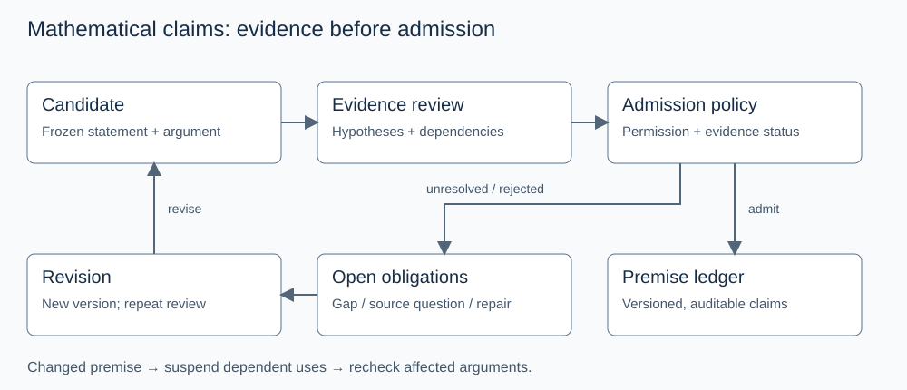

An admission gate controls what a research system may use as a premise. It does not turn a model's confidence into mathematical truth.

The arrows describe stored state transitions. A rejected or unresolved argument returns to an obligation queue; it is never silently promoted by repeated agreement.

## The record being checked

Freeze the statement, quantifiers, hypotheses, proof text, source versions, and dependency identifiers before review. A verdict applies to that version only. Give the reviewer the complete argument and cited evidence, but omit persuasive summaries of earlier approval. A fresh context can reduce anchoring; it cannot establish statistical independence between models.

## Admission policy and evidence status

Admission is a permission decision. Keep three independent fields instead of one ambiguous “verified” flag:

| Field | Example values | Question answered |
|---|---|---|
| Workflow | Candidate, in review, admitted, withdrawn | What has happened to the artifact? |
| Evidence | Source-checked, informal-reviewed, formal-checked | What kind of check supports it? |
| Scope | Unconditional, conditional on P, fixed object version | Exactly what may be concluded? |

A conditional argument can be admitted for conditional use. Its assumptions must remain visible in every dependent result. A withdrawn argument loses its permission to support further work; another argument may still justify the same statement.

A model-reviewed argument can still be wrong. Human review also remains fallible. Formal checking gives a different assurance: the kernel checks the encoded proposition relative to its axioms. Audit both the correspondence to the intended mathematics and the axioms, including placeholders. See the [Lean reference on axioms](https://lean-lang.org/doc/reference/latest/Axioms/).

## A mathematical test case

Suppose a worker proposes to apply a theorem proved for projective varieties to a compact Kähler space. A bibliography match is insufficient. Record the source's precise statement and a hypothesis table. The projectivity row is unresolved unless a separate argument supplies it or a suitable Kähler theorem is found. The candidate remains conditional; adding a second approving model does not discharge that row.

The reviewer returns one of: a localized gap, a counterexample with all hypotheses checked, an unresolved source question, or a review report explaining each inference. A failed proof does not refute its conclusion. A failed source search does not establish novelty.

## Changes and invalidation

Only the admission service may change premise permissions. Store the reviewer, review criteria, evidence, and content hashes. When a dependency is withdrawn, mark its descendants stale and suspend their use. Descendants may have alternative proofs; recheck those rather than declaring every descendant false. Deduplicate identical retries and never accept a verdict for a different statement hash.

## Evaluation

Seed the workflow with a missing hypothesis, a circular dependency, a changed source version, and a deliberately incomplete proof. Check whether the gate blocks each defect and reports the exact obligation. Measure false admissions as well as false rejections. Agreement rates and fluent reports are not substitutes for these tests.

## Reference basis

Gulli's *Agentic Design Patterns*, Chapter 4, supplies the reflection pattern. The admission policy here is a proposed mathematical specialization, not a correctness theorem about reflection. Formal checking and axiom auditing follow the Lean documentation linked above. Keep the distinction between a design proposal and a measured property of an implementation throughout the series.

## Capstone practice

Run Stage 6 with the false open-interval claim. Write a review that names the missing hypothesis and supplies the exact counterexample. Then replay a review against a changed statement version: admission must reject the mismatch.

Use the [lab](/posts/2026/08/agent-system/hands-on-lab/) for record mechanics. Supply mathematical evidence separately.

---

[Series guide](/posts/2026/08/Agent-System/) · [Running cases](/posts/2026/08/agent-system/research-cases/) · [Laboratory](/posts/2026/08/agent-system/hands-on-lab/)

For a runnable introduction, continue to [Module 6: Lean formalization](/posts/2026/08/agent-system/lean-formalization/).
