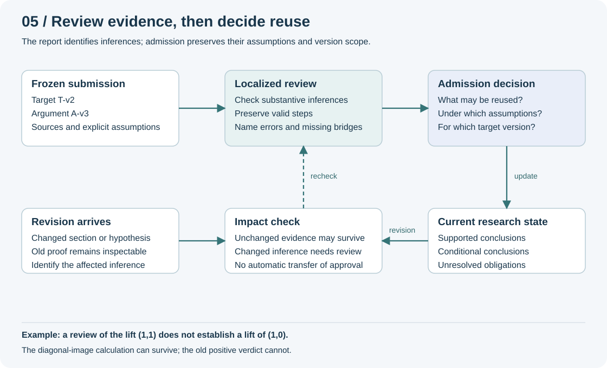

Review asks whether an argument supports its conclusion. Admission asks whether the workflow may reuse that conclusion, under which assumptions and for which version. These decisions are related, but neither an approving tone nor a field named `verified` supplies mathematical evidence.

**Learning goals:** localize a defective inference; distinguish a gap from a counterexample; preserve assumptions through a chain; and bind a review to the text it examined. The laboratory uses the limit and prescribed-output examples from earlier modules. No formal prover is required yet.

## 1. A reviewer needs a claim, an argument, and a context

Consider this submission:

> Each approximating function is continuous. The sequence converges pointwise. Passing to the limit proves continuity.

An unhelpful review says “more rigor is needed.” A useful review identifies the exact transition: pointwise convergence does not justify preservation of continuity. It then separates three questions. Are the premises established? Does the stated implication hold? Is the particular target nevertheless true for another reason?

For $f_n(x)=x^n$ on $[0,1]$, the premises are valid and the conclusion is false. The calculation from Module 4 supplies a counterexample. For a constant sequence of continuous functions, the same general inference is still unjustified as stated, but the particular limit is continuous. An invalid argument and a false conclusion are not synonyms.

To make the review reproducible, freeze the target, proof text, hypotheses, and cited source versions. “Review my latest proof” is ambiguous once several revisions coexist. An ordinary filename and a version label can suffice for the course; the important point is that the reviewed text remains available.

## 2. Review an argument one inference at a time

Here is a more detailed defective proof. Fix $x_0$ and $\varepsilon>0$. Choose $N$ so that $\vert f_N(x_0)-f(x_0)\vert<\varepsilon/3$. By continuity of $f_N$, choose $\delta$ controlling its variation near $x_0$. Apply the triangle inequality and conclude that $\vert f(x)-f(x_0)\vert<\varepsilon$ whenever $\vert x-x_0\vert<\delta$.

The beginning looks like the correct uniform-limit proof. The precise omission is an estimate for $\vert f(x)-f_N(x)\vert$ at all nearby $x$ for the **same** $N$.

| Inference | Review | Reason |
|---|---|---|
| Choose $N$ controlling the error at $x_0$ | Accepted | Pointwise convergence supplies this |
| Choose $\delta$ for continuity of this $f_N$ | Accepted | $N$ is now fixed |
| Split the difference into three terms | Accepted | Triangle inequality |
| Bound the error at every nearby $x$ | Unsupported | Pointwise convergence supplies thresholds depending on $x$ |
| Deduce continuity of $f$ | Not established | Depends on the unsupported estimate |

This report preserves the valid work. It also suggests a concrete repair: establish an estimate uniform on a neighborhood of $x_0$. Global uniform convergence would suffice, but can be stronger than necessary. The reviewer should identify this as a new obligation, not silently add it to the original hypotheses.

## 3. Admission carries assumptions forward

Suppose a draft establishes $P\Rightarrow Q$ and $Q\Rightarrow R$, while $P$ is an unproved assumption. Then $R$ is available conditionally on $P$. Writing a separate lemma for $Q$ does not discharge $P$.

For the output problem, let $P$ say that the requested pair has equal entries. The rule $r(c)=(c,c)$ then gives a solution by choosing that common value. Until the equality is established, this is a conditional result. It is useful because it identifies the remaining check; it does not justify a solution for arbitrary requested pairs.

Store three distinct fields:

| Field | What it answers | Example |
|---|---|---|
| Workflow status | What has been done? | Reviewed and admitted for conditional use |
| Evidence | Why is the implication supported? | Inspected argument using the common value as input |
| Scope | What may be concluded? | A solution assuming the two requested entries are equal |

Do not compress these fields into a confidence percentage. A confidence score cannot say which hypothesis a downstream proof must retain.

[](/images/agent-system/course-review-admission.svg)

The diagram separates the reviewer from the decision to reuse a result. In a small workspace, one person can perform both functions. The separation is logical rather than a requirement to create two agents.

## 4. What changes when a proof is revised?

Recall Module 1's rule $r(c)=(c,c)$. The requested output $(1,1)$ is produced by $c=1$, while $(1,0)$ cannot be produced. No geometric interpretation is needed for this review test.

A review of the input $c=1$ supports the first requested output. If a revision replaces that output by $(1,0)$, the old review no longer supports the target. Yet the description of the possible outputs remains reusable. A good change review therefore says both what expires and what survives.

Compare three revisions:

1. A typographical correction leaves the proposition and proof unchanged. Confirm that it is only editorial.
2. A new proof of the same statement replaces a cited theorem. Review the replacement argument and its assumptions; the old review remains evidence about the old proof.
3. A changed requested output, domain, quantifier, or allowed input changes the mathematical target. Recheck applicability even if most prose is identical.

This is why “review every changed file from scratch” can waste effort, while “reuse every old approval” is unsafe. The useful unit is the affected mathematical inference. The system must still justify its judgment that an edit is irrelevant.

## 5. Design a review request with a bounded job

Create a frozen submission and a separate report. Give the reviewer enough source material to inspect the argument, not merely a summary saying that another assistant approved it.

```text
Review TARGET-v2 and ARGUMENT-v3 without editing them.
For each substantive inference, identify its premises and justification.
Classify findings as a false inference, missing evidence, or an accepted step.
For a claimed counterexample, check every hypothesis of the target.
State the strongest conclusion supported and all remaining assumptions.
Propose repairs separately; do not incorporate them into the reviewed claim.
```

Ask for a second pass after a repair. It should compare the repaired argument with the original finding: was the missing estimate proved, assumed, or avoided by a different route? A longer proof is not evidence that the gap disappeared.

A fresh conversation can reduce exposure to earlier persuasive framing, but it does not guarantee independent mathematical errors. Two reviewers can share the same misconception or incomplete source. Stronger evidence comes from checking the fragile step by another method: an explicit example, a source application audit, or an appropriate formalization.

## 6. Four laboratory tests

Use the same report format for all four cases. Save responses before giving corrections.

| Input | Expected review behavior |
|---|---|
| Correct uniform-limit proof | Accept the actual argument under its stated hypotheses |
| Pointwise proof with the omitted nearby error term | Localize that missing estimate |
| Old $(1,1)$ review attached to new $(1,0)$ target | Reject transfer of approval; retain the image calculation |
| Valid chain from assumed $P$ to $R$ | Preserve $P$ in the conclusion's scope |

Include the valid control. A reviewer that finds imaginary flaws everywhere is not successful. Likewise, a reviewer that says “unverified” without reading any inference has not completed the job.

For formal claims, ask what was actually checked. Lean code in a response is a proposed artifact. The next module introduces execution evidence, axiom dependencies, and the separate question of whether the encoded statement matches the intended one.

## 7. Exercises and worked answers

<details markdown="1">
<summary>1. A counterexample violates one hypothesis</summary>

A reviewer rejects the compact-domain maximum theorem using $f(x)=x$ on $(0,1)$. Is this a valid refutation?

**Answer.** No. The example violates compactness, so it does not refute the theorem. It does refute the proposed version without compactness. The review must identify which statement it tests.
</details>

<details markdown="1">
<summary>2. Repair or target change?</summary>

A failed continuity proof on $[0,1]$ is replaced by a correct proof on every $[0,a]$ with $a<1$.

**Answer.** This is a useful weaker result on a smaller domain, not a completion of continuity at the endpoint. Record the new branch and retain the unresolved or false original conclusion as appropriate to the example.
</details>

<details markdown="1">
<summary>3. Two approvals disagree with a direct calculation</summary>

Two reviews approve an input for $(1,0)$, but every possible output is proved to have equal entries. What should the merge do?

**Answer.** Inspect the arguments and objects, not the vote count. Under the stated hypotheses, the equal-entry calculation excludes $(1,0)$. Locate the erroneous step in the approvals and withdraw their support. Agreement supplies no alternative mathematical implication.
</details>

<details markdown="1">
<summary>4. What exactly should a conditional review admit?</summary>

**Answer.** It may admit the implication and allow use of its conclusion in a context where the remaining assumption is explicit. It may not mark the assumption established. Downstream arguments should inherit that assumption unless they discharge it or use an independent route.
</details>

## 8. Assessment

Submit the frozen inputs, localized reports, repaired versions, and final scoped decisions. Explain one valid inference preserved and one invalid inference blocked. The goal is a review that makes the mathematics easier to inspect and repair, rather than a ritual that turns generated prose into an approval label.

---

[Course roadmap](/posts/2026/12/Agent-System/) · [Direct experiments](/posts/2026/08/agent-system/hands-on-lab/) · [Next module](/posts/2026/08/agent-system/lean-formalization/)
